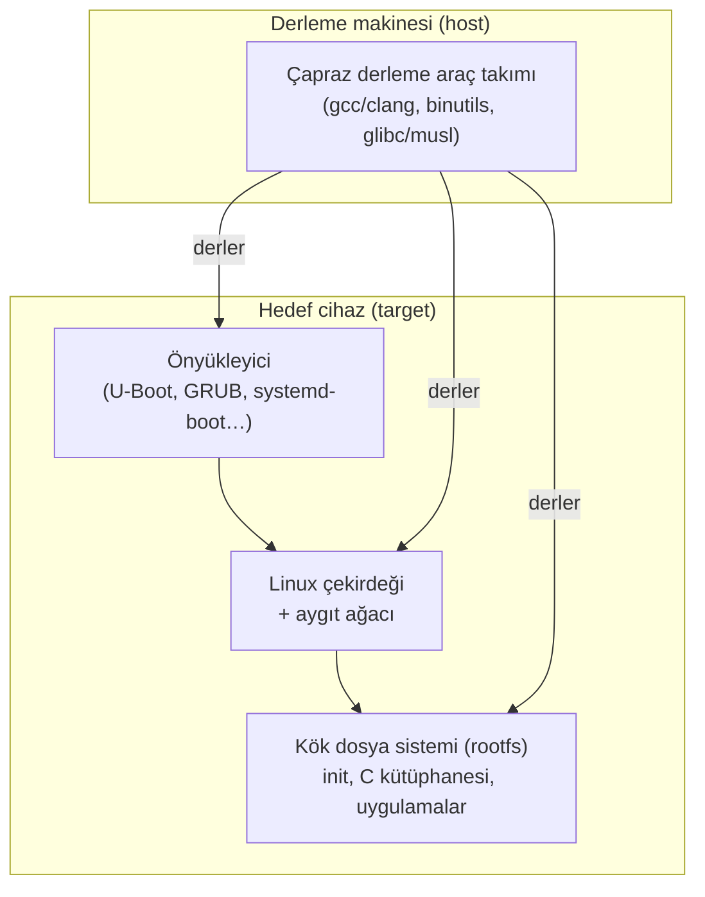

# 1 · Gömülü Linux ve Yocto Project'in yeri

Süre: ~25 dkDüzey: BaşlangıçÖn koşul: Temel Linux bilgisi

!!! hedef "Öğrenme hedefleri"
    Bu bölümün sonunda:

    - Gömülü bir Linux sistemini oluşturan dört temel bileşeni açıklayabilirsiniz.
    - Gömülü Linux üretiminde kullanılan başlıca yaklaşımları karşılaştırabilirsiniz.
    - Yocto Project'in bir dağıtım değil, dağıtım üretme çerçevesi olduğunu açıklayabilirsiniz.
    - Bir proje için Yocto'nun uygun olup olmadığını gerekçeli olarak değerlendirebilirsiniz.

## 1.1 Gömülü Linux sisteminin bileşenleri

Masaüstü veya sunucu dağıtımlarında sistemin bileşenleri dağıtım tarafından hazır sunulur. Gömülü
sistemlerde ise bu bileşenlerin her biri, hedef donanıma ve ürün gereksinimlerine göre **seçilir,
yapılandırılır ve derlenir**.

**Çapraz derleme araç takımı (toolchain)**
:   Derleme makinesinde (genellikle x86-64) çalışan, ancak hedef mimari (ARM, RISC-V vb.) için kod üreten
    derleyici, bağlayıcı ve C kütüphanesi bütünüdür.

**Önyükleyici (bootloader)**
:   Donanımı ilk çalıştırma için hazırlar, belleği başlatır ve çekirdeği yükler.

**Linux çekirdeği**
:   Donanım ile yazılım arasındaki katmandır. ARM gibi mimarilerde donanım bilgisi genellikle **aygıt
    ağacı** (*device tree*) ile çekirdeğe aktarılır.

**Kök dosya sistemi (rootfs)**
:   `init` sistemi, C kütüphanesi, temel araçlar, servisler ve ürün uygulamalarını içerir.

Bu bileşenler elle hazırlanabilir. *Linux From Scratch* projesi bu süreci öğretir. Ancak her sürüm
güncellemesinde, her güvenlik düzeltmesinde ve her yeni ürün varyantında aynı işin tekrarlanması
sürdürülebilir değildir. Bu nedenle sektörde **derleme sistemleri** kullanılır.

## 1.2 Gömülü Linux üretiminde yaklaşımlar

| Yaklaşım | Örnek | Güçlü yönleri | Sınırlılıkları |
|---|---|---|---|
| Hazır ikili dağıtım | Debian, Ubuntu, Raspberry Pi OS | Hızlı başlangıç, geniş paket deposu | Boyut ve içerik denetimi sınırlı; sürüm takvimi dağıtıma bağlı; kart desteği dar |
| Basit derleme sistemi | Buildroot | Kolay öğrenilir, küçük imaj, hızlı derleme | Paket yönetimi ve katmanlı özelleştirme sınırlı; çok sayıda ürün varyantında yönetimi zorlaşır |
| Dağıtım üretme çerçevesi | **Yocto Project / OpenEmbedded** | Katman mimarisi, tekrarlanabilirlik, lisans ve SBOM üretimi, LTS, yaygın üretici desteği | Öğrenme süresi uzun; ilk derleme uzun sürer; yüksek disk ve bellek gereksinimi |
| El ile oluşturma | Linux From Scratch | Tüm süreç öğrenilir | Ürün geliştirme için sürdürülemez |

!!! sss "Yocto Project bir Linux dağıtımı mıdır?"
    Hayır. Yocto Project, **özel Linux dağıtımları üretmek** için araçlar, metadata ve yöntemlerden oluşan
    bir çerçevedir. Projenin referans dağıtımı **Poky** yalnızca bir örnektir. Ürün geliştiren kurumlar
    kendi dağıtımlarını tanımlar. Bu kitaptaki örnek dağıtım ÖrnekOS'tur.

## 1.3 Yocto Project'in temel ilkeleri

**Tarif (recipe) tabanlı tanım**
:   Her yazılım bileşeninin nereden indirileceği, nasıl derleneceği ve nasıl paketleneceği küçük bir
    metin dosyasında tanımlanır. OpenEmbedded ekosisteminde binlerce hazır tarif bulunur.

**Katman (layer) mimarisi**
:   Özelleştirmeler, başka ekiplerin koduna dokunulmadan, üst üste binen katmanlarda tutulur. Yonga
    üreticisinin kart desteği katmanı, topluluk katmanları ve kurumun ürün katmanı birlikte kullanılır.

**Tekrarlanabilirlik**
:   Aynı metadata ve aynı kaynak sürümleriyle aynı çıktı elde edilir. Yocto Project, tekrarlanabilir
    derlemeleri (*reproducible builds*) otomatik testlerle denetler.

**Uyumluluk ve güvenlik**
:   Her paketin lisans bilgisi, kaynak kodu ve yazılım malzeme listesi (SBOM, SPDX 3.0 biçiminde)
    otomatik üretilir. Bilinen güvenlik açıkları `sbom-cve-check` ile taranır. Bu özellikler AB Siber
    Dayanıklılık Yasası (CRA) gibi düzenlemelere uyumda doğrudan katkı sağlar.

**Uzun süreli destek**
:   İki yılda bir yayımlanan LTS sürümler dört yıl desteklenir. 6.0 *Wrynose* en az Nisan 2030'a kadar
    güvenlik düzeltmesi alacaktır.

!!! iyi "Sektördeki kullanım"
    Yocto Project; otomotiv (Automotive Grade Linux), sunucu yönetim denetleyicileri (OpenBMC), endüstriyel
    kontrol, ağ ekipmanı ve tıbbi cihazlar gibi alanlarda yaygın olarak kullanılır. NXP, TI, ST,
    AMD/Xilinx ve Intel gibi yonga üreticilerinin çoğu kart desteğini (BSP) bir **Yocto katmanı** olarak
    sunar. Yeni bir işlemciyle çalışmaya başlandığında genellikle bir `meta-<üretici>` katmanıyla
    karşılaşılır.

## 1.4 Yocto Project'in uygun olmadığı durumlar

Her proje için en uygun araç Yocto değildir:

- **Kısa ömürlü prototipler:** Lisans uyumu ve uzun dönem bakım gereksinimi yoksa hazır bir dağıtım daha hızlı sonuç verir.
- **Çok küçük ve basit sistemler:** Ekip küçükse ve ürün varyantı tekse Buildroot daha düşük maliyetli olabilir.
- **Yetersiz derleme altyapısı:** 6.0 için önerilen değerler 32 GB RAM ve 140 GB disk alanıdır.

!!! dikkat "Derleme süresiyle ilgili yanılgı"
    İlk derleme, derleyici dahil tüm bileşenler kaynaktan derlendiği için uzun sürer. Sonraki derlemelerde
    **paylaşılan durum önbelleği** (*sstate cache*) devreye girer ve yalnızca değişen bileşenler yeniden
    derlenir. Yocto Project'in herkese açık sstate yansısı kullanıldığında ilk derleme de belirgin biçimde
    kısalır. Ayrıntılar için [Bölüm 15](15-sstate.md).

## Özet

- Gömülü Linux sistemi dört bileşenden oluşur: araç takımı, önyükleyici, çekirdek ve kök dosya sistemi.
- Yocto Project bir dağıtım değil, **dağıtım üretme çerçevesidir**.
- Temel ilkeleri: tarif tabanlı tanım, katman mimarisi, tekrarlanabilirlik, uyumluluk ve uzun süreli destek.
- Kısa ömürlü ve küçük projelerde alternatif yaklaşımlar daha uygun olabilir.

## Değerlendirme soruları

Aşağıdakilerden hangisi Yocto Project'i en doğru biçimde tanımlar?

<ul>
<li>Gömülü cihazlar için hazır, küçük bir Linux dağıtımı</li>
<li data-dogru>Özel Linux dağıtımları üretmek için araçlar, metadata ve yöntemler bütünü</li>
<li>ARM işlemciler için bir derleyici</li>
<li>Raspberry Pi'ye özgü bir işletim sistemi</li>
</ul>

Yocto Project, içinden çıkacak dağıtımın tarifler, katmanlar ve yapılandırma dosyalarıyla tanımlandığı
bir üretim çerçevesidir.

Uzun yıllar sahada kalacak bir ürün için Yocto Project tercihinin en güçlü gerekçesi hangisidir?

<ul>
<li>Yocto ile derlemenin her zaman Buildroot'tan daha hızlı olması</li>
<li data-dogru>Lisans uyumu, SBOM üretimi ve tekrarlanabilir derleme gereksinimlerinin karşılanması</li>
<li>Hazır bir masaüstü ortamı sunması</li>
<li>Yalnızca ARM işlemcileri desteklemesi</li>
</ul>

Yocto'nun asıl katkısı ürün yaşam döngüsü boyunca görülür: aynı imajın yıllar sonra yeniden üretilebilmesi
ve her bileşenin lisans ve güvenlik durumunun bilinmesi. Yocto; x86, ARM, RISC-V, PowerPC ve MIPS gibi pek çok
mimariyi destekler.

Aygıt ağacının (device tree) temel işlevi nedir?

<ul>
<li>Kök dosya sistemindeki dizin yapısını tanımlamak</li>
<li data-dogru>Donanımın yapısını ve özelliklerini çekirdeğe tanıtmak</li>
<li>Paket bağımlılıklarını çözmek</li>
<li>Önyükleyiciyi derlemek</li>
</ul>

Aygıt ağacı, özellikle ARM tabanlı sistemlerde, hangi donanımın hangi adreste ve hangi ayarlarla bulunduğunu
çekirdeğe bildiren veri yapısıdır.

!!! alistirma "Alıştırma: Teknoloji seçimi"
    Aşağıdaki üç senaryo için hazır dağıtım, Buildroot ve Yocto Project arasından bir seçim yapın ve
    gerekçenizi tek cümleyle yazın.

    1. Bir araştırma laboratuvarında tek bir Raspberry Pi ile kurulacak veri toplama düzeneği.
    2. Beş yıl sahada kalacak, 20.000 adet üretilecek bir akıllı sayaç.
    3. Tek bir STM32MP1 kartında, küçük bir ekiple üç ayda tamamlanacak bir üretim test düzeneği.

    ??? success "Örnek çözüm"
        1. **Hazır dağıtım.** Hızlı sonuç önceliklidir; lisans ve uzun dönem bakım gereksinimi düşüktür.
        2. **Yocto Project.** Uzun ömür, seri üretim, CVE takibi ve SBOM yükümlülüğü vardır. Üreticinin BSP
           katmanı da büyük olasılıkla Yocto tabanlıdır.
        3. **Buildroot veya Yocto Project.** Her iki seçim de savunulabilir. Ekip Yocto deneyimine sahipse ya
           da düzeneğin ileride ürüne dönüşme olasılığı varsa Yocto; kısa ömürlü ve tek seferlikse Buildroot.

**Sonraki bölüm:** [2 · Ekosistem: projeler ve kavramlar →](02-ekosistem.md)
