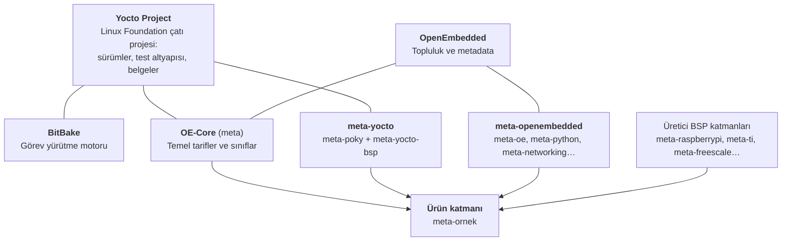

# 2 · Ekosistem: projeler ve kavramlar

<div class="kunye" markdown>
<span>Süre: ~30 dk</span><span>Düzey: Başlangıç</span><span>Ön koşul: Bölüm 1</span>
</div>

!!! hedef "Öğrenme hedefleri"
    Bu bölümün sonunda:

    - Yocto Project, OpenEmbedded, BitBake, OE-Core ve Poky arasındaki ilişkiyi açıklayabilirsiniz.
    - Tarif, katman, makine, dağıtım ve imaj kavramlarını tanımlayabilirsiniz.
    - Katmanların bir derlemede nasıl bir araya geldiğini açıklayabilirsiniz.
    - Yocto sürüm modelini ve LTS kavramını açıklayabilirsiniz.

## 2.1 Temel kavramlar

Yocto ekosistemindeki tüm araçlar, aşağıdaki kavramlar üzerine kuruludur. Bu kavramlar kitabın geri
kalanında sürekli kullanılır.

| Kavram | Dosya | Tanım |
|---|---|---|
| **Metadata** | — | Derlemenin nasıl yapılacağını tanımlayan dosyaların tümü: tarifler, sınıflar, yapılandırma dosyaları |
| **Tarif** (*recipe*) | `.bb` | Tek bir yazılım bileşeninin kaynağını, derleme adımlarını ve paketlemesini tanımlar |
| **Tarif eki** (*append*) | `.bbappend` | Var olan bir tarifi, dosyasını değiştirmeden genişletir veya değiştirir |
| **Sınıf** (*class*) | `.bbclass` | Birden fazla tarifin `inherit` ile paylaştığı ortak mantık (ör. CMake ile derleme) |
| **Yapılandırma dosyası** | `.conf` | Genel ayarlar: katman, makine, dağıtım ve derleme dizini yapılandırmaları |
| **Katman** (*layer*) | dizin | İlgili tariflerin, sınıfların ve yapılandırmaların bir arada tutulduğu birim |
| **Makine** (*machine*) | `conf/machine/*.conf` | Hedef donanım tanımı: işlemci mimarisi, çekirdek, önyükleyici, donanım özellikleri |
| **Dağıtım** (*distro*) | `conf/distro/*.conf` | Ürün politikaları: init sistemi, C kütüphanesi, paket biçimi, etkin özellikler |
| **İmaj** (*image*) | `.bb` | Hedef cihaza yazılacak son ürün: içerdiği paketler ve dosya sistemi biçimi |
| **Görev** (*task*) | — | Bir tarifin derleme adımlarından her biri (`do_fetch`, `do_compile` vb.) |

!!! iyi "Makine, dağıtım ve imajın ayrılması"
    Yocto mimarisinin temel tasarım ilkesi, **donanımın** (makine), **politikanın** (dağıtım) ve
    **içeriğin** (imaj) birbirinden bağımsız tanımlanmasıdır. Böylece aynı imaj farklı kartlar için,
    aynı kart farklı dağıtım politikalarıyla derlenebilir. Kurumsal projelerde bu ayrımın korunması bakım
    maliyetini doğrudan düşürür.

## 2.2 Projeler ve bileşenler



**Yocto Project**
:   Linux Foundation bünyesindeki çatı projedir. Sürüm takvimini belirler, otomatik test altyapısını
    (*autobuilder*) işletir, belgeleri yayımlar ve "Yocto Project Compatible" uyumluluk programını yürütür.

**OpenEmbedded (OE)**
:   Derleme sisteminin ve tariflerin geliştirildiği topluluktur. Yocto Project ile OpenEmbedded ortak
    bir çekirdek üzerinde birlikte çalışır. Bu nedenle iki ad uygulamada sıklıkla birbirinin yerine
    kullanılır.

**BitBake**
:   Python ile yazılmış görev yürütme motorudur. Metadata dosyalarını ayrıştırır, bağımlılık grafiğini
    oluşturur ve görevleri paralel olarak çalıştırır. Derlemenin *nasıl* yapılacağını kendisi bilmez; bu
    bilgiyi metadata sağlar.

**OE-Core** (`openembedded-core` deposu, `meta` katmanı)
:   Tüm Yocto tabanlı sistemlerin ortak temelidir: araç takımı, glibc, BusyBox, systemd, `linux-yocto`
    çekirdek tarifi, temel sınıflar ve QEMU makine tanımları. Katman kimliği `core`dur.

**Poky**
:   Yocto Project'in **referans dağıtımıdır**. Geçmişte BitBake, OE-Core ve meta-yocto katmanlarını tek
    bir git deposunda birleştiren `poky` deposu da bulunuyordu. **Bu depo artık güncellenmemektedir.**
    Günümüzde "Poky" ifadesi, `meta-yocto` deposundaki `meta-poky` katmanını ve bu katmanın tanımladığı
    `poky` dağıtım yapılandırmasını ifade eder.

**meta-openembedded**
:   OE-Core dışında kalan geniş tarif koleksiyonudur: `meta-oe`, `meta-python`, `meta-networking`,
    `meta-multimedia` vb.

!!! info ":material-history: Önceki sürümlerde: `git clone poky`"
    5.0 *Scarthgap* ve öncesine ait kaynakların çoğu, kurulumu `git clone git://git.yoctoproject.org/poky`
    komutuyla başlatır. 5.3 *Whinlatter* ile Poky deposunun `master` dalı güncellenmez olmuş ve resmî
    kurulum yöntemi **`bitbake-setup`** olmuştur. 6.0 *Wrynose*, bu yöntemi kullanan ilk LTS sürümdür.
    `bitbake-setup` aşağıdaki ayrı depoları çeker:

    - `bitbake`: git.openembedded.org/bitbake
    - `openembedded-core`: git.openembedded.org/openembedded-core
    - `meta-yocto`: git.yoctoproject.org/meta-yocto
    - (isteğe bağlı) `yocto-docs`: belgeler

    5.0 *Scarthgap* (Nisan 2028'e kadar destekli) Poky deposuyla kullanılmaya devam edebilir. Yeni
    projelerde ise **6.0 ve `bitbake-setup`** önerilir.

## 2.3 Katmanların birleşimi

Bir derlemede genellikle aşağıdaki katmanlar birlikte bulunur. Daha özel katmanlar, daha genel
katmanların ayarlarını **geçersiz kılabilir** veya **genişletebilir**:

```text
 ┌──────────────────────────────────────────────┐
 │ meta-ornek          ürün katmanı             │   en özel
 ├──────────────────────────────────────────────┤
 │ meta-<üretici-bsp>  kart desteği             │
 ├──────────────────────────────────────────────┤
 │ meta-oe, meta-python…  ek tarifler           │
 ├──────────────────────────────────────────────┤
 │ meta-poky           referans dağıtım         │
 ├──────────────────────────────────────────────┤
 │ meta (OE-Core)      temel                    │   en genel
 └──────────────────────────────────────────────┘
          BitBake tüm katmanları birlikte okur
```

Çakışma durumunda hangi katmanın geçerli olacağını `BBFILE_PRIORITY` değişkeni belirler. Bu konu
[Bölüm 7](07-katmanlar.md)'de ayrıntılı olarak ele alınır.

!!! iyi "Katman arama"
    Yeni bir tarif yazmadan önce [OpenEmbedded Layer Index](https://layers.openembedded.org/) üzerinde
    arama yapılması önerilir. Bu dizin, hangi tarifin hangi katmanda ve hangi sürüm dalında bulunduğunu
    gösterir. Kullanılacak katmanın, projenin Yocto sürümüyle uyumlu bir dalı olduğu doğrulanmalıdır.

## 2.4 Sürüm modeli

Yocto Project her **altı ayda bir** yeni sürüm yayımlar. **İki yılda bir** yayımlanan sürümlerden biri
**LTS** (uzun süreli destek) olarak belirlenir ve dört yıl desteklenir. Diğer sürümler yaklaşık yedi ay
desteklenir.

Her sürümün bir kod adı vardır. Kod adları İngiltere'nin Göller Bölgesi'ndeki (Lake District) tepe ve
geçitlerden alınır. Katman uyumluluğunu bildiren `LAYERSERIES_COMPAT` değişkeninde sürüm numarası değil,
**kod adı** kullanılır:

| Sürüm | Kod adı | Tür | Destek |
|---|---|---|---|
| 6.1 | Blacksail | Kararlı (Eylül 2026) | ~7 ay |
| **6.0** | **Wrynose** | **LTS** | **Nisan 2030'a kadar** |
| 5.3 | Whinlatter | Kararlı | Sona erdi |
| 5.0 | Scarthgap | LTS | Nisan 2028'e kadar |
| 4.0 | Kirkstone | LTS | Sona erdi |

Güncel tablo için: [Sürüm takvimi](../ekler/surumler.md) ve
[wiki.yoctoproject.org/wiki/Releases](https://wiki.yoctoproject.org/wiki/Releases).

!!! iyi "Ürün projelerinde sürüm seçimi"
    Ürün projelerinde **güncel LTS sürüm** tercih edilmelidir. Ara sürümler yeni özellikleri erken
    görmek için uygundur, ancak kısa destek süreleri ürün yaşam döngüsüyle örtüşmez.

## Özet

- BitBake görevleri yürütür; OE-Core temel metadata'yı sağlar; Poky referans dağıtımdır.
- Makine (donanım), dağıtım (politika) ve imaj (içerik) birbirinden bağımsız tanımlanır.
- Poky deposu artık güncellenmemektedir; 6.0 ile resmî kurulum yöntemi `bitbake-setup`tır.
- LTS sürümler iki yılda bir yayımlanır ve dört yıl desteklenir; uyumluluk kod adlarıyla belirtilir.

## Değerlendirme soruları

<div class="quiz" data-id="b02-1">
<p class="quiz-soru">Görevleri bağımlılık sırasına göre ve paralel çalıştıran, ancak derlemenin nasıl yapılacağını kendisi bilmeyen bileşen hangisidir?</p>
<ul>
<li>OE-Core</li>
<li data-dogru>BitBake</li>
<li>Poky</li>
<li>meta-openembedded</li>
</ul>
<p class="quiz-aciklama">BitBake bir görev yürütme motorudur. Neyin, nasıl derleneceği bilgisini metadata (tarifler ve sınıflar) sağlar.</p>
</div>

<div class="quiz" data-id="b02-2">
<p class="quiz-soru">Bir katmanın <code>conf/layer.conf</code> dosyasında <code>LAYERSERIES_COMPAT_ornek = "wrynose"</code> satırı bulunmaktadır. Bu satır ne ifade eder?</p>
<ul>
<li>Katmanın yalnızca Wrynose adlı bir kartta çalıştığını</li>
<li data-dogru>Katmanın Yocto 6.0 (Wrynose) sürüm serisiyle uyumlu olduğunu</li>
<li>Katmanın Wrynose adlı bir dağıtımı tanımladığını</li>
<li>Katmanın en yüksek önceliğe sahip olduğunu</li>
</ul>
<p class="quiz-aciklama">LAYERSERIES_COMPAT, katmanın hangi Yocto sürüm serileriyle test edildiğini kod adlarıyla bildirir. Uyumsuz bir
sürümde BitBake uyarı verir veya derlemeyi durdurur.</p>
</div>

<div class="quiz" data-id="b02-3">
<p class="quiz-soru">Hedef donanımdan bağımsız olarak init sistemi, C kütüphanesi ve paket biçimi gibi politikaları tanımlayan kavram hangisidir?</p>
<ul>
<li>Makine (machine)</li>
<li data-dogru>Dağıtım (distro)</li>
<li>İmaj (image)</li>
<li>Sınıf (class)</li>
</ul>
<p class="quiz-aciklama">Dağıtım yapılandırması ürün politikalarını tanımlar. Makine donanımı, imaj ise cihaza yüklenecek içeriği tanımlar.</p>
</div>

<div class="quiz" data-id="b02-4">
<p class="quiz-soru">2026 sonunda başlayan yeni bir ürün projesi için en uygun başlangıç hangisidir?</p>
<ul>
<li><code>git clone poky</code> ile master dalı</li>
<li data-dogru>Yocto 6.0 Wrynose (LTS) ve <code>bitbake-setup</code></li>
<li>Kirkstone, en çok kaynağa sahip olduğu için</li>
<li>Her ay en yeni geliştirme dalına geçmek</li>
</ul>
<p class="quiz-aciklama">Yeni ürünler için güncel LTS sürüm en güvenli seçimdir. Kirkstone'un desteği sona ermiştir, Poky deposu
güncellenmemektedir, geliştirme dalı ise ürün geliştirme için fazla değişkendir.</p>
</div>

!!! alistirma "Alıştırma: Katman araştırması"
    [layers.openembedded.org](https://layers.openembedded.org/) adresini kullanarak aşağıdaki soruları yanıtlayın:

    1. `htop` tarifi hangi katmanda bulunmaktadır?
    2. `python3-flask` tarifi hangi katmanda bulunmaktadır?
    3. Raspberry Pi kartları için BSP katmanının adı nedir? `wrynose` dalı mevcut mudur?

    ??? success "Örnek çözüm"
        1. `meta-oe` (meta-openembedded deposu).
        2. `meta-python` (meta-openembedded deposu).
        3. `meta-raspberrypi`. Dal bilgisi Layer Index'teki "Branch" seçicisinden kontrol edilir. Bir
           katmanın ilgili sürüme ait dalı yoksa, `LAYERSERIES_COMPAT` değeri incelenerek uyumlu dal
           belirlenebilir.

**Sonraki bölüm:** [3 · İlk derleme →](03-ilk-derleme.md)
