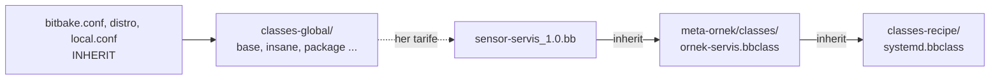

# 8 · Sınıflar, include, require

<div class="kunye" markdown>
<span>Süre: ~45 dk + uygulama</span><span>Düzey: Orta</span><span>Ön koşul: Bölüm 5–7</span>
</div>

!!! hedef "Öğrenme hedefleri"
    Bu bölümün sonunda:

    - Metadata paylaşımını sağlayan `inherit`, `INHERIT`, `include` ve `require` yönergelerini ayırt edebilirsiniz.
    - `classes-recipe/`, `classes-global/` ve `classes/` dizinlerinin rolünü ve arama sırasını açıklayabilirsiniz.
    - Yaygın OE-Core sınıflarını ve temel değişkenlerini tanıyabilirsiniz.
    - `BBCLASSEXTEND` ile tek bir tariften derleme makinesi ve SDK varyantları üretebilirsiniz.
    - `addtask` ile görev zincirine yeni bir görev ekleyebilir, `EXPORT_FUNCTIONS` mekanizmasını açıklayabilirsiniz.
    - Kendi sınıfınızı yazıp bir tarifte kullanabilirsiniz.

## 8.1 Ortak mantığın paylaşılması

Bir üründeki onlarca tarif aynı adımları tekrarlar: CMake ile yapılandırma, systemd servis dosyasının
kurulması, bir sistem kullanıcısının oluşturulması. Bu adımların her tarifte yeniden yazılması hem hata
olasılığını hem de bakım maliyetini artırır. BitBake, ortak mantığın tek bir yerde tanımlanması için dört
yönerge sunar:

| Yönerge | Kullanıldığı dosya | Hedef dosya | Dosya bulunamazsa |
|---|---|---|---|
| `inherit sınıf` | Tarif, tarif eki, sınıf | `.bbclass` | Ayrıştırma hatası |
| `INHERIT += "sınıf"` | Yapılandırma (`.conf`) | `.bbclass` | Ayrıştırma hatası |
| `require dosya` | Her tür metadata dosyası | Çoğunlukla `.inc`, `.conf`, `.bb` | Ayrıştırma hatası |
| `include dosya` | Her tür metadata dosyası | Çoğunlukla `.inc`, `.conf` | **Sessizce atlanır** |

**Sınıf** (*class*), değişken, işlev ve görev tanımlarını adı belli bir birim olarak paketler; tarif
yalnızca hangi davranışı istediğini belirtir. `include` ve `require` ise bir dosyanın içeriğini,
yönergenin bulunduğu satıra metin olarak yerleştirir. Sınıf bir **davranışın**, `.inc` dosyası ise bir
**metin parçasının** paylaşımıdır.

## 8.2 `inherit` ve sınıf dizinleri

`inherit cmake` satırı, BitBake'in `BBPATH` içindeki katmanlarda `cmake.bbclass` dosyasını aramasına yol
açar. Sınıflar, kullanım bağlamına göre üç dizinden birinde bulunur:

| Dizin | Kullanım biçimi | OE-Core'dan örnekler |
|---|---|---|
| `classes-recipe/` | Yalnızca tarif içinden `inherit` | `autotools`, `cmake`, `systemd`, `image` |
| `classes-global/` | Yalnızca yapılandırmadan `INHERIT`; her tarife uygulanır | `base`, `insane`, `package`, `sanity` |
| `classes/` | Her iki biçimde | `buildhistory`, `rm_work`, `useradd` |

Arama sırası yönergeye göre değişir. `inherit` için önce tüm katmanların `classes-recipe/` dizinleri,
ardından `classes/` dizinleri taranır; `INHERIT` için ise `classes-global/` ve `classes/`. İlk bulunan
dosya kullanılır. Yalnızca `classes-global/` altında bulunan bir sınıf tarif içinde devralınmak istenirse BitBake
`Could not inherit file classes/<ad>.bbclass` hatası verir.



Sınıfı devralan dosyada `inherit` satırından **sonra** yapılan atamalar sınıftaki değerlerin üzerine
yazılır. Bu nedenle sınıflar varsayılan değerlerini genellikle `?=` veya `??=` ile tanımlar; tarif yalnızca
değiştirmek istediği değeri atar.

Bir sınıfın bir koşula bağlı olarak devralınması gerektiğinde `inherit_defer` kullanılır. Bu yönerge
ayrıştırmanın sonunda değerlendirilir; dolayısıyla değişkenin daha sonra değişen değeri de dikkate alınır.
İfade boş dize üretirse satır etkisiz kalır:

```bitbake
# ornek-izleme, katmanda tanımlı varsayımsal bir sınıftır
inherit_defer ${@bb.utils.contains('DISTRO_FEATURES', 'ornek-izleme', 'ornek-izleme', '', d)}
```

OE-Core'un `bitbake.conf` dosyasında `BB_DEFER_BBCLASSES = "native nativesdk cross crosssdk"`
tanımlıdır; bu sınıflar için yazılan `inherit` satırları otomatik olarak ertelenir. Genel devralma ise
yapılandırma dosyalarında yapılır; örneğin `INHERIT += "rm_work"` satırı, derlenen her tarifin çalışma
dizinini derleme sonunda siler.

## 8.3 Yaygın sınıflar

| Sınıf | Sağladığı davranış | Temel değişkenler |
|---|---|---|
| `autotools` | `configure`, `make`, `make install` | `EXTRA_OECONF` |
| `cmake` | CMake ile yapılandırma, derleme ve kurulum | `EXTRA_OECMAKE` |
| `meson` | Meson ve Ninja ile derleme | `EXTRA_OEMESON`, `MESON_BUILDTYPE` |
| `pkgconfig` | `pkgconf-native` bağımlılığı ve `PKG_CONFIG_*` ortamı | — |
| `systemd` | Servis dosyalarının paketlenmesi ve etkinleştirilmesi | `SYSTEMD_SERVICE`, `SYSTEMD_AUTO_ENABLE`, `SYSTEMD_PACKAGES` |
| `update-rc.d` | SysV init betiklerinin kaydı | `INITSCRIPT_NAME`, `INITSCRIPT_PARAMS` |
| `useradd` | Paket kurulurken sistem kullanıcısı ve grubu oluşturma | `USERADD_PACKAGES`, `USERADD_PARAM`, `GROUPADD_PARAM` |
| `python_setuptools_build_meta` | `pyproject.toml` ve `setuptools.build_meta` (PEP 517) kullanan Python modülleri | — |
| `cargo` | Rust programlarının Cargo ile derlenmesi | `SRC_URI` içindeki crate listesi |
| `go` | Go programlarının derlenmesi | `GO_IMPORT`, `GO_INSTALL` |

Derleme sistemi sınıfları (`autotools`, `cmake`, `meson`) `pkgconfig` sınıfını kendiliğinden devralmaz.
`pkg-config` ile kütüphane arayan her tarif, hangi derleme sistemini kullanırsa kullansın, bu sınıfı açıkça
devralmalıdır:

```bitbake
inherit cmake pkgconfig
```

!!! info ":material-history: Önceki sürümlerde: `pkgconfig` değişkenleri"
    Yocto 5.x'te `PKG_CONFIG_PATH` gibi değişkenler `bitbake.conf` içinde genel olarak dışa
    aktarılıyordu; bu nedenle `inherit pkgconfig` satırı unutulan tarifler de çoğunlukla derleniyordu.
    6.0 ile `export` satırları `pkgconfig` sınıfına taşınmıştır. Bu satırı içermeyen tarifler
    `do_configure` aşamasında kütüphaneleri bulamayabilir. Aynı sürümde `pkgconfig` tarifi kaldırılmış,
    yerini `pkgconf` almıştır.

Servise ayrı bir sistem kullanıcısı gerektiğinde `useradd` sınıfı kullanılır; kullanıcı, paket imaja
kurulurken oluşturulur:

```bitbake
inherit useradd
USERADD_PACKAGES = "${PN}"
USERADD_PARAM:${PN} = "--system --no-create-home --shell /sbin/nologin sensor"
```

!!! dikkat "`systemd` sınıfı dağıtım özelliğine bağlıdır"
    `systemd` sınıfı yalnızca `DISTRO_FEATURES` içinde `systemd` bulunduğunda etkindir. Aksi halde
    `do_install` sonrasında `${D}${systemd_unitdir}` dizinini siler; servis pakete girmez ve derleme hata
    vermez. Hem systemd hem SysV init destekleyen tarifler `systemd` ve `update-rc.d` sınıflarını birlikte
    devralabilir; systemd etkin olduğunda `update-rc.d` sınıfı otomatik olarak devre dışı kalır. 6.0 ile
    `systemd` ve `sysvinit` dağıtım özellikleri birlikte kullanılamaz (bkz. [Bölüm 11](11-distro.md)).
    Poky dağıtımının varsayılan init sistemi SysV init'tir.

## 8.4 `native`, `nativesdk` ve `BBCLASSEXTEND`

Aynı yazılım üç farklı bağlamda gerekebilir:

| Bağlam | Tarif adı | Çalıştığı yer | Örnek kullanım |
|---|---|---|---|
| Hedef (*target*) | `sensor-oku` | Cihaz | Ürünün parçası |
| Derleme makinesi (*native*) | `sensor-oku-native` | Derleme makinesi | Başka tariflerin derlenmesi sırasında çağrılan araç |
| SDK (*nativesdk*) | `nativesdk-sensor-oku` | SDK'nın kurulduğu makine | Uygulama geliştiricilere dağıtılan araç |

Her bağlam için ayrı tarif yazmak yerine hedef tarifine tek bir satır eklenir:

```bitbake
BBCLASSEXTEND = "native nativesdk"
```

BitBake tarifi bir kez ayrıştırır ve her varyant için ayrı bir sanal tarif oluşturur. Varyantlarda
`native` veya `nativesdk` sınıfı devralınır ve değişken değerleri yeniden yazılır: örneğin native varyantta
`DEPENDS = "libmodbus"` değeri `libmodbus-native` olarak değerlendirilir. Bağlama özgü ayarlar
`:class-target`, `:class-native` ve `:class-nativesdk` koşullu değerleriyle yapılır:

```bitbake
EXTRA_OECMAKE:append:class-native = " -DORNEK_TESTLER=OFF"
```

Tarif bir kez ayrıştırıldığından `include` ve `require` satırları varyanta göre değiştirilemez.
6.0 ile gelen `bitbake-layers show-recipes --show-variants` seçeneği, `BBCLASSEXTEND` ile oluşan
varyantları da listeler.

!!! info ":material-history: Önceki sürümlerde: `CFLAGS +=` ve native varyantlar"
    5.3 öncesinde `native` ve `nativesdk` sınıfları `CFLAGS`, `CXXFLAGS`, `CPPFLAGS` ve `LDFLAGS`
    değişkenlerine sabit atama yapıyordu; tarifteki `CFLAGS += "..."` satırları fiilen yalnızca hedefe
    uygulanıyordu. 5.3'ten itibaren bu satırlar **üç bağlamın tümüne** uygulanır. Yalnızca hedefe yönelik
    bayraklar için `TARGET_CFLAGS += "..."` kullanılmalıdır.

## 8.5 `include` ve `require`

İki yönerge aynı biçimde çalışır; tek fark, dosya bulunamadığında `require` yönergesinin
`Could not include required file ...` hatasıyla ayrıştırmayı durdurmasıdır. Göreli bir yol verildiğinde
dosya önce yönergeyi içeren dosyanın dizininde, ardından `BBPATH` içindeki katmanlarda aranır ve ilk
eşleşme kullanılır. Tüm katmanlardaki eşleşmelerin eklenmesi gereken seyrek durumlar için `include_all`
yönergesi bulunur.

OE-Core'un kendi yapılandırması iki yönergenin kullanım amacını gösterir:

```bitbake title="openembedded-core/meta/conf/bitbake.conf ve distro/defaultsetup.conf (alıntı)"
include conf/local.conf                                        # isteğe bağlı: yoksa sorun değil
require conf/sanity.conf                                       # zorunlu
require conf/distro/include/init-manager-${INIT_MANAGER}.inc   # yolda değişken kullanılabilir
```

Kitap boyunca karşılaşılan tipik kullanımlar:

- **Sürüme göre ayrılan tarifler:** `ornek-panel_1.2.bb` ve `ornek-panel_2.0.bb` ortak tanımları
  `require ornek-panel.inc` satırıyla aynı dosyadan alır.
- **Dağıtım türetme:** `ornekos.conf`, `require conf/distro/poky.conf` ile Poky'yi temel alır.
- **İmaj varyantları:** `ornek-image-dev.bb`, `require ornek-image.bb` ile ürün imajını devralır
  ([Bölüm 9](09-imajlar.md)).
- **Üretilmiş listeler:** `cargo-update-recipe-crates` sınıfının ürettiği crate listesi,
  `require ${BPN}-crates.inc` ile Rust tarifine eklenir.

!!! dikkat "`include` hataları gizler"
    `include` yolu yanlış yazıldığında BitBake uyarı vermez; dosyadaki tüm ayarlar sessizce devre dışı
    kalır. Ürünün davranışını belirleyen her dosya `require` ile eklenmelidir. `include` yalnızca
    `local.conf` gibi **bilerek isteğe bağlı** bırakılan dosyalar için uygundur.

## 8.6 Görev ekleme ve `EXPORT_FUNCTIONS`

Bir işlev `addtask` ile göreve dönüştürülür ve zincirdeki yeri `after` ve `before` ile belirlenir. Ad
`do_` ile başlamıyorsa önek otomatik eklenir:

```bitbake
python do_servis_denetle() {
    ...
}
addtask servis_denetle after do_install before do_package
```

`after` veya `before` belirtilmeyen bir görev yalnızca `bitbake <tarif> -c <görev>` ile çalıştırılabilir.
Var olan bir görev `deltask` ile silinebilir; ancak silinen görevin bağlantıları yeniden kurulmaz.
Zinciri korumak için görevi silmek yerine `do_<görev>[noexec] = "1"` ile etkisiz kılmak daha güvenlidir.
OE-Core'daki `packagegroup` sınıfı, kaynak kodu olmayan paket gruplarında `deltask do_fetch` ve
`deltask do_compile` gibi satırlarla gereksiz görevleri kaldırır.

`EXPORT_FUNCTIONS` ise bir sınıfın görev işlevini **varsayılan uygulama** olarak sunmasını sağlar. Sınıf
işlevi `<sınıf>_<işlev>` adıyla tanımlar ve dışa aktarır. Örneğin `cmake.bbclass` içinde
`cmake_do_install` tanımlıdır ve `EXPORT_FUNCTIONS do_configure do_compile do_install ...` satırı
bulunur. Tarif `do_install` görevini yeniden tanımladığında sınıfın sürümünü bu adla çağırabilir:

```bitbake
inherit cmake

do_install() {
    cmake_do_install
    install -d ${D}${sysconfdir}
    install -m 0644 ${S}/ornek-panel.conf ${D}${sysconfdir}/
}
```

Yalnızca sona ekleme yapılacaksa `do_install:append()` daha sade bir seçenektir. `EXPORT_FUNCTIONS`,
sınıfın sürümü bir koşula bağlı olarak veya görevin ortasında çağrılacağında gereklidir. Mekanizmanın
sonucu `bitbake -e <tarif>` çıktısında görülür: dışa aktarılan bir görevin gövdesi `# Export function set`
açıklaması ve `base_do_install` gibi sınıf işlevi çağrısıyla başlar.

!!! dikkat "Tire içeren sınıf adları ve `EXPORT_FUNCTIONS`"
    Kabuk işlev adlarında tire kullanılamaz. Adı tire içeren bir sınıf (ör. `ornek-servis.bbclass`) bir
    kabuk işlevini `EXPORT_FUNCTIONS` ile dışa aktarmaya çalışırsa BitBake
    `The classname ornek-servis contains a dash character ...` iletisiyle durur. Bu mekanizmayı kullanacak
    sınıfların adında alt çizgi tercih edilmelidir (`ornek_servis.bbclass`).

## 8.7 Uygulama: `ornek-servis` sınıfı

Örnek üründe her uygulama bir systemd servisiyle çalışacaktır. Servis dosyasının kurulması, systemd
değişkenlerinin ayarlanması ve dosyanın denetlenmesi her tarifte tekrarlanmasın diye bir sınıfta toplanır:

```bitbake title="examples/meta-ornek/classes/ornek-servis.bbclass (yorumlar kısaltılmıştır)"
inherit systemd                                                       # (1)!

ORNEK_SERVIS_DOSYASI ?= "${BPN}.service"                              # (2)!

SYSTEMD_SERVICE:${PN} ?= "${ORNEK_SERVIS_DOSYASI}"

do_install:append() {                                                 # (3)!
    install -d ${D}${systemd_system_unitdir}
    install -m 0644 ${UNPACKDIR}/${ORNEK_SERVIS_DOSYASI} ${D}${systemd_system_unitdir}/
}

python do_servis_denetle() {                                          # (4)!
    import os

    if not bb.utils.contains('DISTRO_FEATURES', 'systemd', True, False, d):
        bb.note("DISTRO_FEATURES içinde systemd yok; servis denetimi atlandı")
        return

    dosya = d.getVar('ORNEK_SERVIS_DOSYASI')
    yol = d.getVar('D') + d.getVar('systemd_system_unitdir') + '/' + dosya
    if not os.path.isfile(yol):
        bb.fatal("Servis dosyası kurulmamış: %s" % yol)

    with open(yol, encoding='utf-8') as f:
        satirlar = [s.strip() for s in f]

    if not any(s.startswith('ExecStart=') for s in satirlar):
        bb.fatal("%s: ExecStart= satırı bulunamadı" % dosya)
    if '[Install]' not in satirlar:
        bb.fatal("%s: [Install] bölümü yok; servis açılışta etkinleştirilemez" % dosya)

    bb.note("%s denetlendi: sorun bulunmadı" % dosya)
}
do_servis_denetle[doc] = "Kurulan systemd servis dosyasını paketlemeden önce denetler"
addtask servis_denetle after do_install before do_package             # (5)!
```

1.  **Sınıf içinden sınıf devralma.** `ornek-servis` sınıfını devralan her tarif `systemd` sınıfını da almış olur.
2.  **Varsayılan değer.** `?=` sayesinde tarif farklı bir dosya adı atayabilir.
3.  **`:append` ile ekleme.** Tarif kendi `do_install` görevini tanımlasa bile bu satırlar görevin sonuna eklenir.
4.  **Python görevi.** Hata durumunda `bb.fatal` derlemeyi durdurur; sorunlu servis dosyası pakete ve imaja ulaşmaz.
5.  **Zincire yerleştirme.** Görev `do_install` ile `do_package` arasında çalışır; `[doc]` bayrağı `listtasks` çıktısındaki açıklamadır.

Sınıf, örnek katmanda `classes/` dizinindedir. Yalnızca tariflerde kullanılacak bir sınıf için
`classes-recipe/` dizini amacı daha açık ifade eder; her iki konum da `inherit` ile bulunur.

Sınıfı kullanan tarif yalnızca kendine özgü bilgileri içerir:

```bitbake title="examples/meta-ornek/recipes-ornek/sensor-servis/sensor-servis_1.0.bb (kısaltılmış)"
SUMMARY = "Örnek ağ geçidi için sensör okuma servisi"
LICENSE = "MIT"
LIC_FILES_CHKSUM = "file://${COMMON_LICENSE_DIR}/MIT;md5=0835ade698e0bcf8506ecda2f7b4f302"

SRC_URI = "file://sensor-servis.service"
S = "${UNPACKDIR}"

inherit ornek-servis

RDEPENDS:${PN} = "sensor-oku"
```

```text title="examples/meta-ornek/recipes-ornek/sensor-servis/files/sensor-servis.service"
[Unit]
Description=Örnek ağ geçidi sensör okuma servisi

[Service]
Type=oneshot
ExecStart=/usr/bin/sensor-oku 3
RemainAfterExit=yes

[Install]
WantedBy=multi-user.target
```

!!! lab "Uygulama 8.1 · Sınıfın derlenmesi ve servisin doğrulanması"
    Servisin pakete girmesi için systemd kullanan bir dağıtım gerekir. Bu nedenle ÖrnekOS dağıtımı
    etkinleştirilir (ayrıntılar [Bölüm 11](11-distro.md)'de). Init sistemi değiştiğinden sonraki derleme
    uzun sürer:

    ```bash
    bitbake-config-build enable-fragment distro/ornekos
    bitbake-layers show-recipes -i ornek-servis
    ```

    ```text
    === Matching recipes: ===
    sensor-servis:
      meta-ornek           1.0
    ```

    Yeni görev, tarifin görev listesinde açıklamasıyla görünmelidir:

    ```bash
    bitbake -c listtasks sensor-servis | grep servis_denetle
    ```

    ```text
    do_servis_denetle                     Kurulan systemd servis dosyasını paketlemeden önce denetler
    ```

    Tarif derlenir; görevin günlüğü ve paket içeriği incelenir:

    ```bash
    bitbake sensor-servis
    grep denetlendi tmp/work/*/sensor-servis/1.0/temp/log.do_servis_denetle
    oe-pkgdata-util list-pkg-files sensor-servis
    ```

    ```text
    NOTE: sensor-servis.service denetlendi: sorun bulunmadı
    sensor-servis:
    	/usr/lib/systemd/system-preset/98-sensor-servis.preset
    	/usr/lib/systemd/system/sensor-servis.service
    ```

    Ön ayar (*preset*) dosyasını `systemd` sınıfı üretir; servisin açılışta etkin olmasını sağlar.
    `local.conf` dosyasına `IMAGE_INSTALL:append = " sensor-servis"` satırı eklenir ve imaj QEMU'da
    başlatılır:

    ```bash
    bitbake ornek-image
    runqemu qemux86-64 ornek-image nographic snapshot
    ```

    QEMU içinde:

    ```text
    root@agecidi:~# systemctl is-enabled sensor-servis
    enabled
    root@agecidi:~# journalctl -u sensor-servis --no-pager | grep okuma
    ... agecidi sensor-oku[...]:   sensor0  okuma 1     21.0 C
    ... agecidi sensor-oku[...]:   sensor0  okuma 2     21.4 C
    ... agecidi sensor-oku[...]:   sensor0  okuma 3     21.8 C
    ```

    **Denetimin sınanması:** Servis dosyasındaki `ExecStart=` satırı geçici olarak silinip
    `bitbake sensor-servis` yeniden çalıştırıldığında derleme, `do_servis_denetle` görevinde
    `ExecStart= satırı bulunamadı` iletisiyle durmalıdır.

!!! iyi "Sınıf tasarımında yerleşik uygulamalar"
    - Sınıftaki değişkenler katman önekiyle adlandırılır (`ORNEK_...`); OE-Core değişkenleriyle çakışma önlenir.
    - Varsayılanlar `?=` ile verilir; tarifin her değeri değiştirebilmesi sağlanır.
    - Tarifin görevleri `:append` veya `:prepend` ile genişletilir; sınıf, tarifin görevini tamamen yeniden tanımlamaz.
    - Sınıfın başında kullanım biçimi ve ayarlanabilir değişkenler bir yorum bloğuyla açıklanır.

!!! sss "Ortak kod sınıfa mı, `.inc` dosyasına mı konmalıdır?"
    Farklı yazılımlar tarafından kullanılacak, adı ve arayüzü olan bir **davranış** (servis kurma, kod
    üretme, denetim) sınıfa konur. Aynı yazılımın sürümleri veya varyantları arasında paylaşılan
    **tanımlar** (`SRC_URI`, `LICENSE`, `DEPENDS`) ise `.inc` dosyasına konur ve `require` ile eklenir.

## Özet

- `inherit` sınıfları tarif içinden, `INHERIT` yapılandırmadan devralır; `include` ve `require` dosya içeriğini metin olarak ekler.
- `inherit` önce `classes-recipe/`, sonra `classes/`; `INHERIT` önce `classes-global/`, sonra `classes/` dizinlerinde arar.
- Koşullu devralma için `inherit_defer` kullanılır.
- 6.0 ile `pkg-config` kullanan her tarif `inherit pkgconfig` içermelidir.
- `BBCLASSEXTEND = "native nativesdk"` tek tariften derleme makinesi ve SDK varyantları üretir; bağlama özgü ayarlar `:class-*` ile yapılır.
- `require` eksik dosyada durur, `include` durmaz; ürün davranışını belirleyen dosyalar `require` ile eklenir.
- `addtask ... after ... before ...` zincire görev ekler; `EXPORT_FUNCTIONS`, sınıf işlevini `<sınıf>_<işlev>` adıyla çağrılabilir kılar.

## Değerlendirme soruları

<div class="quiz" data-id="b08-1">
<p class="quiz-soru">Bir dağıtım dosyasında <code>include conf/distro/include/ornek-guvenlik.inc</code> satırı bulunmaktadır, ancak dosya adı yanlış yazılmıştır. Derleme sırasında ne olur?</p>
<ul>
<li>Ayrıştırma hatasıyla derleme durur</li>
<li data-dogru>Uyarı verilmez; dosyadaki ayarlar uygulanmadan derleme sürer</li>
<li>BitBake benzer adlı dosyayı bulup kullanır</li>
<li>Yalnızca <code>bitbake -e</code> çalıştırıldığında hata verilir</li>
</ul>
<p class="quiz-aciklama"><code>include</code> bulunamayan dosyayı sessizce atlar. Zorunlu dosyalar için <code>require</code> kullanılmalıdır;
bu yönerge <code>Could not include required file</code> hatasıyla durur.</p>
</div>

<div class="quiz" data-id="b08-2">
<p class="quiz-soru">Bir katmanın <code>classes-global/</code> dizinindeki <code>ornek-denetim.bbclass</code> sınıfı bir tarifte <code>inherit ornek-denetim</code> ile kullanılmak isteniyor. Sonuç ne olur?</p>
<ul>
<li>Sınıf yalnızca o tarife uygulanır</li>
<li>Sınıf tüm tariflere uygulanır</li>
<li data-dogru>Sınıf bulunamaz; <code>inherit</code> yalnızca <code>classes-recipe/</code> ve <code>classes/</code> dizinlerinde arar</li>
<li>BitBake sınıfı otomatik olarak <code>INHERIT</code> değişkenine ekler</li>
</ul>
<p class="quiz-aciklama"><code>classes-global/</code> yalnızca <code>INHERIT</code> ile genel devralma içindir. Her iki biçimde kullanılacak sınıflar
<code>classes/</code> dizinine konur.</p>
</div>

<div class="quiz" data-id="b08-3">
<p class="quiz-soru">5.0'da sorunsuz derlenen ve <code>inherit cmake</code> kullanan bir tarif, 6.0'da <code>do_configure</code> aşamasında pkg-config ile aranan bir kütüphaneyi bulamıyor. En olası çözüm hangisidir?</p>
<ul>
<li><code>PKG_CONFIG_PATH</code> değişkenini <code>local.conf</code> içinde dışa aktarmak</li>
<li data-dogru>Tarife <code>inherit pkgconfig</code> eklemek</li>
<li><code>cmake</code> yerine <code>autotools</code> kullanmak</li>
<li>Kütüphaneyi <code>RDEPENDS</code> değişkenine eklemek</li>
</ul>
<p class="quiz-aciklama">6.0 ile <code>PKG_CONFIG_*</code> değişkenlerinin dışa aktarımı <code>pkgconfig</code> sınıfına taşınmıştır. Derleme sistemi
sınıfları bu sınıfı kendiliğinden devralmaz.</p>
</div>

<div class="quiz" data-id="b08-4">
<p class="quiz-soru"><code>BBCLASSEXTEND = "native"</code> içeren bir tarifte <code>DEPENDS = "libmodbus"</code> yazılıdır. Native varyant derlenirken hangi tarif derleme bağımlılığı olarak kullanılır?</p>
<ul>
<li><code>libmodbus</code> (hedef mimari için)</li>
<li data-dogru><code>libmodbus-native</code></li>
<li><code>nativesdk-libmodbus</code></li>
<li>Bağımlılık native varyantta yok sayılır</li>
</ul>
<p class="quiz-aciklama"><code>BBCLASSEXTEND</code> varyant oluştururken değişken değerlerini yeniden yazar; native varyantın bağımlılıkları da
derleme makinesi için derlenen <code>-native</code> tarifleridir.</p>
</div>

<div class="quiz" data-id="b08-5">
<p class="quiz-soru"><code>inherit cmake</code> kullanan bir tarifte <code>do_install</code> yeniden tanımlanmıştır. CMake'in standart kurulum adımı bu görevin içinden nasıl çağrılır?</p>
<ul>
<li><code>super.do_install</code></li>
<li><code>bitbake -c install cmake</code></li>
<li data-dogru><code>cmake_do_install</code></li>
<li>Çağrılamaz; görev yeniden tanımlandığında sınıfın sürümü kaybolur</li>
</ul>
<p class="quiz-aciklama"><code>cmake.bbclass</code>, işlevi <code>cmake_do_install</code> adıyla tanımlar ve <code>EXPORT_FUNCTIONS</code> ile varsayılan
<code>do_install</code> olarak sunar. Tarif kendi sürümünü yazdığında sınıfın sürümünü bu adla çağırabilir.</p>
</div>

!!! alistirma "Alıştırma: `sensor-oku` için derleme makinesi varyantı"
    Cihazdaki aracın aynısının derleme makinesinde de çalıştırılması istenmektedir.

    1. `sensor-oku` tarifini değiştirmeden, `meta-ornek` içinde bir tarif ekiyle native varyant tanımlayın.
    2. Varyantı derleyin ve `bitbake-layers show-recipes --show-variants "sensor-oku*"` çıktısında görüldüğünü doğrulayın.
    3. Aracı derleme makinesinde `oe-run-native` ile çalıştırın.

    ??? success "Örnek çözüm"
        `recipes-ornek/sensor-oku/sensor-oku_%.bbappend`:
        ```bitbake
        BBCLASSEXTEND = "native"
        ```
        ```bash
        bitbake sensor-oku-native
        bitbake sensor-oku-native -c addto_recipe_sysroot
        oe-run-native sensor-oku-native sensor-oku 2
        ```
        Tarifte `${CC}`, `${CFLAGS}` ve `${LDFLAGS}` kullanıldığından ek değişiklik gerekmez: native
        varyantta bu değişkenler derleme makinesinin derleyicisini ve bayraklarını gösterir.

**Sonraki bölüm:** [9 · İmajlar →](09-imajlar.md)
