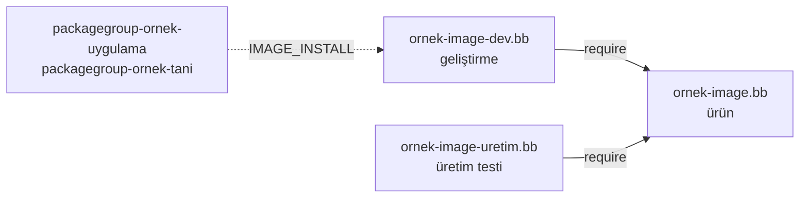

# 9 · İmajlar

<div class="kunye" markdown>
<span>Süre: ~50 dk + uygulama</span><span>Düzey: Orta</span><span>Ön koşul: Bölüm 6–8</span>
</div>

!!! hedef "Öğrenme hedefleri"
    Bu bölümün sonunda:

    - İmaj tarifinin diğer tariflerden farkını ve imajın oluşturulma adımlarını açıklayabilirsiniz.
    - `IMAGE_INSTALL`, `IMAGE_FEATURES` ve `EXTRA_IMAGE_FEATURES` değişkenlerini doğru dosyada kullanabilirsiniz.
    - Paket gruplarıyla imaj içeriğini düzenleyebilir, `require` ile imaj varyantları türetebilirsiniz.
    - `IMAGE_FSTYPES` ve `wic` ile cihaza yazılabilir imaj biçimleri üretebilirsiniz.
    - Salt okunur kök dosya sisteminin gereksinimlerini ve imaj boyutunun izlenmesini açıklayabilirsiniz.

## 9.1 İmaj tarifinin rolü

İmaj (*image*), cihaza yazılacak son üründür: kök dosya sistemi, çoğu zaman çekirdek ve önyükleyiciyle
birlikte bir veya daha fazla dosya biçiminde sunulur. İmaj tarifi yazılım derlemez; başka tariflerin
ürettiği **paketlerden** hangilerinin kurulacağını seçer, bunları boş bir dizine kurar ve sonucu istenen
biçimlere dönüştürür. Bu nedenle imaj tariflerinde `SRC_URI` bulunmaz ve tarif kendisi paket üretmez.

Aynı metadata'dan genellikle birden fazla imaj üretilir. Örnek ürün için üç varyant öngörülür:

| Varyant | Amaç | Örnek katmanda |
|---|---|---|
| Ürün | Sahaya gönderilen, yalnızca gerekli içerik | `ornek-image.bb` |
| Geliştirme | Ürün içeriği ve tanılama, SSH, hata ayıklama araçları | `ornek-image-dev.bb` |
| Üretim testi | Üretim hattında donanım testi | Bölüm sonu alıştırması |

## 9.2 İmaj tarifinin yapısı

```bitbake title="examples/meta-ornek/recipes-core/images/ornek-image.bb"
SUMMARY = "Örnek ağ geçidi ürün imajı (ÖrnekOS)"
LICENSE = "MIT"

inherit core-image                                                    # (1)!

IMAGE_INSTALL = "packagegroup-core-boot ${CORE_IMAGE_EXTRA_INSTALL} sensor-oku"   # (2)!

IMAGE_LINGUAS = ""                                                    # (3)!
```

1.  **İmaj sınıfı.** `core-image`, `image` sınıfını devralır ve `IMAGE_FEATURES` değerlerini paket gruplarına eşleyen tanımları ekler.
2.  **Kurulacak paketler.** `packagegroup-core-boot` açılış için gereken en küçük kümedir (temel dosyalar, init sistemi, BusyBox vb.). `CORE_IMAGE_EXTRA_INSTALL` korunarak yapılandırmadan yapılan eklemelerin imaja ulaşması sağlanır.
3.  **Yerel ayarlar.** glibc kullanan dağıtımlarda varsayılan değer `"c en-us en-gb"`dir. Ekransız bir cihazda yerel ayar paketlerine gerek yoktur.

`IMAGE_FEATURES` ise paket adları yerine **üst düzey özellikler** tanımlar. Özelliklerin çoğu bir paket
grubuna karşılık gelir (`tools-debug` → `packagegroup-core-tools-debug`); bazıları ise kök dosya sisteminin
yapılandırmasını değiştirir:

| Özellik | Etkisi |
|---|---|
| `ssh-server-dropbear` / `ssh-server-openssh` | SSH sunucusu |
| `tools-debug`, `tools-profile` | `gdb`, `strace` ve profil araçları |
| `package-management` | Paket yöneticisi ve veritabanı imajda kalır |
| `dev-pkgs`, `dbg-pkgs` | Kurulu her paketin `-dev` / `-dbg` paketi |
| `read-only-rootfs` | Salt okunur kök dosya sistemi (bkz. 9.7) |
| `allow-root-login`, `empty-root-password`, `allow-empty-password` | Parolasız root erişimi (yalnızca geliştirme) |

Bir imajda kullanılabilecek tüm özellikler `bitbake -c list_image_features ornek-image` ile listelenir.

Değişkenlerin yazılacağı yer bellidir: `IMAGE_INSTALL` ve `IMAGE_FEATURES` **imaj tarifinde**,
`EXTRA_IMAGE_FEATURES` ise **yapılandırmada** (`local.conf` veya parça) tanımlanır; `bitbake.conf` bu
değeri `IMAGE_FEATURES` değişkenine ekler. Yapılandırmadan paket eklenirken `IMAGE_INSTALL:append`
kullanılır; belirli bir imajla sınırlamak için `IMAGE_INSTALL:append:pn-ornek-image = " strace"` yazılır.

!!! info ":material-history: Önceki sürümlerde: `debug-tweaks`"
    5.2 öncesinde `EXTRA_IMAGE_FEATURES = "debug-tweaks"` satırı parolasız root girişini tek seferde açıyordu.
    Bu özellik kaldırılmıştır; yerine açıkça `allow-empty-password allow-root-login empty-root-password
    post-install-logging` özellikleri yazılır. 6.0'da aynı amaçla `core/yocto/root-login-with-empty-password`
    parçası kullanılabilir ([Bölüm 3](03-ilk-derleme.md)).

!!! dikkat "Geçersiz özellik imajı görünmez kılar"
    `IMAGE_FEATURES` içinde tanımsız bir özellik (ör. eski bir yapılandırmadan kalan `debug-tweaks`)
    bulunduğunda imaj tarifi ayrıştırma sırasında atlanır (*skipped*). `bitbake ornek-image` komutu
    `Nothing PROVIDES 'ornek-image'` hatası verir; ayrıntılı iletide geçersiz özellik ve geçerli özelliklerin
    listesi yer alır.

## 9.3 İmajın oluşturulması

İmajın paket listesi `PACKAGE_INSTALL` değişkeninde birleşir: `IMAGE_INSTALL`, özelliklerden gelen
paketler (`FEATURE_INSTALL`) ve ilk açılışta bekleyen kurulum betiklerini çalıştıran `run-postinsts`. Bu
listedeki her paketin tarifi kendi görev zincirini tamamlar. Ardından `do_rootfs` görevinde paket
yöneticisi (Poky'de `PACKAGE_CLASSES` ayarına göre rpm/dnf) paketleri `RDEPENDS` ve `RRECOMMENDS`
bağımlılıklarını çözerek boş bir dizine kurar ve kurulum sonrası betikleri çalıştırır.
`do_image_qa` ve `do_image` görevlerinden sonra `IMAGE_FSTYPES` içindeki her biçim için bir
`do_image_<biçim>` görevi oluşturulur; `do_image_complete` ise çıktıları `tmp/deploy/images/<makine>/`
dizinine taşır.

Aşağıdaki animasyon, `IMAGE_INSTALL` listesinden paket çözümlemesine, kök dosya sisteminden imaj
dosyalarına kadar olan akışı adım adım gösterir:

<div class="akis" data-senaryo="imaj"></div>

Çıktı adları `IMAGE_LINK_NAME` (`<imaj>-<makine>.rootfs`) ve tarih damgası içeren `IMAGE_NAME`
değişkenlerinden türetilir. Tarih damgasız adlar, son derlenen dosyayı gösteren sembolik bağlantılardır:

```text
tmp/deploy/images/qemux86-64/
├── ornek-image-qemux86-64.rootfs.ext4.zst      # QEMU için kök dosya sistemi
├── ornek-image-qemux86-64.rootfs.tar.zst       # aynı içerik, arşiv biçiminde
├── ornek-image-qemux86-64.rootfs.manifest      # kurulu paketler ve sürümleri
├── ornek-image-qemux86-64.rootfs.spdx.json     # SPDX 3.0 SBOM (Bölüm 16)
└── ornek-image-qemux86-64.rootfs.qemuboot.conf # runqemu ayarları
```

## 9.4 Paket grupları

Paket grubu (*package group*), içinde dosya bulunmayan ve yalnızca `RDEPENDS` taşıyan bir pakettir.
İmaj tarifleri uzun paket listeleri yerine anlamlı gruplara başvurur; bir aracın eklenmesi veya
çıkarılması tek bir yerde yapılır ve tüm varyantlara yansır.

```bitbake title="examples/meta-ornek/recipes-core/packagegroups/packagegroup-ornek.bb (kısaltılmış)"
SUMMARY = "Örnek ağ geçidi paket grupları"
LICENSE = "MIT"

inherit packagegroup

PACKAGES = "${PN}-uygulama ${PN}-tani"                                # (1)!

RDEPENDS:${PN}-uygulama = "sensor-oku sensor-servis"
RDEPENDS:${PN}-tani = "ethtool iproute2 iproute2-ss lsof procps"     # (2)!
```

1.  **Birden fazla grup.** `PACKAGES`, `inherit packagegroup` satırından **sonra** tanımlanır. Sınıf her grup için `-dbg` ve `-dev` paketlerini (6.0'da varsayılan olan `ptest` dağıtım özelliği etkinse `-ptest` paketlerini de) ekler ve boş paketlere izin verir.
2.  **Paket adları.** `RDEPENDS` tarif adlarını değil paket adlarını içerir: `ss` komutu `iproute2` tarifinin ayrı bir paketi olan `iproute2-ss` içindedir.

Paket grupları varsayılan olarak mimariden bağımsızdır (`PACKAGE_ARCH = "all"`). İçeriği
`MACHINE_FEATURES` değerine göre değişen bir grup, `inherit` satırından önce
`PACKAGE_ARCH = "${MACHINE_ARCH}"` tanımlamalıdır.

## 9.5 Varyantların `require` ile türetilmesi

Geliştirme imajı ürün imajının bir kopyası olarak yazılmaz; ürün imajını `require` ile ekler ve yalnızca
farkları tanımlar. Ürün imajında yapılan her değişiklik böylece geliştirme imajına da yansır:

```bitbake title="examples/meta-ornek/recipes-core/images/ornek-image-dev.bb (kısaltılmış)"
require ornek-image.bb

SUMMARY = "Örnek ağ geçidi geliştirme imajı"

IMAGE_INSTALL += "packagegroup-ornek-uygulama packagegroup-ornek-tani"
IMAGE_FEATURES += "ssh-server-dropbear tools-debug"

IMAGE_ROOTFS_EXTRA_SPACE = "65536"
```



İmaj tarifinde `+=` kullanılabilir; çünkü `require` satırından sonra değişkenin değeri bellidir. Aynı
satır `local.conf` içinde yazılsaydı, daha önce ayrıştırılan yapılandırmadaki değer imaj tarifindeki `=`
ataması tarafından silinirdi.

!!! sss "Geliştirme özellikleri parçayla mı, ayrı imajla mı eklenmelidir?"
    `ornek/gelistirici` parçası ([Bölüm 7](07-katmanlar.md)) etkin olduğu derleme dizinindeki **tüm**
    imajlara uygulanır; geliştiricinin kendi derlemesi için uygundur. Ayrı bir imaj tarifi ise sürekli
    entegrasyonda ürün ve geliştirme imajlarının aynı derlemede, farklı adlarla üretilmesini sağlar.
    Böylece geliştirme ayarlarıyla derlenmiş bir imajın yanlışlıkla ürün olarak dağıtılma riski azalır.

## 9.6 Dosya sistemi biçimleri ve `wic`

`IMAGE_FSTYPES`, üretilecek biçimleri belirler. Varsayılan değer `tar.zst`'dir; QEMU makineleri buna
`ext4.zst` ekler. `runqemu`, `.zst` ile sıkıştırılmış imajları yalnızca `snapshot` kipinde açar;
kitaptaki uygulamalarda bu seçeneğin kullanılmasının nedeni budur.

| Biçim | Kullanım |
|---|---|
| `ext4` | Blok aygıtına doğrudan yazılan kök dosya sistemi |
| `tar.zst` | Arşiv: elle bölümleme, NFS kök dizini, konteyner |
| `squashfs`, `squashfs-zst` | Sıkıştırılmış, doğası gereği salt okunur kök dosya sistemi |
| `wic` | Bölüm tablosu, önyükleme ve veri bölümleri içeren disk imajı |
| `cpio.gz` | initramfs |

Biçim adına `.zst`, `.xz`, `.bmap` gibi dönüşüm sonekleri eklenebilir: `wic.bmap`, imajın `bmaptool` ile
hızlı yazılmasını sağlayan blok haritasını da üretir.

!!! dikkat "`IMAGE_FSTYPES` değiştirilirken"
    Yocto belgelerine göre bu değişken `:append` veya `:prepend` ile değil, `+=` ile genişletilmelidir.
    İmaj tarifinde tanımlanacaksa `inherit core-image` satırından **önce** yazılmalıdır.

Cihazların çoğu tek bir kök dosya sistemi yerine bölümlenmiş bir disk bekler. **Wic** (*OpenEmbedded Image
Creator*), derleme çıktılarından bu diski bir *kickstart* (`.wks`) dosyasına göre oluşturur. Örnek ürünün
`qemux86-64` üzerinde BIOS ile açılan disk düzeni önyükleme, kök ve kalıcı veri bölümlerinden oluşur:

```text title="examples/meta-ornek/files/wic/ornek-disk-pcbios.wks"
part /boot --source bootimg_pcbios --ondisk sda --label boot --active --align 1024
part /     --source rootfs --ondisk sda --fstype=ext4 --label kok --align 1024 --use-uuid
part /data --ondisk sda --fstype=ext4 --label veri --size 64 --align 1024

bootloader --timeout=0 --append="rootwait rootfstype=ext4 console=tty0 console=ttyS0,115200"
```

`--source` eklentisi bölümün içeriğini belirler: `bootimg_pcbios` BIOS önyükleyicisini ve çekirdeği,
`rootfs` kök dosya sistemini yerleştirir. `--source` verilmeyen `/data` bölümü `--size` ile belirtilen
boyutta boş oluşturulur. Bağlama noktası olan bölümler için Wic `/etc/fstab` satırlarını kendisi ekler;
`--use-uuid` kök bölümün aygıt adı yerine bölüm UUID'si ile bulunmasını sağlar. Dosya `WKS_FILE`
değişkeniyle seçilir; bu atama disk düzeni donanıma bağlı olduğundan genellikle makine yapılandırmasında
yapılır ([Bölüm 10](10-makine-bsp.md)).

!!! info ":material-history: Önceki sürümlerde: Wic"
    - 6.0 ile `.wks` dosyaları katmanın **`files/wic/`** dizininde aranır. Eski konumlar (`wic/`,
      `scripts/lib/wic/canned-wks/`) derlemenin `need to be moved to files/wic within the layer` hatasıyla
      durmasına neden olur. Wic eklentileri ise `scripts/lib/wic/plugins/source/` altında kalır.
    - 6.0 ile Wic aracı OE-Core'dan ayrılmış, ayrı bir proje olarak `wic-native` tarifiyle derlenmektedir.
    - `WIC_SECTOR_SIZE` kullanımdan kalkmıştır; yerine `WIC_CREATE_EXTRA_ARGS += "--sector-size 4096"` yazılır.
    - 5.3 ile eklenti adlarındaki tireler alt çizgiye dönüşmüştür: `bootimg-pcbios` → `bootimg_pcbios`.

!!! lab "Uygulama 9.1 · Bölümlenmiş disk imajı"
    `local.conf` dosyasına şu satırlar eklenir (ürün projesinde `WKS_FILE` makine yapılandırmasına aittir):

    ```bitbake
    IMAGE_FSTYPES += "wic wic.bmap"
    WKS_FILE = "ornek-disk-pcbios.wks"
    ```

    ```bash
    bitbake ornek-image
    bitbake wic-native -c addto_recipe_sysroot
    alias wic="oe-run-native wic-native wic"
    wic ls tmp/deploy/images/qemux86-64/ornek-image-qemux86-64.rootfs.wic
    ```

    Çıktıda üç bölüm görülmelidir (başlangıç, bitiş ve boyut değerleri derlemeye göre değişir):

    ```text
    Num     Start        End          Size      Fstype
     1      ...          ...          ...       fat16
     2      ...          ...          ...       ext4
     3      ...          ...          ...       ext4
    ```

    Disk imajı QEMU'da başlatılır:

    ```bash
    runqemu qemux86-64 ornek-image wic nographic snapshot
    ```

    **Beklenen sonuç:** Sistem disk imajından açılır; `mount | grep /data` komutu üçüncü bölümün
    `/data` dizinine ext4 olarak bağlandığını gösterir.

    Uygulamadan sonra eklenen iki satır `local.conf` dosyasından kaldırılır: `bootimg_pcbios` disk düzeni
    yalnızca x86 için geçerlidir ve [Bölüm 10](10-makine-bsp.md)'daki ARM makinelerinde derlemeyi bozar.

## 9.7 Salt okunur kök dosya sistemi ve overlayfs

Sahadaki bir cihazda kök dosya sisteminin salt okunur olması üç fayda sağlar: ani güç kesintisinde dosya
sistemi bozulmaz, yetkisiz değişiklik kalıcı olamaz ve imajın tamamı güncelleme sistemiyle tek parça
halinde değiştirilebilir ([Bölüm 17](17-guvenlik-guncelleme.md)). Özellik imaj tarifinde etkinleştirilir:

```bitbake
IMAGE_FEATURES += "read-only-rootfs"
```

Bu özellik önyükleyici yapılandırmasındaki çekirdek komut satırına (`APPEND`) `ro` ekler, `/etc` altındaki
ayarları buna göre düzenler ve yalnızca kurulum aşamasında gereken paketleri (`shadow`, `base-passwd`,
`run-postinsts` vb.) imajdan çıkarır.
Kurulum sonrası betiklerin tamamı derleme sırasında çalışabilmelidir; ilk açılışa ertelenmesi gereken bir
betik varsa **derleme durur**. Bu, hatanın cihazda değil derleme makinesinde görülmesini sağlar.
Uygulamalar ise yazma işlemlerini `/tmp`, `/var/volatile` gibi geçici alanlara veya kalıcı veri bölümüne
yönlendirmelidir.

Belirli dizinlerin yazılabilir kalması gerektiğinde `overlayfs` kullanılır. `overlayfs` sınıfı systemd
ve `overlayfs` dağıtım özelliklerini gerektirir. Bağlama noktası makine yapılandırmasında, yazılabilir
dizinler tarifte tanımlanır; bağlama noktası için imajda bir `/etc/fstab` satırı veya BSP'den gelen bir
systemd `.mount` birimi bulunmalıdır:

```bitbake
OVERLAYFS_MOUNT_POINT[data] = "/data"                        # makine yapılandırması
OVERLAYFS_WRITABLE_PATHS[data] = "/var/lib/sensor-servis"    # tarif (inherit overlayfs)
```

`/etc` dizini ise init sisteminden önce bağlanması gerektiğinden ayrı ele alınır:
`IMAGE_FEATURES += "overlayfs-etc"` ile birlikte `OVERLAYFS_ETC_MOUNT_POINT`, `OVERLAYFS_ETC_DEVICE` ve
`OVERLAYFS_ETC_FSTYPE` değişkenleri tanımlanır.

## 9.8 İmaj boyutunun izlenmesi

Boyut kontrolü için iki tür araç bulunur. **Sınırlama** değişkenleri imajın kendisini etkiler:
`IMAGE_LINGUAS` yerel ayar paketlerini, `IMAGE_ROOTFS_MAXSIZE` (KB) ise izin verilen en büyük boyutu
belirler; sınır aşılırsa derleme durur. Dosya sistemi boyutu, kök dizin boyutunun
`IMAGE_OVERHEAD_FACTOR` (varsayılan 1.3) ile çarpılması ve `IMAGE_ROOTFS_EXTRA_SPACE` eklenmesiyle
hesaplanır.

**İzleme** için `buildhistory` sınıfı kullanılır. Her derlemede imajın paket listesini, paket
boyutlarını ve dosya listesini bir git deposuna kaydeder:

```bitbake title="local.conf"
INHERIT += "buildhistory"
BUILDHISTORY_COMMIT = "1"
```

İmaj bilgileri `buildhistory/images/<makine>/<libc>/<imaj>/` altında tutulur: `installed-package-sizes.txt`
(büyükten küçüğe paket boyutları), `image-info.txt` (`IMAGESIZE` dahil, imajı etkileyen değişkenler) ve
`files-in-image.txt`. İki derleme arasındaki anlamlı farklar OE-Core'daki `buildhistory-diff` betiğiyle
listelenir (GitPython gerektirir).

!!! iyi "Boyut değişimini sürekli entegrasyonda denetleme"
    Ürün imajları için bir boyut bütçesi belirlenir ve `IMAGE_ROOTFS_MAXSIZE` ile zorunlu kılınır.
    `buildhistory` çıktısı CI'da saklanır; her değişiklik isteğinde `buildhistory-diff` çıktısı
    incelenerek imaja beklenmeyen paketlerin girmesi erkenden fark edilir ([Bölüm 18](18-ci.md)).

!!! lab "Uygulama 9.2 · Ürün ve geliştirme imajlarının karşılaştırılması"
    Uygulama 8.1'de etkinleştirilen ÖrnekOS dağıtımıyla devam edilir. `local.conf` dosyasına
    `buildhistory` satırları (9.8) eklenir ve iki imaj birlikte derlenir:

    ```bash
    bitbake ornek-image ornek-image-dev
    cd buildhistory/images/qemux86_64/glibc
    wc -l ornek-image/installed-package-names.txt ornek-image-dev/installed-package-names.txt
    grep IMAGESIZE ornek-image/image-info.txt ornek-image-dev/image-info.txt
    cd -
    ```

    **Beklenen sonuç:** Geliştirme imajının paket sayısı ve `IMAGESIZE` değeri ürün imajına göre belirgin
    biçimde yüksektir. Farkın kaynağı `installed-package-sizes.txt` dosyasında görülür. Geliştirme imajı
    QEMU'da başlatılarak araçların varlığı doğrulanır:

    ```bash
    runqemu qemux86-64 ornek-image-dev nographic snapshot
    ```

    ```text
    root@agecidi:~# for k in strace gdb ethtool ss lsof; do command -v $k >/dev/null && echo "$k: var"; done
    strace: var
    gdb: var
    ethtool: var
    ss: var
    lsof: var
    ```

    Aynı komut ürün imajında (`runqemu qemux86-64 ornek-image nographic snapshot`) hiçbir satır üretmez.
    `ornek/gelistirici` parçası etkinse `tools-debug` özelliği ürün imajına da eklenir ve `strace` ile `gdb`
    görünür; bu durum 9.5'teki SSS kutusunda açıklanan riskin somut bir örneğidir.

## Özet

- İmaj tarifi yazılım derlemez; paketleri seçer, kök dosya sistemini kurar ve `IMAGE_FSTYPES` biçimlerine dönüştürür.
- `IMAGE_INSTALL` ve `IMAGE_FEATURES` imaj tarifinde, `EXTRA_IMAGE_FEATURES` ve `IMAGE_INSTALL:append` yapılandırmada kullanılır.
- `debug-tweaks` kaldırılmıştır; geçersiz bir özellik imaj tarifinin atlanmasına yol açar.
- Paket grupları içerik listelerini düzenler; varyantlar `require` ile ürün imajından türetilir.
- 6.0 ile `.wks` dosyaları katmanın `files/wic/` dizininde bulunmalıdır.
- `read-only-rootfs` kurulum sonrası betiklerin derleme sırasında çalışmasını zorunlu kılar; yazılabilir alanlar `overlayfs` ile sağlanır.
- `IMAGE_ROOTFS_MAXSIZE` boyutu sınırlar, `buildhistory` değişimi izler.

## Değerlendirme soruları

<div class="quiz" data-id="b09-1">
<p class="quiz-soru">Bir geliştirici, yalnızca kendi derlemesinde tüm imajlara SSH sunucusu eklemek istiyor. Önerilen yöntem hangisidir?</p>
<ul>
<li><code>ornek-image.bb</code> içine <code>IMAGE_FEATURES += "ssh-server-dropbear"</code> eklemek</li>
<li data-dogru>Yapılandırmada (<code>local.conf</code> veya bir parça) <code>EXTRA_IMAGE_FEATURES += "ssh-server-dropbear"</code> kullanmak</li>
<li><code>local.conf</code> içinde <code>IMAGE_FEATURES = "ssh-server-dropbear"</code> yazmak</li>
<li><code>packagegroup-core-boot</code> tarifini değiştirmek</li>
</ul>
<p class="quiz-aciklama"><code>EXTRA_IMAGE_FEATURES</code> yapılandırma içindir ve <code>bitbake.conf</code> tarafından <code>IMAGE_FEATURES</code> değişkenine eklenir.
İmaj tarifinin değiştirilmesi ürün imajını da etkiler.</p>
</div>

<div class="quiz" data-id="b09-2">
<p class="quiz-soru">5.0'dan 6.0'a taşınan bir katmanda <code>wic/ornek.wks</code> dosyası bulunmaktadır. Derleme hatasını gidermek için dosya nereye taşınmalıdır?</p>
<ul>
<li><code>conf/wic/</code></li>
<li><code>scripts/lib/wic/canned-wks/</code></li>
<li data-dogru>Katmanın <code>files/wic/</code> dizinine</li>
<li>İmaj tarifiyle aynı dizine ve adı <code>.bbwks</code> olacak biçimde</li>
</ul>
<p class="quiz-aciklama">6.0 ile <code>.wks</code> dosyaları katmanın <code>files/wic/</code> dizininde aranır. Eski konumlar derlemenin bu konumu
öneren bir hatayla durmasına neden olur.</p>
</div>

<div class="quiz" data-id="b09-3">
<p class="quiz-soru"><code>local.conf</code> içine <code>IMAGE_INSTALL += "strace"</code> yazılmış, ancak <code>strace</code> <code>ornek-image</code> içinde görünmüyor. Neden?</p>
<ul>
<li><code>strace</code> yalnızca <code>tools-debug</code> ile kurulabilir</li>
<li data-dogru>İmaj tarifi <code>IMAGE_INSTALL</code> için <code>=</code> kullandığından, daha önce ayrıştırılan yapılandırmadaki değer silinir</li>
<li><code>+=</code> operatörü yapılandırma dosyalarında desteklenmez</li>
<li>Paket adları büyük harfle yazılmalıdır</li>
</ul>
<p class="quiz-aciklama">Yapılandırma dosyaları tariflerden önce ayrıştırılır. Tarifteki <code>=</code> ataması önceki değeri siler;
<code>:append</code> ise en son uygulandığı için korunur: <code>IMAGE_INSTALL:append = " strace"</code>.</p>
</div>

<div class="quiz" data-id="b09-4">
<p class="quiz-soru"><code>read-only-rootfs</code> özelliği etkin (ve <code>read-only-rootfs-delayed-postinsts</code> etkin olmayan) bir imajda, bir paketin kurulum sonrası betiği derleme sırasında çalışamıyor ve ilk açılışa ertelenmek istiyor. Ne olur?</p>
<ul>
<li>Betik ilk açılışta çalışır ve kök dosya sistemi geçici olarak yazılabilir yapılır</li>
<li>Betik sessizce atlanır</li>
<li data-dogru>Derleme hata vererek durur</li>
<li>Paket imajdan otomatik olarak çıkarılır</li>
</ul>
<p class="quiz-aciklama">Salt okunur kök dosya sisteminde ilk açılışta çalışacak betiklere yer yoktur. Derleme sistemi hatayı cihaz yerine
derleme makinesinde, erkenden bildirir. Ertelenmiş betiklere izin vermek için <code>read-only-rootfs-delayed-postinsts</code> özelliği ayrıca etkinleştirilmelidir.</p>
</div>

<div class="quiz" data-id="b09-5">
<p class="quiz-soru">6.0'a taşınan bir yapılandırmada <code>EXTRA_IMAGE_FEATURES = "debug-tweaks"</code> satırı kalmıştır. <code>bitbake ornek-image</code> komutunun sonucu ne olur?</p>
<ul>
<li>Root parolasız giriş açılır</li>
<li>Satır yok sayılır, imaj derlenir</li>
<li data-dogru>İmaj tarifi geçersiz özellik nedeniyle atlanır ve <code>Nothing PROVIDES 'ornek-image'</code> hatası alınır</li>
<li>BitBake satırı otomatik olarak yeni özelliklere dönüştürür</li>
</ul>
<p class="quiz-aciklama"><code>debug-tweaks</code> 5.2'de kaldırılmıştır. Geçersiz özellik içeren imaj tarifi atlanır; yerine
<code>allow-empty-password allow-root-login empty-root-password post-install-logging</code> yazılmalıdır.</p>
</div>

!!! alistirma "Alıştırma: Üretim testi imajı"
    Üretim hattında her kart, test istasyonuna bağlanıp seri konsoldan sınanır. Bu amaçla
    `ornek-image-uretim.bb` imajını yazın:

    1. Ürün imajının tüm içeriğini devralmalıdır.
    2. Tanılama paket grubunu içermeli, SSH sunucusu içermemelidir.
    3. Seri konsolda parola sorulmadan root oturumu açılmalıdır.
    4. Kök dosya sistemi salt okunur olmalı, imaj 128 MB'ı aşmamalıdır.

    ??? success "Örnek çözüm"
        `recipes-core/images/ornek-image-uretim.bb`:
        ```bitbake
        require ornek-image.bb

        SUMMARY = "Örnek ağ geçidi üretim testi imajı"

        IMAGE_INSTALL += "packagegroup-ornek-tani"

        IMAGE_FEATURES += "read-only-rootfs empty-root-password serial-autologin-root"

        # 128 MB (KB cinsinden); aşılırsa derleme durur
        IMAGE_ROOTFS_MAXSIZE = "131072"
        ```
        `serial-autologin-root` özelliği yalnızca `empty-root-password` ile birlikte etkilidir. Ağ üzerinden
        erişim olmadığı için `allow-root-login` gerekmez. Bu imaj üretim hattının dışına çıkmamalı;
        imaj adı ve CI çıktıları ürün imajından açıkça ayrılmalıdır.

**Sonraki bölüm:** [10 · Makine ve BSP →](10-makine-bsp.md)
