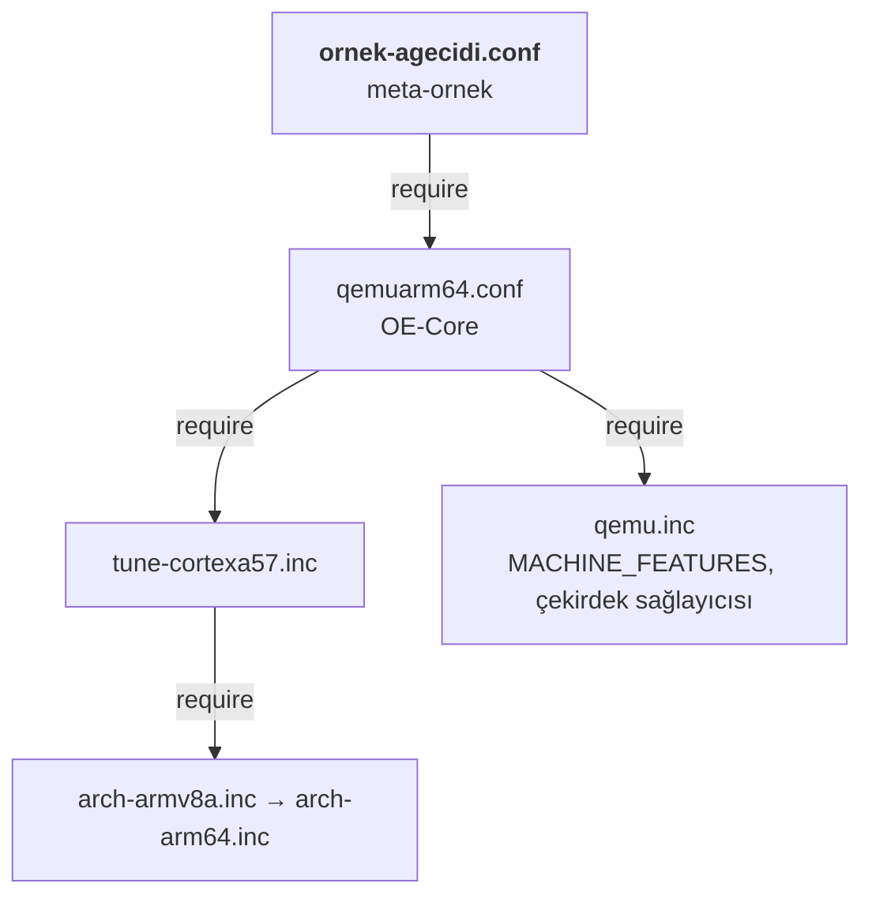

# 10 · Makine ve BSP

<div class="kunye" markdown>
<span>Süre: ~50 dk + uygulama</span><span>Düzey: Orta</span><span>Ön koşul: Bölüm 3, 7 ve 8</span>
</div>

!!! hedef "Öğrenme hedefleri"
    Bu bölümün sonunda:

    - `MACHINE` değişkeninin ve makine dosyasının yapılandırmadaki yerini açıklayabilirsiniz.
    - Ayarlama (tune) dosyalarının paket mimarisini nasıl belirlediğini açıklayabilirsiniz.
    - 6.0 ile değişen `MACHINE_FEATURES` hesaplamasını yorumlayabilirsiniz.
    - U-Boot ve aygıt ağacı ayarlarını makine düzeyinde tanımlayabilirsiniz.
    - Hazır bir makineden kuruma özgü bir makine dosyası türetebilirsiniz.
    - Bir BSP katmanı ekleyerek gerçek bir kart için imaj üretebilirsiniz.

## 10.1 Makine kavramı

Yocto Project yapılandırması üç bağımsız eksen üzerine kuruludur:

| Eksen | Değişken | Yanıtladığı soru | Örnek ürün |
|---|---|---|---|
| Makine | `MACHINE` | Yazılım **hangi donanımda** çalışacak? | `qemux86-64`, `ornek-agecidi`, `raspberrypi5` |
| Dağıtım | `DISTRO` | Ürün **hangi politikalarla** oluşturulacak? | `ornekos` ([Bölüm 11](11-distro.md)) |
| İmaj | hedef tarif | Cihaza **hangi yazılımlar** yüklenecek? | `ornek-image` ([Bölüm 9](09-imajlar.md)) |

Bu ayrım sayesinde aynı imaj ve dağıtım, yalnızca `MACHINE` değiştirilerek QEMU'da, geliştirme kartında
ve üretim kartında derlenebilir. Donanıma özgü bilgi imaj tarifine veya dağıtım dosyasına yazılmamalıdır.

`MACHINE` değeri, `BBPATH` üzerindeki katmanlarda aranan `conf/machine/${MACHINE}.conf` dosyasının adıdır.
6.0'da değer genellikle yerleşik `machine/<ad>` parçasıyla atanır:

```bash
bitbake-config-build enable-fragment machine/qemuarm64
```

Genel yapılandırma şu sırayla okunur: `local.conf` → etkin parçalar → **makine dosyası** → dağıtım
dosyası → `defaultsetup.conf`. Dağıtım dosyası makineden sonra okunduğundan makinenin değerlerini
geçersiz kılabilir. Bu nedenle makine dosyası yalnızca donanımı tanımlamalı, dağıtım politikası
(init sistemi, paket biçimi vb.) içermemelidir.

**Kart destek paketi** (*Board Support Package*, BSP), bir kartı çalıştırmak için gereken makine dosyaları,
çekirdek ve önyükleyici tarifleri, aygıt ağaçları ve ürün yazılımlarından (*firmware*) oluşan katmandır.
BSP katmanları genellikle kart veya yonga üreticisi tarafından sağlanır.

## 10.2 Makine dosyasının yapısı

OE-Core'daki `qemuarm64.conf` dosyası tipik bir makine tanımıdır (kısaltılmıştır):

```bitbake title="openembedded-core/meta/conf/machine/qemuarm64.conf"
#@TYPE: Machine
#@NAME: QEMU ARMv8 machine
#@DESCRIPTION: Machine configuration for running an ARMv8 system on QEMU

require conf/machine/include/arm/armv8a/tune-cortexa57.inc     # (1)!
require conf/machine/include/qemu.inc                          # (2)!

KERNEL_IMAGETYPE = "Image"                                     # (3)!

PREFERRED_PROVIDER_virtual/bootloader ?= "u-boot"              # (4)!
UBOOT_MACHINE ?= "qemu_arm64_defconfig"

SERIAL_CONSOLES ?= "115200;ttyAMA0 115200;hvc0"                # (5)!

QB_SYSTEM_NAME = "qemu-system-aarch64"                         # (6)!
QB_MACHINE = "-machine virt"
```

1.  **İşlemci ayarları.** Derleyici bayraklarını ve paket mimarisini belirler (bkz. 10.3).
2.  **Ortak QEMU ayarları.** `MACHINE_FEATURES`, `PREFERRED_PROVIDER_virtual/kernel ??= "linux-yocto"` ve
    `MACHINEOVERRIDES =. "qemuall:"` satırları bu dosyadadır.
3.  **Çekirdek imaj biçimi.** ARM64 için `Image`, x86 için `bzImage`, 32 bit ARM için genellikle `zImage`.
4.  **Önyükleyici.** `virtual/bootloader` sanal hedefini karşılayan tarif ve U-Boot yapılandırması (bkz. 10.5).
5.  **Seri konsol.** `hız;aygıt` çiftleri; bu konsollarda oturum açma istemi (getty) başlatılır.
6.  **`runqemu` ayarları.** `QB_` önekli değişkenler yalnızca QEMU için kullanılır.

Makine dosyalarında sık kullanılan diğer değişkenler:

| Değişken | Görevi |
|---|---|
| `PREFERRED_PROVIDER_virtual/kernel` | Kullanılacak çekirdek tarifi (bkz. [Bölüm 12](12-cekirdek.md)) |
| `KERNEL_DEVICETREE` | Derlenecek aygıt ağacı dosyaları (bkz. 10.6) |
| `IMAGE_FSTYPES`, `WKS_FILE` | Karta uygun imaj biçimleri ve disk düzeni |
| `MACHINE_ESSENTIAL_EXTRA_RDEPENDS` | Açılış için **zorunlu** makine paketleri; `packagegroup-core-boot` tarafından kurulur |
| `MACHINE_EXTRA_RRECOMMENDS` | İsteğe bağlı makine paketleri (ürün yazılımı, modüller); `packagegroup-base` tarafından kurulur |
| `MACHINEOVERRIDES` | Makineye uygulanacak koşullu değer (*override*) adları |

Örnek ürünün makinesinin devraldığı dosyalar:



## 10.3 Ayarlama dosyaları (tune)

Ayarlama dosyaları `conf/machine/include/<mimari>/` altında bulunur ve derleyicinin hangi işlemci için
kod üreteceğini tanımlar. Temel değişkenler:

- **`DEFAULTTUNE`:** Seçilen ayar kümesinin adı (ör. `cortexa57`). Ayarlama dosyaları bu değeri `?=` ile
  atar; makine dosyası `require` satırından önce farklı bir değer vererek seçimi değiştirebilir.
- **`TUNE_FEATURES`:** Seçilen kümenin özellikleri (ör. `aarch64 crc cortexa57`).
- **`AVAILTUNES`:** O ayarlama dosyasında tanımlı tüm kümeler.
- **`TUNE_PKGARCH`:** Bu ayarla derlenen paketlerin mimari adı.

Yocto paketleri üç mimari düzeyinde üretir:

| Düzey | Örnek değer (`ornek-agecidi`) | İçerik |
|---|---|---|
| `all` | `all` | Mimariden bağımsız paketler (betikler, veri dosyaları) |
| `TUNE_PKGARCH` | `cortexa57` | Derlenmiş programların çoğu |
| `MACHINE_ARCH` | `ornek_agecidi` | Makineye özgü paketler (çekirdek, önyükleyici, `base-files`) |

Bu düzenin amacı yeniden kullanımdır: aynı ayar kümesini kullanan iki makine `cortexa57` paketlerini ve
sstate çıktılarını paylaşır; yalnızca makineye özgü paketler yeniden derlenir.
`PACKAGE_EXTRA_ARCHS` (`aarch64 armv8a armv8a-crc cortexa57`) ise bu makinede kurulabilecek uyumlu
paket mimarilerini listeler.

!!! dikkat "Tariflere sabit işlemci bayrağı yazılmamalıdır"
    `-mcpu=cortex-a76` gibi bayraklar tariflere veya `local.conf` dosyasına yazılmamalıdır. Bu bayraklar
    `TUNE_CCARGS` aracılığıyla ayarlama dosyasından gelir. Raspberry Pi 5 için örneğin
    `require conf/machine/include/arm/armv8-2a/tune-cortexa76.inc` satırı yeterlidir.

## 10.4 Makine özellikleri: `MACHINE_FEATURES`

`MACHINE_FEATURES`, donanımın **sahip olduğu** yetenekleri listeler: `alsa`, `bluetooth`, `wifi`, `screen`,
`usbhost`, `usbgadget`, `rtc`, `vfat`, `pci` gibi. Tarifler ve paket grupları bu listeye bakarak bileşen
ekler veya çıkarır. Bir yeteneğin imaja girmesi için çoğu durumda hem makinenin hem dağıtımın onu
desteklemesi gerekir; bu kesişim `COMBINED_FEATURES` değişkeninde hesaplanır.

6.0 ile nihai değer şu biçimde hesaplanır:

```text
MACHINE_FEATURES (nihai) = MACHINE_FEATURES
                         + (MACHINE_FEATURES_DEFAULTS − MACHINE_FEATURES_OPTED_OUT)
```

`MACHINE_FEATURES_DEFAULTS`, OE-Core'un tüm makinelere sunduğu varsayılanlardır (`bitbake.conf` içinde
`rtc qemu-usermode`). BSP katmanları bu listeyi genişletebilir; istenmeyen varsayılanlar
`MACHINE_FEATURES_OPTED_OUT` ile dışarıda bırakılır. meta-raspberrypi bu mekanizmayı şöyle kullanır:

```bitbake title="meta-raspberrypi/conf/machine/include/rpi-base.inc (kısaltılmış)"
MACHINE_FEATURES_DEFAULTS:append = " apm usbhost keyboard vfat ext2 screen touchscreen alsa bluetooth wifi sdio ..."

# Raspberry Pi has no hardware clock
MACHINE_FEATURES_OPTED_OUT:append = " rtc"
```

!!! info ":material-history: Önceki sürümlerde: `MACHINE_FEATURES_BACKFILL`"
    5.x ve öncesinde aynı işlev `MACHINE_FEATURES_BACKFILL` ve `MACHINE_FEATURES_BACKFILL_CONSIDERED`
    değişkenleriyle sağlanırdı. 6.0'da bu değişkenler kaldırılmıştır; kullanıldıklarında BitBake, yerine
    geçen değişkeni bildiren bir hata verir. Önemli bir davranış farkı da vardır: `MACHINE_FEATURES`
    değişkenine `=` ile değer atayan makineler artık varsayılanları da otomatik olarak alır. Eski bir BSP
    uyarlanırken nihai değer `bitbake-getvar MACHINE_FEATURES` ile denetlenmeli, istenmeyen özellikler
    `MACHINE_FEATURES_OPTED_OUT` değişkenine eklenmelidir.

!!! sss "`:remove` ile `MACHINE_FEATURES_OPTED_OUT` arasındaki fark nedir?"
    `MACHINE_FEATURES_OPTED_OUT` yalnızca **varsayılanlar listesinden** gelen özellikleri etkiler ve
    belgelerde önerilen yöntemdir. `MACHINE_FEATURES:remove` ise özellik nereden gelirse gelsin onu siler ve
    sonradan yapılan eklemelerle geri alınamaz. `qemu.inc` içindeki `screen` gibi `=` ile atanmış bir
    özellik varsayılan değildir; onu çıkarmak için değer yeniden atanır.

## 10.5 Önyükleyici: U-Boot

Gömülü ARM kartlarının çoğunda çekirdeği belleğe yükleyen yazılım **U-Boot**'tur. OE-Core, `u-boot`
tarifini (6.0'da 2026.01 sürümü) ve `uboot-config` sınıfını sağlar. BSP katmanları genellikle bu tarife
bir tarif ekiyle kendi yamalarını ekler veya üreticinin U-Boot çatalını ayrı bir tarifle sunar.

Tek yapılandırmalı kartlarda şu değişkenler yeterlidir:

```bitbake
PREFERRED_PROVIDER_virtual/bootloader ?= "u-boot"
UBOOT_MACHINE = "am335x_evm_defconfig"     # U-Boot kaynağındaki configs/ altındaki dosya
UBOOT_BINARY = "u-boot.bin"                 # varsayılan: u-boot.${UBOOT_SUFFIX}
```

Aynı kart için birden fazla U-Boot yapılandırması gerektiğinde (ör. SD kart ve eMMC ya da güvenli
önyüklemeli ve önyüklemesiz) `UBOOT_CONFIG` kullanılır. 6.0 ile her ayar ayrı bir değişken bayrağıyla
(*variable flag*) verilir:

```bitbake title="Çoklu U-Boot yapılandırması (6.0 biçimi)"
UBOOT_MACHINE = ""
UBOOT_CONFIG ??= "sd emmc"
UBOOT_CONFIG[sd] = "ornek_sd_defconfig"
UBOOT_CONFIG[emmc] = "ornek_emmc_defconfig"

UBOOT_CONFIG_BINARY[emmc] = "u-boot-with-spl.bin"     # dağıtılacak ikili
UBOOT_CONFIG_IMAGE_FSTYPES[emmc] = "wic"              # bu yapılandırmaya özgü imaj türü
UBOOT_CONFIG_MAKE_OPTS[sd] = "DEVICE_TREE=ornek-sd"   # ek make seçenekleri
UBOOT_CONFIG_FRAGMENTS[emmc] = "ornek-emmc.config"    # kaynak ağacındaki Kconfig parçası
```

Tüm yapılandırmalar için ortak Kconfig parçaları `UBOOT_FRAGMENTS` ile verilir. Kurumun kendi katmanındaki
`.cfg` dosyaları ise `u-boot` tarif ekinde `SRC_URI` değişkenine eklenerek yapılandırmayla birleştirilir;
yöntem çekirdek için anlatılanla aynıdır ([Bölüm 12](12-cekirdek.md)).

!!! info ":material-history: Önceki sürümlerde: virgülle ayrılmış `UBOOT_CONFIG`"
    6.0 öncesinde tüm ayarlar tek bayrakta virgülle yazılırdı:
    `UBOOT_CONFIG[emmc] = "ornek_emmc_defconfig,wic,u-boot-with-spl.bin"`. Bu biçim 6.0'da hâlâ
    desteklenmektedir, ancak kullanımdan kaldırılmıştır ve Wrynose sonrasındaki sürümlerde silinecektir.
    BSP katmanları yeni bayraklara geçirilmelidir.

!!! sss "Her kartta U-Boot bulunur mu?"
    Hayır. x86 sistemler UEFI ile, Raspberry Pi kartları ise kendi ürün yazılımıyla çekirdeği doğrudan
    yükler. meta-raspberrypi'de U-Boot isteğe bağlıdır ve `RPI_USE_U_BOOT = "1"` ile etkinleştirilir.
    Güvenli önyükleme veya A/B güncelleme gibi gereksinimler önyükleyici seçimini doğrudan etkiler
    ([Bölüm 17](17-guvenlik-guncelleme.md)).

## 10.6 Aygıt ağacı

ARM ve RISC-V sistemlerde donanım (bellek adresleri, kesmeler, I²C/SPI aygıtları, pin ayarları) çalışma
anında taranamaz. Bu bilgi çekirdeğe **aygıt ağacı** (*device tree*) ile verilir: kaynak biçimi `.dts`,
derlenmiş biçimi `.dtb`'dir. Böylece aynı çekirdek ikilisi, yalnızca farklı bir `.dtb` ile farklı kartlarda
çalışabilir.

Çekirdek kaynağındaki aygıt ağaçları `KERNEL_DEVICETREE` ile seçilir. ARM64'te dosya adı üretici dizinini
içerir:

```bitbake title="meta-raspberrypi/conf/machine/raspberrypi5.conf (kısaltılmış)"
RPI_KERNEL_DEVICETREE = " \
    broadcom/bcm2712-rpi-5-b.dtb \
    broadcom/bcm2712-rpi-cm5-cm5io.dtb \
"
```

**Aygıt ağacı bindirmeleri** (*overlays*, `.dtbo`), temel ağaca açılışta uygulanan küçük eklerdir. Bir
genişletme kartı (HAT, cape) veya isteğe bağlı bir sensör, temel `.dtb` değiştirilmeden bindirmeyle
tanımlanır. Bindirmeler de `KERNEL_DEVICETREE` listesine `.dtbo` uzantısıyla yazılır. Bindirmelerin
uygulanabilmesi için temel ağacın simge tablosuyla derlenmesi gerekebilir (`KERNEL_DTC_FLAGS = "-@"`).
Bindirmeyi uygulayan önyükleyicidir: U-Boot'ta `fdt apply` komutu veya FIT yapılandırmaları,
Raspberry Pi'de `config.txt` içindeki `dtoverlay=` satırları kullanılır. meta-raspberrypi'de bu satırlar
`RPI_EXTRA_CONFIG` değişkeniyle eklenebilir.

Çekirdek ağacında bulunmayan, kuruma özgü `.dts` dosyaları için OE-Core'daki `devicetree` sınıfı
kullanılır. Bu sınıf `DT_FILES_PATH` dizinindeki kaynakları derler, içinde `/plugin/;` bulunan dosyaları
bindirme olarak tanır ve çıktıları `${DEPLOY_DIR_IMAGE}/devicetree/` altına yerleştirir.

!!! iyi "QEMU makinelerinde `KERNEL_DEVICETREE` bulunmaz"
    `qemuarm64` makinesinin `virt` platformunda aygıt ağacını QEMU'nun kendisi üretir. Bu nedenle QEMU'dan
    türetilen bir makinede aygıt ağacı ayarı yapılmaz; gerçek karta geçildiğinde bu ayar BSP'den gelir.

## 10.7 Yaygın BSP katmanları

| Katman | Sağlayan | Kapsam |
|---|---|---|
| `meta-yocto-bsp` | Yocto Project (meta-yocto deposu) | Başvuru makineleri: `genericx86-64`, `genericarm64`, `beaglebone-yocto` |
| `meta-raspberrypi` | Yocto Project topluluğu | Raspberry Pi kartları ve Compute Module'ler |
| `meta-freescale`, `meta-imx` | Topluluk / NXP | i.MX işlemcileri; `meta-imx` NXP'nin kendi BSP sürümüdür |
| `meta-ti` (`meta-ti-bsp`) | Texas Instruments | AM335x, AM62x, AM64x vb. (BeagleBone, BeaglePlay) |
| `meta-st-stm32mp` | STMicroelectronics | STM32MP1 / STM32MP2 kartları |
| `meta-xilinx` | AMD (Xilinx) | Zynq, ZynqMP, Versal |
| `meta-intel` | Intel | x86 platformları |

Güncel liste OpenEmbedded Layer Index üzerinden izlenebilir. Üretici BSP'leri yeni bir Yocto sürümünü
gecikmeyle destekleyebilir; bakım durumu proje başında doğrulanmalıdır.

!!! iyi "BSP katmanı seçilmeden önce yapılacak denetimler"
    1. Katmanın `conf/layer.conf` dosyasında `LAYERSERIES_COMPAT` değerinin `wrynose` içerdiği doğrulanmalıdır.
    2. Kullanılan çekirdek ve U-Boot sürümleri, bunların bakım süresi ve güvenlik güncellemesi politikası
       incelenmelidir.
    3. Ürün yazılımı lisansları (`LICENSE_FLAGS`) ve dağıtım koşulları değerlendirilmelidir
       ([Bölüm 16](16-lisans-sbom.md)).

## 10.8 Kuruma özgü makine dosyasının türetilmesi

Ürün kartı çoğu zaman bir geliştirme kartının veya bir modülün (SoM) türevidir. Bu durumda BSP katmanındaki
makine dosyası **kopyalanmaz ve değiştirilmez**; kurumun katmanında yeni bir makine dosyası oluşturulur ve
temel makine `require` ile devralınır. BSP güncellendiğinde değişiklikler kendiliğinden gelir; kuruma özgü
farklar ise tek bir küçük dosyada görünür kalır. meta-raspberrypi'deki `raspberrypi-cm5-io-board.conf`
dosyası da `raspberrypi5.conf` dosyasını benzer biçimde (`MACHINEOVERRIDES` ve `include` ile) devralır.

Örnek ürünün makine dosyası, donanım olmadan denenebilmesi için `qemuarm64` makinesinden türetilmiştir:

```bitbake title="examples/meta-ornek/conf/machine/ornek-agecidi.conf (açıklamalar kısaltılmış)"
#@TYPE: Machine
#@NAME: Örnek ağ geçidi (QEMU ARMv8 tabanlı)

require conf/machine/qemuarm64.conf             # (1)!

MACHINEOVERRIDES =. "qemuarm64:"                # (2)!

KMACHINE = "qemuarm64"                          # (3)!

MACHINE_FEATURES = "usbgadget vfat"             # (4)!
```

1.  **Temel makine.** Ayarlama dosyası, çekirdek türü, seri konsol ve `runqemu` ayarları devralınır.
2.  **Koşullu değerler.** Tariflerde `:qemuarm64` ile yazılmış değerler bu makinede de geçerli olur.
    Bu satır olmadan `linux-yocto` tarifinin `COMPATIBLE_MACHINE` denetimi başarısız olur. `=.` işleci
    değeri başa ekler; listenin sonundaki makine adı en yüksek önceliği korur.
3.  **Çekirdek eşlemesi.** `linux-yocto`, yapılandırmayı `KMACHINE` adına göre seçer (varsayılan: `MACHINE`).
    Türetilmiş makinede bu eşleme yapılmazsa çekirdek yapılandırma aşaması
    `Could not locate BSP definition for ornek-agecidi/standard` hatasıyla durur.
4.  **Ekransız ürün.** `qemu.inc` içindeki `alsa bluetooth screen` çıkarılır. `rtc` ve `qemu-usermode`
    varsayılan olarak eklenmeye devam eder.

!!! dikkat "`incompatible with machine ... (not in COMPATIBLE_MACHINE)`"
    Yeni bir makineyle derleme yapıldığında çekirdek veya önyükleyici tarifi bu iletiyle atlanıyorsa tarif
    yalnızca belirli makineler için işaretlenmiştir. İki çözüm vardır: makine dosyasında temel makinenin
    adını `MACHINEOVERRIDES` değişkenine eklemek (yukarıdaki yöntem) ya da kurumun katmanında bir tarif ekiyle
    `COMPATIBLE_MACHINE:ornek-agecidi = "ornek-agecidi"` ve `KMACHINE:ornek-agecidi` tanımlamak
    (`meta-yocto-bsp` katmanının `linux-yocto` ekindeki yöntem).

!!! lab "Uygulama 10.1 · `ornek-agecidi` makinesinin QEMU'da çalıştırılması"
    Makine etkinleştirilir ve hesaplanan değerler denetlenir:

    ```bash
    bitbake-config-build enable-fragment machine/ornek-agecidi
    bitbake-getvar --value MACHINEOVERRIDES
    bitbake-getvar --value MACHINE_FEATURES
    bitbake-getvar --value TUNE_FEATURES
    bitbake-getvar -r linux-yocto --value KMACHINE
    ```

    Beklenen çıktılar:

    ```text
    qemuarm64:qemuall:aarch64:ornek-agecidi
    usbgadget vfat rtc qemu-usermode
    aarch64 crc cortexa57
    qemuarm64
    ```

    İmaj derlenir ve çalıştırılır:

    ```bash
    bitbake ornek-image
    ls tmp/deploy/images/ornek-agecidi/
    runqemu ornek-agecidi nographic snapshot
    ```

    `tmp/deploy/images/ornek-agecidi/` dizininde `Image` çekirdeği ve
    `ornek-image-ornek-agecidi.rootfs.ext4.zst` kök dosya sistemi bulunur. QEMU içinde:

    ```text
    agecidi login: root
    root@agecidi:~# uname -m
    aarch64
    root@agecidi:~# sensor-oku 1
    Örnek ağ geçidi · sensör okuması
      sensor0  okuma 1     21.0 C
    ```

    Aynı imaj ve aynı tarifler, yalnızca makine değiştirilerek ARM64 için derlenmiştir. Sonraki bölümlere
    geçmeden önce makine geri alınır: `bitbake-config-build enable-fragment machine/qemux86-64`.

!!! lab "Uygulama 10.2 · Raspberry Pi 5 için imaj (donanım gerektirir)"
    BSP katmanı, kurulumun `layers/` dizinine indirilir ve eklenir (komutlar `build/` dizininde çalıştırılır):

    ```bash
    git clone -b wrynose https://git.yoctoproject.org/meta-raspberrypi ../layers/meta-raspberrypi
    bitbake-layers add-layer ../layers/meta-raspberrypi
    bitbake-config-build enable-fragment machine/raspberrypi5
    ```

    Raspberry Pi 5 kablosuz ağ ürün yazılımı Synaptics lisansı içerir. Lisans koşulları incelendikten sonra
    `conf/local.conf` dosyasına şu satır eklenir:

    ```bitbake
    LICENSE_FLAGS_ACCEPTED += "synaptics-killswitch"
    ```

    ```bash
    bitbake-getvar --value MACHINE_FEATURES      # rtc listede bulunmamalıdır
    bitbake ornek-image
    ls tmp/deploy/images/raspberrypi5/*.wic.*
    ```

    `ornek-image-raspberrypi5.rootfs.wic.bz2` ve `.wic.bmap` dosyaları üretilir. İmaj, SD karta
    `bmaptool` ile yazılır (`/dev/sdX` yerine kartın aygıt adı yazılmalıdır; yanlış aygıt seçimi veri
    kaybına yol açar):

    ```bash
    sudo bmaptool copy tmp/deploy/images/raspberrypi5/ornek-image-raspberrypi5.rootfs.wic.bz2 /dev/sdX
    ```

    Seri konsol `ttyAMA10` (kartın hata ayıklama UART bağlantısı) üzerindedir; ayrıntılar için
    meta-raspberrypi belgelerindeki `ENABLE_UART` açıklaması incelenmelidir. `ornek-image`
    `packagegroup-base` içermediğinden `MACHINE_EXTRA_RRECOMMENDS` ile gelen kablosuz ağ ürün yazılımı
    imaja girmez.

## Özet

- `MACHINE` donanımı, `DISTRO` politikayı, imaj tarifi içeriği tanımlar; bu üç eksen birbirinden bağımsızdır.
- Makine dosyası `conf/machine/<ad>.conf` konumundadır ve `machine/<ad>` parçasıyla seçilir.
- Ayarlama dosyaları `DEFAULTTUNE` ve `TUNE_FEATURES` ile derleyici bayraklarını, `TUNE_PKGARCH` ile paket mimarisini belirler.
- 6.0'da `MACHINE_FEATURES` değerine `MACHINE_FEATURES_DEFAULTS` otomatik eklenir; istenmeyenler `MACHINE_FEATURES_OPTED_OUT` ile çıkarılır.
- U-Boot, `UBOOT_MACHINE` veya 6.0'ın bayrak tabanlı `UBOOT_CONFIG` biçimiyle yapılandırılır.
- Aygıt ağaçları ve bindirmeler `KERNEL_DEVICETREE` ile, ağaç dışı kaynaklar `devicetree` sınıfıyla derlenir.
- Kuruma özgü makine, BSP makinesini `require` ile devralır; `MACHINEOVERRIDES` ve gerekirse `KMACHINE` ayarlanır.

## Değerlendirme soruları

<div class="quiz" data-id="b10-1">
<p class="quiz-soru">Ürün kartı, BSP katmanındaki <code>raspberrypi5</code> makinesinden yalnızca birkaç ayarla ayrılmaktadır. Önerilen yaklaşım hangisidir?</p>
<ul>
<li>BSP katmanındaki <code>raspberrypi5.conf</code> dosyasını doğrudan düzenlemek</li>
<li>Dosyayı kurumun katmanına kopyalayıp düzenlemek</li>
<li data-dogru>Kurumun katmanında yeni bir makine dosyası oluşturup <code>raspberrypi5.conf</code> dosyasını <code>require</code> ile devralmak</li>
<li>Farklılıkları <code>ornek-image.bb</code> tarifine yazmak</li>
</ul>
<p class="quiz-aciklama">Devralma, BSP güncellemelerinin kendiliğinden gelmesini ve kuruma özgü farkların küçük bir dosyada izlenmesini sağlar.
Kopyalanan dosya BSP'den kopar.</p>
</div>

<div class="quiz" data-id="b10-2">
<p class="quiz-soru">Yocto 6.0'da bir makine dosyasında <code>MACHINE_FEATURES = "usbhost vfat"</code> yazılmıştır. <code>bitbake-getvar MACHINE_FEATURES</code> çıktısında <code>rtc</code> görülmesinin nedeni nedir?</p>
<ul>
<li>Atama hatalıdır ve BitBake değeri yok saymıştır</li>
<li data-dogru><code>MACHINE_FEATURES_DEFAULTS</code> içindeki özellikler, <code>MACHINE_FEATURES_OPTED_OUT</code> ile çıkarılmadıkça otomatik eklenir</li>
<li><code>rtc</code> dağıtım dosyasından gelir</li>
<li>Önbellek temizlenmemiştir</li>
</ul>
<p class="quiz-aciklama">6.0 ile varsayılan özellikler <code>=</code> atamasından bağımsız olarak eklenir. Gerçek saat devresi bulunmayan bir kart için
<code>MACHINE_FEATURES_OPTED_OUT += "rtc"</code> yazılmalıdır.</p>
</div>

<div class="quiz" data-id="b10-3">
<p class="quiz-soru"><code>qemuarm64</code> makinesinden türetilen bir makinede <code>MACHINEOVERRIDES =. "qemuarm64:"</code> satırı unutulmuştur. En olası sonuç nedir?</p>
<ul>
<li>İmaj x86 için derlenir</li>
<li data-dogru><code>linux-yocto</code> tarifi <code>COMPATIBLE_MACHINE</code> denetimi nedeniyle atlanır ve çekirdek sağlayıcısı bulunamaz</li>
<li>Seri konsol devre dışı kalır</li>
<li>Herhangi bir etkisi olmaz</li>
</ul>
<p class="quiz-aciklama"><code>COMPATIBLE_MACHINE</code> düzenli ifadesi <code>MACHINEOVERRIDES</code> içindeki adlarla karşılaştırılır. Yeni makine adı ifadeyle
eşleşmediğinden tarif atlanır. Ya temel makine adı <code>MACHINEOVERRIDES</code> değişkenine eklenir ya da tarif ekiyle uyumluluk tanımlanır.</p>
</div>

<div class="quiz" data-id="b10-4">
<p class="quiz-soru">Aynı kart için SD kart ve eMMC olmak üzere iki U-Boot yapılandırması üretilecektir. 6.0'da önerilen yazım hangisidir?</p>
<ul>
<li><code>UBOOT_MACHINE = "sd_defconfig emmc_defconfig"</code></li>
<li><code>UBOOT_CONFIG[emmc] = "emmc_defconfig,wic,u-boot-with-spl.bin"</code></li>
<li data-dogru><code>UBOOT_CONFIG[emmc] = "emmc_defconfig"</code> ve ayrıca <code>UBOOT_CONFIG_BINARY[emmc] = "u-boot-with-spl.bin"</code></li>
<li>İki ayrı <code>u-boot</code> tarifi yazmak</li>
</ul>
<p class="quiz-aciklama">6.0'da her ayar ayrı bir değişken bayrağıyla verilir (<code>UBOOT_CONFIG_BINARY</code>, <code>UBOOT_CONFIG_IMAGE_FSTYPES</code>,
<code>UBOOT_CONFIG_MAKE_OPTS</code>, <code>UBOOT_CONFIG_FRAGMENTS</code>). Virgüllü biçim kullanımdan kaldırılmıştır.</p>
</div>

!!! alistirma "Alıştırma: Raspberry Pi 5 tabanlı ürün makinesi"
    Ürünün ilk donanım sürümü Raspberry Pi 5 üzerinde geliştirilecektir. Kartta kablosuz ağ ve Bluetooth
    kullanılmayacak, harici bir I²C gerçek saat devresi bindirmeyle tanımlanacaktır.

    1. `meta-ornek/conf/machine/ornek-agecidi-rpi5.conf` dosyasını `raspberrypi5` makinesini devralacak biçimde yazın.
    2. Kablosuz ağ ve Bluetooth özelliklerini, varsayılanlardan geldikleri göz önünde bulundurarak dışarıda bırakın.
    3. `i2c-rtc` bindirmesini `config.txt` dosyasına ekleyin.
    4. `bitbake-getvar` ile `MACHINE_FEATURES` ve `PREFERRED_PROVIDER_virtual/kernel` değerlerini doğrulayın.

    ??? success "Örnek çözüm"
        ```bitbake title="conf/machine/ornek-agecidi-rpi5.conf"
        #@TYPE: Machine
        #@NAME: Örnek ağ geçidi (Raspberry Pi 5 tabanlı)

        MACHINEOVERRIDES =. "raspberrypi5:"
        require conf/machine/raspberrypi5.conf

        # wifi ve bluetooth, rpi-base.inc içinde MACHINE_FEATURES_DEFAULTS'a eklenir
        MACHINE_FEATURES_OPTED_OUT:append = " wifi bluetooth"

        # Harici I2C saat devresi (ör. DS3231)
        ENABLE_I2C = "1"
        RPI_EXTRA_CONFIG = " \n dtoverlay=i2c-rtc,ds3231 \n"
        MACHINE_FEATURES:append = " rtc"
        ```
        `MACHINEOVERRIDES` satırı sayesinde meta-raspberrypi'deki `:raspberrypi5` koşullu değerleri
        (ör. `KBUILD_DEFCONFIG:raspberrypi5`) bu makinede de geçerli olur; çekirdek sağlayıcısı
        `linux-raspberrypi` olarak kalır. `rtc`, BSP'de `MACHINE_FEATURES_OPTED_OUT` ile çıkarıldığı için
        doğrudan `MACHINE_FEATURES` değişkenine eklenir. `RPI_EXTRA_CONFIG` biçimi ve `i2c-rtc` bindirmesinin
        parametreleri, kullanılan meta-raspberrypi sürümünün belgeleriyle doğrulanmalıdır.

**Sonraki bölüm:** [11 · Dağıtım yapılandırması →](11-distro.md)
