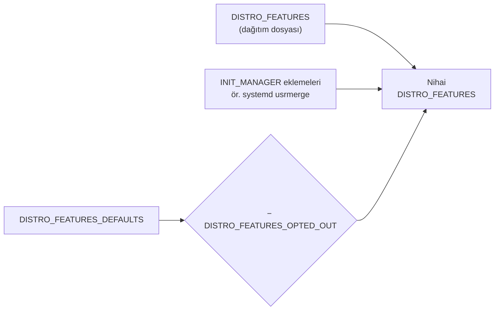

# 11 · Dağıtım yapılandırması

<div class="kunye" markdown>
<span>Süre: ~45 dk + uygulama</span><span>Düzey: Orta</span><span>Ön koşul: Bölüm 5, 7 ve 10</span>
</div>

!!! hedef "Öğrenme hedefleri"
    Bu bölümün sonunda:

    - Dağıtım (distro) kavramını ve makine ile imajdan farkını açıklayabilirsiniz.
    - Kuruma özgü bir dağıtım dosyası yazabilir ve etkinleştirebilirsiniz.
    - 6.0'daki `DISTRO_FEATURES` hesaplamasını yorumlayabilir, varsayılan özelliklerden vazgeçebilirsiniz.
    - Init sistemi, C kütüphanesi, derleyici ve paket biçimi seçimlerinin sonuçlarını değerlendirebilirsiniz.
    - Sağlayıcı ve sürüm tercihlerini dağıtım düzeyinde sabitleyebilirsiniz.
    - Ürün ve geliştirme yapılandırmalarını parçalarla ayırabilirsiniz.

## 11.1 Dağıtım kavramı

**Dağıtım** (*distro*), bir ürün ailesinin tüm cihazlarında ortak olan teknik politikaların toplamıdır:
hangi init sisteminin, hangi C kütüphanesinin ve paket biçiminin kullanılacağı, hangi yazılım
özelliklerinin (ağ protokolleri, grafik, güvenlik) etkin olacağı, hangi sürümlerin sabitleneceği.
Makine "hangi donanım", imaj "hangi içerik" sorusunu yanıtlarken dağıtım "**hangi kurallarla**" sorusunu
yanıtlar ([Bölüm 10](10-makine-bsp.md)).

`DISTRO` değişkeni, `conf/distro/${DISTRO}.conf` dosyasının adıdır ve yerleşik `distro/<ad>` parçasıyla
seçilir. Üç durum ayırt edilmelidir:

| `DISTRO` | Kaynak | Açıklama |
|---|---|---|
| boş (`nodistro`) | OE-Core `defaultsetup.conf` | Yalnızca OE-Core varsayılanları; ürün için tasarlanmamıştır |
| `poky` | meta-yocto / meta-poky | Yocto Project'in başvuru dağıtımı; test ve öğrenme amaçlıdır |
| `ornekos` | meta-ornek | Kurumun ürün politikaları |

Poky bir başvuru dağıtımıdır: varsayılanları Yocto Project'in test gereksinimlerine göre seçilir ve
sürümden sürüme değişebilir. Ürünün davranışının bu değişikliklerden etkilenmemesi için kurum kendi
dağıtımını tanımlamalıdır. Politikaların `local.conf` dosyasına yazılması da önerilmez; bu dosya sürüm
denetimine girmez ve her geliştiricide farklılaşır.

## 11.2 ÖrnekOS dağıtım dosyası

```bitbake title="examples/meta-ornek/conf/distro/ornekos.conf"
require conf/distro/poky.conf                       # (1)!

DISTRO = "ornekos"                                  # (2)!
DISTRO_NAME = "ÖrnekOS"
DISTRO_VERSION = "0.1"
DISTRO_CODENAME = "ilk"
MAINTAINER = "Örnek Kurum <ornek@example.com>"

INIT_MANAGER = "systemd"                            # (3)!

DISTRO_FEATURES_OPTED_OUT += "x11 wayland opengl vulkan pulseaudio 3g nfc"   # (4)!
```

1.  **Temel dağıtım.** Poky'nin ayarları (paket biçimi, çekirdek sürümü, QA kuralları) devralınır;
    yalnızca farklılıklar yazılır. Bu satır, katmanın `meta-poky` katmanına bağımlı olmasına yol açar.
    Bağımlılık istenmiyorsa dağıtım yalnızca OE-Core üzerine kurulur ve gereken tüm ayarlar açıkça yazılır.
2.  **Kimlik.** `DISTRO_NAME` ve `DISTRO_VERSION`, `/etc/issue` ve `/etc/os-release` dosyalarına yazılır.
    `DISTRO` değeri aynı zamanda bir koşullu değer adıdır (`DISTROOVERRIDES`): tariflerde `:ornekos`
    soneki yalnızca bu dağıtımda geçerli olan değerler için kullanılabilir.
3.  **Init sistemi.** Poky `sysvinit` kullanır; ürün politikası `systemd`'dir (bkz. 11.4).
4.  **Özelliklerden vazgeçme.** Ekransız bir ağ geçidinde grafik ve ses sunucusu gerekmez (bkz. 11.3).

!!! dikkat "Dağıtım dosyasında atama işlecinin seçimi"
    Yapılandırma `local.conf` → parçalar → makine → **dağıtım** sırasıyla okunur. Dağıtım dosyası
    `local.conf` dosyasından **sonra** okunduğu için:

    - Dağıtımda `?=` ile atanan bir değer, `local.conf` dosyasında atanmışsa onu **korur**; geliştirici
      değeri değiştirebilir.
    - Dağıtımda `=` ile atanan bir değer `local.conf` ayarını **geçersiz kılar**.

    Ürün açısından pazarlık konusu olmayan politikalar (init sistemi, C kütüphanesi) `=` ile, geliştiricinin
    değiştirebileceği tercihler `?=` ile yazılmalıdır. Devralınan dağıtımda bir değer zaten `?=` ile
    atanmışsa (ör. Poky'deki `PACKAGE_CLASSES ?= "package_rpm"`), türetilen dağıtımda ikinci bir `?=`
    etkisiz kalır.

## 11.3 Dağıtım özellikleri: `DISTRO_FEATURES`

`DISTRO_FEATURES`, dağıtımın desteklemeyi **seçtiği** yetenekleri listeler. Tarifler bu listeye bakarak
yapılandırmalarını değiştirir; örneğin `wayland` yoksa grafik kütüphaneleri Wayland desteği olmadan
derlenir, `ipv6` yoksa ağ araçları IPv6 olmadan yapılandırılır. Bir tarif belirli bir özellik olmadan
anlamsızsa `features_check` sınıfıyla bunu bildirir:

```bitbake
inherit features_check
REQUIRED_DISTRO_FEATURES = "systemd"
```

Bu özellik bulunmadığında tarif hata vermek yerine atlanır. Tariflerin özelliğe göre davranış değiştirmesi
ise genellikle `${@bb.utils.contains('DISTRO_FEATURES', 'systemd', ..., ..., d)}` ifadesi veya
`PACKAGECONFIG` ile yapılır.

6.0 ile nihai değer, makine özelliklerindekiyle aynı biçimde hesaplanır:



`DISTRO_FEATURES_DEFAULTS` OE-Core'da `default-distrovars.inc` dosyasında tanımlıdır ve 6.0'da şu
özellikleri içerir:

```text
acl alsa bluetooth debuginfod ext2 ipv4 ipv6 wifi xattr nfs zeroconf pci 3g nfc x11 vfat
seccomp pulseaudio gobject-introspection-data ldconfig opengl ptest multiarch wayland vulkan
```

Bu listenin kendisi değiştirilmez; istenmeyen özellikler `DISTRO_FEATURES_OPTED_OUT` ile dışarıda bırakılır.
Tüm varsayılanlardan vazgeçmek için `DISTRO_FEATURES_OPTED_OUT = "*"` yazılır ve gereken özellikler
`DISTRO_FEATURES` içinde tek tek listelenir. Poky'nin küçük boyutlu varyantı `poky-tiny` bu yöntemi kullanır.

!!! info ":material-history: Önceki sürümlerde: `DISTRO_FEATURES_BACKFILL` ve `DISTRO_FEATURES_DEFAULT`"
    5.x ve öncesinde varsayılan özellikler `DISTRO_FEATURES_DEFAULT` değişkeninde tutulur, sonradan eklenen
    özellikler `DISTRO_FEATURES_BACKFILL` ile dağıtımlara yansıtılır, bunlardan vazgeçmek için
    `DISTRO_FEATURES_BACKFILL_CONSIDERED` kullanılırdı. 6.0'da bu üç değişken kaldırılmış, yerlerine
    `DISTRO_FEATURES_DEFAULTS` ve `DISTRO_FEATURES_OPTED_OUT` gelmiştir. Eski adlar kullanıldığında BitBake
    hata verir. Ayrıca `multiarch`, `opengl`, `ptest`, `vulkan` ve `wayland` 6.0 ile varsayılan listeye
    girmiştir. `DISTRO_FEATURES` değişkenine `=` ile değer atayan eski dağıtımlar artık varsayılanların
    tamamını otomatik olarak alır; geçiş sırasında nihai değer mutlaka denetlenmelidir.

!!! sss "`ptest` özelliği imajı büyütür mü?"
    `ptest` dağıtım özelliği, tariflerin paket testlerini ayrı `-ptest` paketleri olarak **üretmesini**
    sağlar; bu paketler imaja kendiliğinden eklenmez. İmaja eklenmeleri için imajda `ptest-pkgs` özelliği
    etkinleştirilmelidir. Özellik derleme süresini uzatır; test altyapısı kullanılmayacaksa
    `DISTRO_FEATURES_OPTED_OUT` listesine eklenebilir.

## 11.4 Init sistemi: `INIT_MANAGER`

`INIT_MANAGER`, açılışta ilk çalışan süreci ve buna bağlı aygıt ile oturum yöneticilerini seçer.
Değer, `conf/distro/include/init-manager-${INIT_MANAGER}.inc` dosyasının okunmasını sağlar:

| Değer | Init | Aygıt yöneticisi | Eklenen `DISTRO_FEATURES` | Uygun olduğu durum |
|---|---|---|---|---|
| `systemd` | systemd | systemd-udevd | `systemd usrmerge` | Servis denetimi, bekçi köpeği, günlük yönetimi gereken ürünler |
| `sysvinit` | SysVinit | udev | `sysvinit` | Geleneksel betik tabanlı sistemler |
| `mdev-busybox` | BusyBox init | BusyBox mdev | — | Çok kısıtlı bellek ve işlemci kaynağı |

İçerme dosyaları ayrıca `VIRTUAL-RUNTIME_init_manager`, `VIRTUAL-RUNTIME_dev_manager` ve
`VIRTUAL-RUNTIME_login_manager` gibi değişkenleri `??=` ile atar. Tarifler ve paket grupları bu değişkenler
aracılığıyla seçilen init sistemine uygun paketleri çeker.

!!! info ":material-history: Önceki sürümlerde: varsayılan init sistemi ve SysVinit uyumluluğu"
    - 6.0 öncesinde `defaultsetup.conf` içindeki varsayılan değer `none` idi. 6.0 ile **nodistro**
      yapılandırmasının varsayılanı `systemd` olmuştur. **Poky** ise `sysvinit` kullanmaya devam eder.
    - 6.0 öncesinde systemd, SysVinit betiklerini çalıştırabilen bir uyumluluk katmanıyla derlenebiliyordu;
      `systemd` ve `sysvinit` dağıtım özellikleri birlikte bulunabiliyordu. Bu destek 6.0'da kaldırılmıştır
      (`systemd-compat-units` tarifi ve systemd'nin `sysvinit` PACKAGECONFIG seçeneği silinmiştir).
      Artık iki özellik **birlikte kullanılamaz**; servisler seçilen init sistemine uygun biçimde, systemd
      için birim dosyalarıyla, tanımlanmalıdır ([Bölüm 8](08-siniflar.md)).

## 11.5 C kütüphanesi ve derleyici

**C kütüphanesi** `TCLIBC` ile seçilir ve tüm kullanıcı alanı yazılımını etkiler:

- `glibc` (varsayılan): en geniş uyumluluk; masaüstü Linux dağıtımlarıyla aynı davranış.
- `musl`: daha küçük ve daha basit bir uygulama; bazı yazılımlar glibc'ye özgü davranışlara dayandığından
  yama gerektirebilir. `poky-tiny` musl kullanır.
- `newlib`, `picolibc`, `baremetal`: işletim sistemi olmayan (bare-metal) hedefler içindir.

C kütüphanesi bir ürün kararıdır ve sonradan değiştirilmesi tüm sistemin yeniden derlenmesi ve test
edilmesi anlamına gelir. Bu nedenle dağıtım dosyasında `=` ile sabitlenmelidir.

**Derleyici** 5.3'ten itibaren `PREFERRED_TOOLCHAIN_TARGET` ile seçilebilir. Desteklenen değerler `gcc`
(varsayılan) ve `clang`'dır. Değişken genel bir yapılandırma dosyasında, tercihen dağıtımda ayarlanır:

```bitbake
PREFERRED_TOOLCHAIN_TARGET = "clang"
```

Clang ile derlenemeyen tarifler bir tarif ekiyle `TOOLCHAIN = "gcc"` olarak işaretlenir; OE-Core'daki
bazı tarifler bunu zaten yapar. `TOOLCHAIN` değişkeni genel olarak ayarlanmamalıdır. Yerel (native) araçlar
ve SDK için `PREFERRED_TOOLCHAIN_NATIVE` ve `PREFERRED_TOOLCHAIN_SDK` değişkenleri bulunur.

!!! info ":material-history: Önceki sürümlerde: meta-clang ve `TCLIBCAPPEND`"
    5.3 öncesinde Clang, ayrı bir katman olan **meta-clang** ile sağlanır ve `TOOLCHAIN = "clang"`
    ataması genel yapılandırmada kullanılırdı. 5.3 ile Clang/LLVM OE-Core'a alınmıştır. Ayrıca 5.0 ve
    öncesinde `TCLIBCAPPEND` değişkeni `TMPDIR` adına C kütüphanesi soneki ekleyebiliyordu (nodistro'da
    `tmp-glibc` gibi). Farklı C kütüphaneleri aynı `TMPDIR` dizinini paylaşabildiğinden bu değişken 5.1'de
    kaldırılmıştır.

## 11.6 Paket biçimi: `PACKAGE_CLASSES`

Yocto her tarifin çıktısını paketlere böler ve kök dosya sistemini bu paketlerden oluşturur.
`PACKAGE_CLASSES` hangi biçimlerin üretileceğini belirler; **ilk değer** imajın oluşturulmasında
kullanılır, diğer değerler yalnızca ek paket üretir.

| Değer | Biçim | Cihazdaki paket yöneticisi | Değerlendirme |
|---|---|---|---|
| `package_ipk` | ipk | opkg | Küçük ve hızlı; nodistro varsayılanı |
| `package_rpm` | rpm | dnf | Python gerektirir, cihazda daha fazla yer kaplar; Poky varsayılanı |
| `package_deb` | deb | apt | Debian ekosistemine alışkın ekipler için |

Paket biçimi, cihazda paket yöneticisi bulunmasa da derleme süresini ve `tmp/deploy/` içeriğini etkiler.
Cihazın sahada paket tabanlı güncellenmesi planlanıyorsa (`package-management` imaj özelliği) seçim,
paket yöneticisinin boyutu ve paket deposu altyapısı göz önüne alınarak yapılmalıdır
([Bölüm 17](17-guvenlik-guncelleme.md)).

## 11.7 Sağlayıcı ve sürüm tercihleri

Bazı bileşenlerin birden fazla tarifi vardır. Örneğin `virtual/kernel` sanal hedefini `linux-yocto`,
`linux-yocto-rt` veya bir üretici çekirdeği karşılayabilir. Seçim `PREFERRED_PROVIDER` ile, aynı tarifin
birden fazla sürümü arasındaki seçim `PREFERRED_VERSION` ile yapılır:

```bitbake
PREFERRED_PROVIDER_virtual/kernel = "linux-yocto-rt"    # gerçek zamanlı çekirdek
PREFERRED_VERSION_linux-yocto ?= "6.18%"                 # % joker karakteri: 6.18.x
```

Görev dağılımı şöyledir: donanıma bağlı sağlayıcılar (çekirdek, önyükleyici) **makine** dosyasında,
ürün politikası olan sürüm sabitlemeleri **dağıtım** dosyasında tanımlanır. Poky, örneğin,
`PREFERRED_VERSION_linux-yocto ?= "6.18%"` satırını içerir. Etkin sağlayıcı ve sürümler şu komutlarla
denetlenir:

```bash
bitbake-getvar --value PREFERRED_PROVIDER_virtual/kernel
bitbake -s | grep -E "^(linux-yocto|busybox) "
```

!!! iyi "Sürüm sabitleme LTS içinde ölçülü kullanılmalıdır"
    6.0 bir LTS sürümüdür ve nokta sürümleri (6.0.x) güvenlik düzeltmelerini getirir. Bir tarifin belirli
    bir yama sürümüne (ör. `6.18.24`) sabitlenmesi bu düzeltmelerin alınmasını engeller. Sabitleme genellikle
    ana sürüm düzeyinde (`6.18%`) yapılmalı, daha dar sabitlemelerin gerekçesi katmanda belgelenmelidir.

## 11.8 Ürün ve geliştirme yapılandırmalarının ayrılması

Geliştirme sürecinde SSH erişimi, hata ayıklama araçları ve parolasız root girişi gibi kolaylıklar
gerekir; bunların hiçbiri sahaya giden üründe bulunmamalıdır. Yaygın hata, bu ayarların dağıtım dosyasına
veya `local.conf` dosyasına eklenip unutulmasıdır. 6.0 ile önerilen ayrım şudur:

| Katman | İçerik | Örnek |
|---|---|---|
| Dağıtım dosyası | Değişmeyen ürün politikaları | `ornekos.conf` |
| Makine parçası | Hedef donanım | `machine/ornek-agecidi` |
| Geliştirme parçaları | Yalnızca geliştirmede etkinleşen ayarlar | `ornek/gelistirici`, `core/yocto/root-login-with-empty-password` |
| İmaj varyantları | İçerik farkları | `ornek-image`, `ornek-image-dev` ([Bölüm 9](09-imajlar.md)) |

Ürün derlemesi, CI ortamında yalnızca makine ve dağıtım parçaları etkinken yapılır. Geliştirici kendi
kurulumunda ek parçaları etkinleştirir; hangi parçaların etkin olduğu `bitbake-config-build list-fragments`
çıktısında açıkça görülür.

```bash
# Geliştirici kurulumu
bitbake-config-build enable-fragment distro/ornekos ornek/gelistirici

# Ürün derlemesi öncesinde geliştirme parçası kapatılır
bitbake-config-build disable-fragment ornek/gelistirici
```

!!! lab "Uygulama 11.1 · ÖrnekOS dağıtımının etkinleştirilmesi"
    ÖrnekOS, Uygulama 8.1'den beri etkindir. Karşılaştırma için önce geçici olarak Poky'ye (ve Uygulama
    10.2'de makine değiştirildiyse `qemux86-64` makinesine) dönülüp değerler kaydedilir, ardından ÖrnekOS
    yeniden etkinleştirilir:

    ```bash
    bitbake-config-build enable-fragment machine/qemux86-64 distro/poky
    bitbake-getvar --value DISTRO_FEATURES > /tmp/poky-features.txt
    bitbake-config-build enable-fragment distro/ornekos
    bitbake-getvar --value DISTRO_FEATURES
    bitbake-getvar --value INIT_MANAGER
    ```

    Beklenen çıktı (boşluk düzeni farklı olabilir):

    ```text
     systemd usrmerge acl alsa bluetooth debuginfod ext2 gobject-introspection-data ipv4 ipv6
    ldconfig multiarch nfs pci ptest seccomp vfat wifi xattr zeroconf
    systemd
    ```

    `sysvinit`, `x11`, `wayland`, `opengl`, `vulkan`, `pulseaudio`, `3g` ve `nfc` listede yer almaz.
    Bir değerin nereden geldiği değişken geçmişiyle izlenir:

    ```bash
    bitbake-getvar DISTRO_FEATURES_OPTED_OUT
    ```

    ```text
    # $DISTRO_FEATURES_OPTED_OUT [6 operations]
    #   append .../meta-ornek/conf/distro/ornekos.conf:21
    #     "x11 wayland opengl vulkan pulseaudio 3g nfc"
    ...
    DISTRO_FEATURES_OPTED_OUT=" x11 wayland opengl vulkan pulseaudio 3g nfc"
    ```

    İmaj derlenir ve QEMU'da doğrulanır. ÖrnekOS çıktıları Uygulama 8.1'den sstate önbelleğinde
    bulunduğundan derlemenin büyük kısmı önbellekten alınır:

    ```bash
    bitbake ornek-image
    runqemu qemux86-64 nographic snapshot
    ```

    ```text
    ÖrnekOS 0.1 agecidi ttyS0

    agecidi login: root
    root@agecidi:~# cat /proc/1/comm
    systemd
    root@agecidi:~# cat /etc/os-release
    ID=ornekos
    NAME="ÖrnekOS"
    VERSION="0.1 (ilk)"
    VERSION_ID=0.1
    VERSION_CODENAME="ilk"
    PRETTY_NAME="ÖrnekOS 0.1 (ilk)"
    CPE_NAME="cpe:/o:openembedded:ornekos:0.1"
    ```

## Özet

- Dağıtım, ürünün teknik politikalarını tanımlar; Poky başvuru amaçlıdır, ürün için kurumun kendi dağıtımı kullanılmalıdır.
- Dağıtım dosyası `local.conf` dosyasından sonra okunur: `=` geliştirici ayarını geçersiz kılar, `?=` korur.
- 6.0'da `DISTRO_FEATURES_DEFAULTS` otomatik eklenir; istenmeyen özellikler `DISTRO_FEATURES_OPTED_OUT` ile çıkarılır.
- `INIT_MANAGER`: `systemd`, `sysvinit` veya `mdev-busybox`. Nodistro varsayılanı `systemd`, Poky'ninki `sysvinit`'tir; ikisi birlikte kullanılamaz.
- `TCLIBC` C kütüphanesini, `PREFERRED_TOOLCHAIN_TARGET` derleyiciyi, `PACKAGE_CLASSES` paket biçimini seçer.
- `PREFERRED_PROVIDER` ve `PREFERRED_VERSION` ile sağlayıcı ve sürüm tercihleri sabitlenir.
- Geliştirme kolaylıkları dağıtıma değil, ayrı parçalara ve imaj varyantlarına yazılır.

## Değerlendirme soruları

<div class="quiz" data-id="b11-1">
<p class="quiz-soru">Yocto 6.0'da Poky'den türetilen bir dağıtımda Wayland desteği istenmemektedir. Belgelerde önerilen yazım hangisidir?</p>
<ul>
<li><code>DISTRO_FEATURES_BACKFILL_CONSIDERED += "wayland"</code></li>
<li data-dogru><code>DISTRO_FEATURES_OPTED_OUT += "wayland"</code></li>
<li><code>DISTRO_FEATURES_DEFAULTS:remove = "wayland"</code></li>
<li><code>IMAGE_FEATURES:remove = "wayland"</code></li>
</ul>
<p class="quiz-aciklama"><code>wayland</code> 6.0'da varsayılan özelliklerdendir. Varsayılanlardan vazgeçmek için <code>DISTRO_FEATURES_OPTED_OUT</code>
kullanılır; <code>DISTRO_FEATURES_DEFAULTS</code> doğrudan değiştirilmez. <code>BACKFILL</code> değişkenleri 6.0'da kaldırılmıştır.</p>
</div>

<div class="quiz" data-id="b11-2">
<p class="quiz-soru">Hiçbir dağıtım seçilmemiş (nodistro) bir 6.0 kurulumunda varsayılan init sistemi hangisidir?</p>
<ul>
<li>sysvinit</li>
<li data-dogru>systemd</li>
<li>mdev-busybox</li>
<li>Init sistemi seçilmez</li>
</ul>
<p class="quiz-aciklama">6.0 ile <code>defaultsetup.conf</code> içindeki <code>INIT_MANAGER</code> varsayılanı <code>none</code> yerine <code>systemd</code> olmuştur.
Poky ise kendi dosyasında <code>sysvinit</code> seçmeye devam eder.</p>
</div>

<div class="quiz" data-id="b11-3">
<p class="quiz-soru">Dağıtım dosyasında <code>PACKAGE_CLASSES = "package_ipk"</code>, geliştiricinin <code>local.conf</code> dosyasında <code>PACKAGE_CLASSES = "package_deb"</code> yazılıdır. Hangi değer geçerli olur?</p>
<ul>
<li><code>package_deb</code>, çünkü <code>local.conf</code> her zaman önceliklidir</li>
<li data-dogru><code>package_ipk</code>, çünkü dağıtım dosyası <code>local.conf</code> dosyasından sonra okunur</li>
<li>İkisi birlikte uygulanır</li>
<li>BitBake çakışma hatası verir</li>
</ul>
<p class="quiz-aciklama">Sonra okunan dosyadaki <code>=</code> ataması önceki değeri geçersiz kılar. Geliştiricinin değiştirebilmesi istenen değerler
dağıtımda <code>?=</code> ile atanmalıdır.</p>
</div>

<div class="quiz" data-id="b11-4">
<p class="quiz-soru">Bir ürün ekibi tüm sistemi Clang ile derlemek, ancak Clang ile derlenemeyen tek bir tarifi GCC ile derlemek istemektedir. Doğru yaklaşım hangisidir?</p>
<ul>
<li>Genel yapılandırmada <code>TOOLCHAIN = "clang"</code>, tarifte <code>TOOLCHAIN = "gcc"</code></li>
<li data-dogru>Dağıtımda <code>PREFERRED_TOOLCHAIN_TARGET = "clang"</code>, tarif ekinde <code>TOOLCHAIN = "gcc"</code></li>
<li>meta-clang katmanını eklemek</li>
<li><code>CC = "clang"</code> satırını <code>local.conf</code> dosyasına yazmak</li>
</ul>
<p class="quiz-aciklama">5.3'ten itibaren genel seçim <code>PREFERRED_TOOLCHAIN_TARGET</code> ile yapılır. <code>TOOLCHAIN</code> yalnızca tarif düzeyinde
kullanılmalıdır. <code>CC</code> değişkeninin elle değiştirilmesi sysroot ve bayrak ayarlarını bozar.</p>
</div>

<div class="quiz" data-id="b11-5">
<p class="quiz-soru">Bir dağıtımın <code>DISTRO_FEATURES</code> değişkeninde hem <code>systemd</code> hem <code>sysvinit</code> bulunmaktadır. 6.0'da bu yapılandırma için doğru ifade hangisidir?</p>
<ul>
<li>systemd, SysVinit betiklerini uyumluluk katmanıyla çalıştırır</li>
<li>Açılışta iki init sistemi sırayla başlatılır</li>
<li data-dogru>Bu birleşim artık desteklenmez; tek bir init sistemi seçilmelidir</li>
<li>BitBake sysvinit'i otomatik olarak kaldırır</li>
</ul>
<p class="quiz-aciklama">systemd'nin SysVinit uyumluluk desteği 6.0'da kaldırılmıştır. Init sistemi <code>INIT_MANAGER</code> ile tek bir değer olarak seçilmelidir.</p>
</div>

!!! alistirma "Alıştırma: Küçük boyutlu ürün varyantı"
    Aynı ürünün, belleği kısıtlı ikinci bir donanım için küçük boyutlu bir varyantı planlanmaktadır.
    `ornekos-mini` adlı bir dağıtım tasarlayın:

    1. ÖrnekOS'un kimlik bilgilerini devralsın, ancak `DISTRO` ve `DISTRO_NAME` farklı olsun.
    2. C kütüphanesi musl, init sistemi BusyBox olsun.
    3. Varsayılan özelliklerin tamamından vazgeçilsin; yalnızca `ipv4`, `ipv6`, `vfat` ve `ldconfig` etkin olsun.
    4. Paket biçimi ipk olsun.
    5. Etkinleştirdikten sonra `DISTRO_FEATURES` ve `TCLIBC` değerlerini doğrulayın.

    ??? success "Örnek çözüm"
        ```bitbake title="conf/distro/ornekos-mini.conf"
        require conf/distro/ornekos.conf

        DISTRO = "ornekos-mini"
        DISTRO_NAME = "ÖrnekOS Mini"

        TCLIBC = "musl"
        INIT_MANAGER = "mdev-busybox"

        DISTRO_FEATURES_OPTED_OUT = "*"
        DISTRO_FEATURES = "ipv4 ipv6 vfat ldconfig"

        PACKAGE_CLASSES = "package_ipk"
        ```
        ```bash
        bitbake-config-build enable-fragment distro/ornekos-mini
        bitbake-getvar --value DISTRO_FEATURES     # ipv4 ipv6 vfat ldconfig
        bitbake-getvar --value TCLIBC              # musl
        ```
        `DISTRO_FEATURES_OPTED_OUT = "*"` ile hem varsayılanlar hem ÖrnekOS'tan gelen `+=` değeri geçersiz
        kalır. `mdev-busybox` init yöneticisi `DISTRO_FEATURES` değişkenine özellik eklemez. Yeni dağıtımda
        `DISTRO` değeri değiştiğinden `:ornekos` koşullu değerleri (ör. [Bölüm 12](12-cekirdek.md)'deki
        çekirdek parçası) artık uygulanmaz; gerekiyorsa `DISTROOVERRIDES =. "ornekos:"` satırı eklenir.
        C kütüphanesi değiştiğinden ilk derleme uzun sürer.

**Sonraki bölüm:** [12 · Linux çekirdeği →](12-cekirdek.md)
