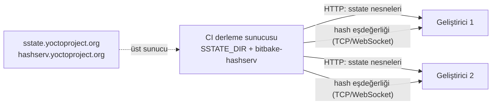

# 15 · Derleme performansı: sstate ve hash eşdeğerliği

<div class="kunye" markdown>
<span>Süre: ~50 dk + uygulama</span><span>Düzey: İleri</span><span>Ön koşul: Bölüm 3, 4 ve 14</span>
</div>

!!! hedef "Öğrenme hedefleri"
    Bu bölümün sonunda:

    - Görev imzasının nasıl hesaplandığını ve bir görevin ne zaman yeniden çalıştığını açıklayabilirsiniz.
    - sstate önbelleğinin bir görev çıktısını yeniden kullanma kararını nasıl verdiğini açıklayabilirsiniz.
    - Hash eşdeğerliğinin görev, çıktı ve birleşik imza kavramlarını ayırt edebilirsiniz.
    - `DL_DIR` ve `SSTATE_DIR` dizinlerini, `PREMIRRORS` ve `SSTATE_MIRRORS` ile ekip içinde paylaşabilirsiniz.
    - Yocto Project'in herkese açık sstate yansısını ve kurum içi bir yansıyı yapılandırabilirsiniz.
    - Paralellik, kaynak baskısı ve disk kullanımı ayarlarını derleme makinesine göre belirleyebilirsiniz.

## 15.1 Görev imzaları

BitBake bir görevin yeniden çalıştırılması gerekip gerekmediğine görevin **imzasına** (task signature,
*task hash*) bakarak karar verir. İmza, görevin çıktısını etkileyebilecek tüm girdilerin özetidir:

- Görev fonksiyonunun gövdesi ve bu fonksiyonun başvurduğu diğer fonksiyonlar,
- Görevin kullandığı değişkenlerin değerleri (BitBake bu bağımlılıkları fonksiyon gövdesini çözümleyerek
  kendisi bulur; `vardeps` ve `vardepsexclude` bayraklarıyla düzeltilebilir),
- `SRC_URI` içindeki yerel dosyaların sağlamaları,
- Görevin bağımlı olduğu diğer görevlerin imzaları.

Son madde nedeniyle bir değişiklik bağımlılık zinciri boyunca yayılır: `glibc` tarifindeki bir değişiklik,
ona bağlı tüm tariflerin imzalarını değiştirir. İmzaya katılmaması gereken değişkenler (ör. `TMPDIR`,
`WORKDIR`, `DL_DIR`, `SSTATE_DIR`, `PARALLEL_MAKE`) `BB_BASEHASH_IGNORE_VARS` listesinde tutulur. Bu
sayede derleme dizininin konumu veya paralellik ayarı imzayı değiştirmez ve farklı makinelerde üretilen
imzalar karşılaştırılabilir olur.

İmzanın girdileri `bitbake-dumpsig`, iki imza arasındaki fark ise `bitbake-diffsigs` ile incelenir
(bkz. [Bölüm 14](14-hata-ayiklama.md)).

## 15.2 Paylaşılan durum önbelleği (sstate)

Görevlerin bir kısmı **sstate görevi**dir: `do_populate_sysroot`, `do_package`, `do_packagedata`,
`do_package_write_rpm`, `do_populate_lic`, `do_package_qa` ve `do_deploy` bu türdendir. Bu görevler
çalıştıktan sonra çıktıları imzayla adlandırılmış bir arşiv olarak `SSTATE_DIR` dizinine yazılır.
Her sstate görevinin bir de `_setscene` karşılığı vardır (ör. `do_populate_sysroot_setscene`). Setscene
görevi, görevi çalıştırmak yerine arşivi açarak aynı çıktıyı geri yükler.

sstate nesnesinin adı tarifi, mimariyi, sürümü, imzayı ve görevi içerir; nesneler imzanın ilk dört
karakterine göre iki düzeyli dizinlere dağıtılır:

```text
.sstate-cache/
└── 3e/9b/
    ├── sstate:sensor-oku:x86-64-v3-poky-linux:1.0:r0:x86-64-v3:14:3e9b..._package.tar.zst
    └── sstate:sensor-oku:x86-64-v3-poky-linux:1.0:r0:x86-64-v3:14:3e9b..._package.tar.zst.siginfo
```

`.siginfo` dosyası nesneyi üreten imzanın girdilerini içerir; `bitbake-diffsigs` önbellekteki
nesnelerle karşılaştırma yaparken bu dosyaları kullanır.

**Yeniden kullanım kararı.** Derleme başladığında BitBake, hedef için gereken görevlerin imzalarını
hesaplar ve her sstate görevi için şu sırayı izler:

1. Görevin girdilerinden imza (task hash) hesaplanır.
2. Hash eşdeğerliği sunucusuna bu imzanın bilinen bir **birleşik imzası** (unihash) olup olmadığı
   sorulur; yoksa birleşik imza görev imzasının kendisidir (bkz. 15.3). Nesne adında birleşik imza kullanılır.
3. Nesne önce yerel `SSTATE_DIR` dizininde, bulunamazsa `SSTATE_MIRRORS` ile tanımlanan yansılarda aranır.
4. Nesne bulunursa setscene görevi nesneyi indirir (gerekirse) ve geri yükler; asıl görev ve onun yalnızca
   bu görev için gereken bağımlılıkları çalıştırılmaz.
5. Nesne bulunamazsa görev normal biçimde çalıştırılır, çıktısı yeni bir nesne olarak `SSTATE_DIR`
   dizinine yazılır ve çıktının özeti (output hash) hash eşdeğerliği sunucusuna bildirilir.

Aşağıdaki animasyon, bir görevin girdilerinden başlayarak bu kararın nasıl verildiğini adım adım gösterir.

<div class="akis" data-senaryo="sstate"></div>

Setscene aşaması hedeften geriye doğru çalışır. Örneğin `ornek-image` için gereken paketlerin
`do_package_write_rpm` nesneleri önbellekte varsa, bu paketlerin derleyicisi ve derleme bağımlılıkları
hiç geri yüklenmez. Derleme başında görülen satır bu aşamanın sonucudur:

```text
Sstate summary: Wanted 1650 Local 1210 Mirrors 402 Missed 38 Current 0 (97% match, 0% complete)
```

| Alan | Anlamı |
|---|---|
| `Wanted` | Setscene ile karşılanabilecek görev sayısı |
| `Local` | Yerel `SSTATE_DIR` dizininde bulunanlar |
| `Mirrors` | Yansılarda bulunanlar |
| `Missed` | Hiçbir yerde bulunamayan ve çalıştırılacak görevler |
| `Current` | `TMPDIR` içinde zaten güncel olan görevler |

!!! sss "`tmp/` silindiğinde neden derleme saatler değil dakikalar sürer?"
    `TMPDIR` yalnızca türetilmiş çıktıları içerir. `SSTATE_DIR` korunduğu sürece BitBake görevlerin
    tamamına yakınını setscene ile geri yükler. Bu nedenle bir derleme sorununda ilk adım olarak
    `tmp/` dizinini silmek güvenlidir; `SSTATE_DIR` ve `DL_DIR` ise yalnızca bilinçli bir kararla
    temizlenmelidir (bkz. [Bölüm 4](04-build-dizini.md)).

## 15.3 Hash eşdeğerliği

İmza girdilere dayandığından, çıktıyı değiştirmeyen bir girdi değişikliği de bağımlı tüm görevlerin
yeniden çalışmasına yol açar. Örneğin bir kütüphanenin kaynağındaki yorum satırı değiştirildiğinde
kütüphanenin derlenmiş hali aynı kalır; ancak imzası değiştiği için ona bağlı tüm tarifler de yeniden
derlenir. **Hash eşdeğerliği** (hash equivalence) bu gereksiz yayılmayı önler. Her görev için üç değer
izlenir:

| Değer | Hesaplandığı kaynak |
|---|---|
| Görev imzası (*task hash*) | Görevin girdileri (15.1) |
| Çıktı özeti (*output hash*) | Görevin ürettiği dosyaların içeriği |
| Birleşik imza (*unihash*) | Başlangıçta görev imzasıyla aynıdır; eşdeğerlik bulunduğunda daha önceki görev imzasına eşlenir |

Bir görev yeniden çalıştığında çıktı özeti sunucuya bildirilir. Aynı çıktı özeti daha önce başka bir görev
imzasıyla kaydedilmişse sunucu eski birleşik imzayı döndürür. Bağımlı görevlerin imzaları bağımlılıkların
birleşik imzalarından hesaplandığından değişmez ve bu görevlerin çıktıları sstate önbelleğinden geri
yüklenir. Hash eşdeğerliğinin etkinliği, **tekrarlanabilir derlemelere** bağlıdır: aynı girdiden her
seferinde bit düzeyinde aynı çıktı üretilmezse çıktı özetleri de eşleşmez.

OE-Core'da hash eşdeğerliği varsayılan olarak etkindir:

```bitbake
BB_SIGNATURE_HANDLER ?= "OEEquivHash"
BB_HASHSERVE ??= "auto"
```

`auto` değeri, BitBake'in her derlemede kendi yerel sunucusunu başlatmasını sağlar. 6.0'da sunucunun
veritabanı (`hashserv.db`) `BB_HASHSERVE_DB_DIR` dizininde tutulur; `bitbake-setup` bu değişkeni
`site.conf` dosyasında `${SSTATE_DIR}` olarak tanımlar. Böylece aynı üst dizindeki kurulumlar hem sstate
önbelleğini hem de eşdeğerlik veritabanını paylaşır. Veritabanı SQLite kullandığından NFS üzerinde
tutulamaz; birden fazla makinenin paylaşacağı bir eşdeğerlik veritabanı için sürekli çalışan bir sunucu
(`bitbake-hashserv`) kurulmalıdır.

??? info ":material-history: Önceki sürümlerde: sstate ve eşdeğerlik veritabanının konumu"
    `oe-init-build-env` ile oluşturulan derleme dizinlerinde varsayılan konumlar `build/sstate-cache` ve
    `build/downloads` dizinleridir; eşdeğerlik veritabanı ise derleme dizinindeki `cache/` (`PERSISTENT_DIR`)
    altında bulunur. Bu yapıda aynı makinedeki iki derleme dizini, `SSTATE_DIR` elle paylaştırılsa bile
    ayrı eşdeğerlik veritabanları kullanır ve yeniden kullanım oranı düşer. 6.0 ile `bitbake-setup`,
    `site.conf` dosyasına `SSTATE_DIR` ve `BB_HASHSERVE_DB_DIR` tanımlarını varsayılan olarak ekler;
    BitBake de yerel sunucunun veritabanını `BB_HASHSERVE_DB_DIR` altında açar.

## 15.4 İndirme ve sstate dizinlerinin paylaşılması

`bitbake-setup` ile oluşturulan kurulumlarda iki önbellek, kurulumların üst dizininde paylaşılır:

| Değişken | `bitbake-setup` varsayılanı | İçerik |
|---|---|---|
| `DL_DIR` | `<üst-dizin>/.bitbake-setup-downloads` | İndirilen kaynak arşivleri ve git depoları |
| `SSTATE_DIR` | `<üst-dizin>/.sstate-cache` | sstate nesneleri ve `hashserv.db` |

Aynı makinedeki kurulumlar bu dizinleri doğrudan paylaşır. Ekip veya CI düzeyinde paylaşım için iki
mekanizma kullanılır:

**Kaynak yansıları (`PREMIRRORS`, `MIRRORS`).** `PREMIRRORS` asıl kaynaktan **önce**, `MIRRORS` asıl
kaynak başarısız olduktan **sonra** denenir. Kurum içi bir kaynak yansısı için `own-mirrors` sınıfı
kısa bir yol sunar:

```bitbake
INHERIT += "own-mirrors"
SOURCE_MIRROR_URL = "http://yocto-ci.ornek.local/kaynaklar/"
BB_GENERATE_MIRROR_TARBALLS = "1"      # git depoları için yansıya konabilecek arşiv üret
BB_FETCH_PREMIRRORONLY = "1"           # isteğe bağlı: yalnızca yansıdan indir
```

`BB_GENERATE_MIRROR_TARBALLS`, git gibi sürüm denetim sistemlerinden alınan kaynakların `DL_DIR` içinde
tek dosyalık arşivler olarak da saklanmasını sağlar; bu arşivler yansı sunucusuna kopyalanabilir.
`BB_FETCH_PREMIRRORONLY = "1"`, internet erişimi olmayan veya yalnızca onaylı kaynakların kullanılması
gereken ortamlarda derlemenin yalnızca yansıya dayanmasını zorunlu kılar.

**sstate yansıları (`SSTATE_MIRRORS`).** Biçim, eşleşme deseni ve hedef URL çiftlerinden oluşur. `PATH`
sözcüğü nesnenin önbellek içindeki göreli yoluyla değiştirilir:

```bitbake
SSTATE_MIRRORS = "\
    file://.* http://yocto-ci.ornek.local/sstate/PATH;downloadfilename=PATH \
    file://.* file:///srv/yocto/sstate/PATH \
"
```

`downloadfilename=PATH` parametresi, indirilen nesnenin yerel `SSTATE_DIR` içinde aynı alt dizin yapısıyla
saklanmasını sağlar. Yansılar yazıldıkları sırayla denenir.



!!! iyi "Yansıyı yalnızca CI beslemelidir"
    Yaygın kurumsal düzen şudur: sstate yansısına ve eşdeğerlik sunucusuna **yalnızca CI** yazar;
    geliştiriciler salt okunur erişim kullanır. Böylece yansıdaki nesnelerin hepsi denetimli, temiz bir
    kurulumdan üretilmiş olur. Eşdeğerlik sunucusu, yalnızca o sunucunun bildiği sstate nesnelerine işaret
    eden kayıtlar içermelidir; geliştiricilerin yerel nesnelerine ait kayıtlar paylaşılan sunucuya
    yazılırsa diğer istemciler var olmayan nesneleri arar. Bu nedenle istemcilerin paylaşılan sunucuya
    yazması engellenmelidir: resmî belgeler istemcilerin bağlandığı sunucunun `--read-only` kipte
    çalıştırılmasını önerir. Uygulama 15.1'deki düzende ise istemciler sunucuya yalnızca
    `BB_HASHSERVE_UPSTREAM` üzerinden bağlanır; yerel sunucu üst sunucudan yalnızca kayıt çeker, ona
    kayıt yazmaz.

## 15.5 Yocto Project'in herkese açık sstate yansısı

Yocto Project, standart yapılandırmalar için önceden derlenmiş sstate nesnelerini ve bunlara ait
eşdeğerlik kayıtlarını herkese açık olarak sunar. OE-Core'daki `core/yocto/sstate-mirror-cdn` parçası
bu hizmeti etkinleştirir:

```bitbake title="meta/conf/fragments/yocto/sstate-mirror-cdn.conf (özet)"
BB_HASHSERVE_UPSTREAM = 'wss://hashserv.yoctoproject.org/ws'
SSTATE_MIRRORS ?= "file://.* http://sstate.yoctoproject.org/all/PATH;downloadfilename=PATH"
```

```bash
bitbake-config-build enable-fragment core/yocto/sstate-mirror-cdn
```

Parça iki ayarı birlikte yapar: nesnelerin indirileceği yansıyı ve yerel eşdeğerlik sunucusunun kayıt
çekeceği üst sunucuyu (`BB_HASHSERVE_UPSTREAM`). İkincisi olmadan birleşik imzalar yansıdakilerle
eşleşmeyebilir ve nesnelerin önemli bir kısmı bulunamaz. Üst sunucuya WebSocket ile bağlanıldığından
derleme makinesinde Python `websockets` modülü gerekir; modül yoksa BitBake hata verir ve
`bitbake-setup install-buildtools` komutunu önerir.

Yansı, ağ bağlantısı yerel derlemeden hızlı olduğunda kazanç sağlar. Kurumun kendi katmanlarındaki
tarifler ve standart dışı yapılandırmalar (farklı `DISTRO_FEATURES`, farklı derleyici seçenekleri) için
yansıda nesne bulunmaz; bu görevler yerel olarak derlenir.

## 15.6 Paralellik ve kaynak baskısı

| Değişken | Varsayılan | İşlevi |
|---|---|---|
| `BB_NUMBER_THREADS` | İşlemci çekirdeği sayısı | Aynı anda çalışan BitBake görevi sayısı |
| `BB_NUMBER_PARSE_THREADS` | İşlemci çekirdeği sayısı | Tarif ayrıştırma sırasında kullanılan iş parçacığı sayısı |
| `PARALLEL_MAKE` | `-j <çekirdek sayısı>` | Tek bir görevin (`make`, `ninja`) içindeki paralellik |
| `BB_PRESSURE_MAX_CPU`, `_IO`, `_MEMORY` | Tanımsız | Linux PSI baskı değeri bu sınırı aştığında yeni görev başlatılmaz |
| `BB_LOADFACTOR_MAX` | Tanımsız | PSI desteklenmiyorsa: yük ortalaması / çekirdek sayısı oranı için sınır |

İki paralellik düzeyi çarpımsal etki gösterir: `BB_NUMBER_THREADS = "16"` ve `PARALLEL_MAKE = "-j 16"`
ile en kötü durumda 256 derleyici süreci aynı anda çalışabilir. Özellikle LLVM, Rust ve çekirdek gibi
büyük C++ projelerinin aynı anda derlendiği anlarda bellek tükenebilir. Çekirdeğin bellek yetersizliği
mekanizması (OOM killer) süreçleri sonlandırdığında görev günlüğünde açıklaması belirsiz hatalar görülür;
bu durumda `dmesg` çıktısı incelenmelidir.

`BB_PRESSURE_MAX_*` değişkenleri bu soruna dinamik bir çözüm sunar. Değerler, `/proc/pressure/*`
dosyalarındaki toplam bekleme süresinin saniyedeki artışıdır (mikrosaniye). Değerin 1 ile 1000000
arasında seçilmesi beklenir; bu aralığın dışındaki değerler için BitBake uyarı verir. Uygun değer, makinede ağır bir derleme sırasında ölçülen değerlerin biraz altında seçilir.
Yocto Project'in kendi derleme sunucularında kullanılan parça (`yocto-autobuilder/autobuilder-resource-constraints`)
örnek olarak şu değerleri içerir:

```bitbake
BB_NUMBER_THREADS = '16'
PARALLEL_MAKE = '-j 16 -l 75'
BB_PRESSURE_MAX_CPU = '20000'
BB_PRESSURE_MAX_IO = '20000'
```

Tek bir tarif için farklı bir sınır tanımlanabilir: `PARALLEL_MAKE:pn-llvm = "-j 8"`.

## 15.7 Disk kullanımı: `rm_work`

Bir imaj derlemesinde `tmp/work/` dizini yüz gigabaytları bulabilir. `rm_work` sınıfı, her tarif
tamamlandıktan sonra o tarifin çalışma dizinini (`temp/` günlük dizini hariç) siler:

```bitbake
INHERIT += "rm_work"
RM_WORK_EXCLUDE += "sensor-oku linux-yocto"
```

`RM_WORK_EXCLUDE` listesindeki tariflerin çalışma dizinleri korunur; üzerinde çalışılan ve hata
ayıklanan tarifler bu listeye eklenmelidir. Sınıf etkinleştirildiğinde BitBake, disk kullanımını azaltmak
için tarifleri olabildiğince tamamlayarak ilerleyen `completion` zamanlayıcısını kullanır. Çıktılar
sstate önbelleğinde bulunduğundan silinen çalışma dizinleri gerektiğinde yeniden üretilir.

!!! dikkat "sstate önbelleği kendiliğinden küçülmez"
    `SSTATE_DIR` her imza değişikliğinde yeni nesneler biriktirir ve hiçbir nesneyi kendiliğinden silmez.
    Paylaşılan önbelleklerde düzenli bir temizlik politikası uygulanmalıdır. OE-Core'daki
    `scripts/sstate-cache-management.py` betiği, aynı görevin eski nesnelerini (`--remove-duplicated`)
    veya belirtilen derlemelerin kullanmadığı nesneleri (`--stamps-dir`) silebilir. Uygulamada erişim
    zamanına göre, örneğin son 30 günde kullanılmamış nesnelerin silinmesi de yaygındır. Disk dolduğunda
    derlemenin kontrollü biçimde durması için `BB_DISKMON_DIRS` değişkeni kullanılır.

!!! lab "Uygulama 15.1 · Kurum içi sstate yansısının HTTP üzerinden paylaşılması"
    Bu uygulamada `ornek-image` derlemesini daha önce tamamlamış bir makine (`yocto-ci.ornek.local`)
    sunucu, ikinci bir makine istemci olarak kullanılır. Tek makinede denemek için istemci olarak ayrı bir
    üst dizinde yeni bir `bitbake-setup` kurulumu oluşturulabilir.

    **1. Sunucu: eşdeğerlik sunucusu.** Var olan veritabanı kullanılarak bir `bitbake-hashserv` süreci
    başlatılır. Sunucu makinedeki derlemeler de bu süreci kullanacak biçimde ayarlanır; böylece
    veritabanına tek bir süreç erişir:

    ```bash
    bitbake-hashserv --bind :8686 \
        --database ~/bitbake-builds/.sstate-cache/hashserv.db \
        --upstream wss://hashserv.yoctoproject.org/ws
    ```

    ```bitbake title="Sunucu: ~/bitbake-builds/site.conf (eklenecek satır)"
    BB_HASHSERVE = "localhost:8686"
    ```

    **2. Sunucu: sstate nesnelerinin yayımlanması.** Deneme amacıyla Python'un yerleşik HTTP sunucusu
    yeterlidir; kalıcı kurulumda nginx veya Apache gibi bir sunucu kullanılmalıdır:

    ```bash
    python3 -m http.server 8000 --directory ~/bitbake-builds/.sstate-cache
    ```

    **3. İstemci: yansı ayarları.** İstemcinin `site.conf` dosyasına (veya `local.conf` dosyasına)
    şu satırlar eklenir. `core/yocto/sstate-mirror-cdn` parçası istemcide etkinse devre dışı bırakılır;
    Yocto Project yansısına ikinci sırada doğrudan, eşdeğerlik kayıtlarına ise kurum sunucusu üzerinden
    erişilir:

    ```bitbake
    SSTATE_MIRRORS = "\
        file://.* http://yocto-ci.ornek.local:8000/PATH;downloadfilename=PATH \
        file://.* http://sstate.yoctoproject.org/all/PATH;downloadfilename=PATH \
    "
    BB_HASHSERVE_UPSTREAM = "yocto-ci.ornek.local:8686"
    ```

    ```bash
    bitbake-config-build disable-fragment core/yocto/sstate-mirror-cdn   # etkinse
    bitbake ornek-image
    ```

    **Beklenen sonuç.** Derleme başındaki özet, görevlerin büyük çoğunluğunun yansıdan karşılandığını
    gösterir (sayılar yapılandırmaya göre değişir):

    ```text
    Sstate summary: Wanted 1650 Local 0 Mirrors 1644 Missed 6 Current 0 (99% match, 0% complete)
    ```

    Sunucudaki HTTP günlüğünde istemcinin istekleri görülür:

    ```text
    192.168.1.20 - - [01/Nov/2026 10:12:03] "GET /3e/9b/sstate:sensor-oku:x86-64-v3-poky-linux:1.0:r0:x86-64-v3:14:3e9b..._package.tar.zst HTTP/1.1" 200 -
    ```

    `Mirrors` değeri düşük kalıyorsa iki ayar denetlenmelidir: istemcinin ve sunucunun katman
    sürümleri ile yapılandırma parçaları aynı mı (`bitbake-setup status`), ve istemci eşdeğerlik
    sunucusuna erişebiliyor mu. Eşleşmeyen bir görev için `bitbake -S printdiff ornek-image` komutu,
    yerel imzayı yansıdaki en yakın nesnenin `.siginfo` dosyasıyla karşılaştırır.

## Özet

- Görev imzası; görev kodundan, kullanılan değişkenlerden, yerel dosya sağlamalarından ve bağımlılıkların imzalarından hesaplanır.
- sstate görevlerinin çıktıları imzayla adlandırılmış nesneler olarak saklanır ve setscene görevleriyle geri yüklenir.
- Hash eşdeğerliği, çıktısı değişmeyen görevlerin değişikliği bağımlılık zincirine yaymasını önler; etkinliği tekrarlanabilir derlemelere bağlıdır.
- 6.0'da `bitbake-setup`, `SSTATE_DIR` ve `BB_HASHSERVE_DB_DIR` dizinlerini kurulumlar arasında paylaştırır.
- Ekip düzeyinde paylaşım `PREMIRRORS`/`own-mirrors`, `SSTATE_MIRRORS` ve ortak bir `bitbake-hashserv` ile yapılır.
- `core/yocto/sstate-mirror-cdn` parçası Yocto Project'in herkese açık yansısını ve eşdeğerlik sunucusunu etkinleştirir.
- Paralellik `BB_NUMBER_THREADS`, `PARALLEL_MAKE` ve `BB_PRESSURE_MAX_*` ile; disk kullanımı `rm_work` ve önbellek temizliğiyle yönetilir.

## Değerlendirme soruları

<div class="quiz" data-id="b15-1">
<p class="quiz-soru">Derleme dizini <code>~/build1</code>'den <code>~/build2</code>'ye taşındığında görev imzaları neden değişmez?</p>
<ul>
<li>BitBake imzaları yalnızca tarif adından hesaplar</li>
<li data-dogru><code>TMPDIR</code>, <code>WORKDIR</code>, <code>DL_DIR</code> gibi konuma bağlı değişkenler <code>BB_BASEHASH_IGNORE_VARS</code> ile imza hesabının dışında tutulur</li>
<li>İmzalar sstate dizininde sabitlenmiştir</li>
<li>Değişir; her taşımada tam derleme gerekir</li>
</ul>
<p class="quiz-aciklama">İmzaların farklı konum ve makinelerde karşılaştırılabilir olması sstate paylaşımının ön koşuludur. Konuma veya o anki
derleme ortamına bağlı değişkenler bu nedenle imzaya katılmaz.</p>
</div>

<div class="quiz" data-id="b15-2">
<p class="quiz-soru">Bir kütüphane tarifinin kaynağında yalnızca bir yorum satırı değiştirilmiştir ve hash eşdeğerliği etkindir. Beklenen davranış nedir?</p>
<ul>
<li>Kütüphane ve ona bağlı tüm tarifler yeniden derlenir</li>
<li data-dogru>Kütüphane yeniden derlenir; çıktısı aynıysa birleşik imza eskisine eşlenir ve bağımlı tarifler sstate'ten geri yüklenir</li>
<li>Hiçbir görev yeniden çalışmaz</li>
<li>Yalnızca bağımlı tarifler yeniden derlenir</li>
</ul>
<p class="quiz-aciklama">Kütüphanenin görev imzası değiştiği için görev çalışır. Çıktı özeti daha önce kaydedilmiş bir çıktıyla aynıysa sunucu eski
birleşik imzayı döndürür; bağımlı görevlerin imzaları değişmez.</p>
</div>

<div class="quiz" data-id="b15-3">
<p class="quiz-soru"><code>Sstate summary</code> satırında <code>Missed</code> değeri neyi gösterir?</p>
<ul>
<li>İndirilemeyen kaynak arşivlerini</li>
<li>Başarısız olan görevleri</li>
<li data-dogru>Ne yerel önbellekte ne de yansılarda nesnesi bulunan ve bu nedenle çalıştırılacak sstate görevlerini</li>
<li>Silinmiş sstate nesnelerini</li>
</ul>
<p class="quiz-aciklama"><code>Local</code> ve <code>Mirrors</code> bulunan, <code>Missed</code> bulunamayan nesneleri sayar. Bulunamayan görevler çalıştırılır ve
çıktıları yerel önbelleğe yazılır.</p>
</div>

<div class="quiz" data-id="b15-4">
<p class="quiz-soru"><code>SSTATE_MIRRORS</code> doğru tanımlandığı halde yansıdaki nesnelerin çoğu bulunamamaktadır. Olası neden hangisidir?</p>
<ul>
<li><code>DL_DIR</code> paylaşılmamıştır</li>
<li data-dogru>İstemci, yansıyı üreten makinenin eşdeğerlik kayıtlarına (<code>BB_HASHSERVE_UPSTREAM</code> veya ortak sunucu) erişememektedir</li>
<li><code>rm_work</code> etkindir</li>
<li><code>BB_NUMBER_THREADS</code> değeri farklıdır</li>
</ul>
<p class="quiz-aciklama">Nesne adlarında birleşik imza kullanılır. Eşdeğerlik kayıtları paylaşılmazsa istemci farklı birleşik imzalar hesaplayabilir ve
yansıdaki nesneleri bulamaz. <code>sstate-mirror-cdn</code> parçasının iki ayarı birlikte yapmasının nedeni budur.</p>
</div>

<div class="quiz" data-id="b15-5">
<p class="quiz-soru"><code>BB_NUMBER_THREADS = "16"</code> ve <code>PARALLEL_MAKE = "-j 16"</code> olan bir makinede derleme sırasında süreçler açıklamasız biçimde sonlanmaktadır. İlk incelenmesi gereken nedir?</p>
<ul>
<li>sstate yansısının erişilebilirliği</li>
<li data-dogru><code>dmesg</code> çıktısında bellek yetersizliği (OOM killer) kayıtları</li>
<li><code>LIC_FILES_CHKSUM</code> değerleri</li>
<li><code>BB_HASHSERVE</code> ayarı</li>
</ul>
<p class="quiz-aciklama">İki paralellik düzeyi çarpımsal etki gösterir ve bellek tükenebilir. OOM killer yalnızca çekirdek günlüğüne kayıt düşer. Çözüm
paralelliği azaltmak veya <code>BB_PRESSURE_MAX_MEMORY</code> gibi baskı sınırları tanımlamaktır.</p>
</div>

!!! alistirma "Alıştırma: Önbellek davranışının ölçülmesi"
    1. `ornek-image` derlemesi tamamlanmış bir kurulumda `du -sh tmp/work` değerini not edin, `tmp/`
       dizinini silin ve imajı yeniden derleyin. `Sstate summary` satırını ve derleme süresini kaydedin.
    2. `rm_work` sınıfını etkinleştirin, `sensor-oku` tarifini `RM_WORK_EXCLUDE` listesine ekleyin,
       `tmp/` dizinini yeniden silip derleyin ve `du -sh tmp/work` değerini ilk değerle karşılaştırın.
    3. `local.conf` dosyasına `CFLAGS:append:pn-sensor-oku = " -DORNEK_TANI"` satırını ekleyin ve imajı
       yeniden derleyin. `sensor-oku` dışındaki tariflerin neden yeniden derlenmediğini, imaj
       görevlerinin ise neden yeniden çalıştığını açıklayın.
    4. Aynı satır bir C kütüphanesi tarifine eklenseydi hash eşdeğerliğinin hangi koşulda bağımlı
       tariflerin yeniden derlenmesini önleyeceğini belirtin.

    ??? success "Örnek çözüm"
        1. Yapılandırma değişmediği için tüm imzalar önceki derlemeyle aynıdır. Özet satırında `Local`
           değeri `Wanted` değerine eşit veya çok yakın, `Missed` değeri sıfıra yakındır. İmajın kendisi de
           bir sstate görevi olan `do_image_complete` ile geri yüklendiğinden `do_rootfs` bile
           çalıştırılmayabilir; derleme, ilk derlemenin süresine göre çok kısa sürer.
        2. ```bitbake
           INHERIT += "rm_work"
           RM_WORK_EXCLUDE += "sensor-oku"
           ```
           `tmp/work` boyutu belirgin biçimde azalır. `sensor-oku` dışındaki tariflerin çalışma
           dizinlerinde yalnızca `temp/` günlük dizini kalır.
        3. `CFLAGS` yalnızca `sensor-oku` için değiştiğinden yalnızca bu tarifin görev imzaları değişir;
           diğer tariflerin girdileri aynıdır ve önbellekten karşılanır. `sensor-oku` programı farklı
           bayraklarla derlendiğinden paketlerinin içeriği ve dolayısıyla çıktı özetleri değişir; imajın
           `do_rootfs` görevi paket görevlerinin birleşik imzalarına bağlı olduğundan imaj görevleri de
           yeniden çalışır. `bitbake-diffsigs -t sensor-oku do_compile` değişen girdiyi gösterir.
        4. Kütüphanenin derleme görevleri her durumda yeniden çalışır. Değişiklik kütüphanenin
           `do_populate_sysroot` çıktısını (başlık dosyaları, `.so` dosyaları) **bit düzeyinde aynı**
           bırakıyorsa, çıktı özeti önceki kayıtla eşleşir, birleşik imza eski değerine eşlenir ve bu
           kütüphaneye `DEPENDS` ile bağlı tariflerin derleme görevleri önbellekten karşılanır. Bu,
           ancak derlemenin tekrarlanabilir olmasıyla mümkündür; ikili dosyaya zaman damgası veya yol
           bilgisi gömülürse eşdeğerlik bulunamaz.

**Sonraki bölüm:** [16 · Lisans uyumu, SPDX ve CVE →](16-lisans-sbom.md)
