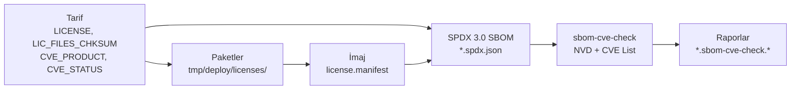

# 16 · Lisans uyumu, SPDX ve CVE

<div class="kunye" markdown>
<span>Süre: ~55 dk + uygulama</span><span>Düzey: İleri</span><span>Ön koşul: Bölüm 6, 7, 9</span>
</div>

!!! hedef "Öğrenme hedefleri"
    Bu bölümün sonunda:

    - `LICENSE` ifadelerini SPDX kimlikleriyle doğru biçimde yazabilir ve okuyabilirsiniz.
    - `INCOMPATIBLE_LICENSE` ve `LICENSE_FLAGS_ACCEPTED` ile bir lisans politikası uygulayabilirsiniz.
    - Lisans manifestosunu, lisans metinlerini ve kaynak arşivlerini üretebilirsiniz.
    - SPDX 3.0 SBOM'unun içeriğini ve 6.0 ile gelen PURL, tedarikçi ve sonuç lisansı alanlarını açıklayabilirsiniz.
    - `sbom-cve-check` ile güvenlik açığı taraması yapabilir, sonuçları `CVE_STATUS` ile kayıt altına alabilirsiniz.
    - AB Siber Dayanıklılık Yasası'nın (CRA) Yocto tabanlı ürünlere etkisini üst düzeyde değerlendirebilirsiniz.

## 16.1 Ürünleştirmede üç soru

Bir imaj sahaya çıkmadan önce kurumun üç soruyu belgeli biçimde yanıtlayabilmesi gerekir:

1. **İmajda hangi bileşenler, hangi sürümlerle bulunmaktadır?** Yanıt, yazılım malzeme listesidir (SBOM).
2. **Bu bileşenlerin lisansları hangi yükümlülükleri doğurmaktadır?** Kaynak kodu sunma, lisans metnini
   ekleme veya belirli lisansları hiç kullanmama gibi.
3. **Bileşenlerde bilinen güvenlik açıkları var mıdır ve her biri için hangi karar verilmiştir?**

Yocto bu yanıtları derleme sırasında tariflerdeki meta veriden üretir; bu nedenle bilgi imajla tutarlıdır:



## 16.2 `LICENSE` ifadeleri

`LICENSE` değişkeni tarifin **kaynak kodunun** lisansını SPDX kimlikleriyle bildirir. Kimlikler
OE-Core'daki `meta/files/common-licenses/` dizinindeki dosya adlarıyla aynıdır (`MIT`, `Apache-2.0`,
`GPL-2.0-only`, `GPL-2.0-or-later`, `LGPL-2.1-or-later` vb.).

| İfade | Anlamı |
|---|---|
| `LICENSE = "MIT"` | Kaynağın tamamı MIT lisanslıdır. |
| `LICENSE = "GPL-2.0-only & BSD-3-Clause"` | Kaynağın **farklı bölümleri** farklı lisanslıdır; her ikisinin yükümlülükleri geçerlidir. |
| `LICENSE = "LGPL-2.1-only \| GPL-3.0-only"` | Kaynak iki lisanstan **biri seçilerek** kullanılabilir. |
| `LICENSE = "MIT & (GPL-2.0-only \| BSD-2-Clause)"` | Parantezle gruplama yapılabilir. |
| `LICENSE:${PN}-tools = "GPL-2.0-only"` | Paket bazında daraltma; paket lisansı tarif lisansının bir alt kümesi olmalıdır. |
| `LICENSE = "CLOSED"` | Kurum içi, kapalı kaynak bileşen; lisans metni sağlaması aranmaz. |

Lisans metninin değişmediği `LIC_FILES_CHKSUM` ile denetlenir ([Bölüm 6](06-tarifler.md)); yukarı akışta
metin değiştiğinde sağlama tutmaz ve derleme durur. Bu, lisans değişikliğinin fark edilmesini sağlayan
bir denetimdir.

!!! dikkat "Eski lisans adları"
    `GPLv2`, `GPL-2.0` veya `LGPLv2.1` gibi eski yazımlar geçerli SPDX kimlikleri değildir. Bu adlar kalite
    denetiminde `obsolete-license` hatası üretir; `INCOMPATIBLE_LICENSE` içinde kullanıldıklarında derleme
    doğrudan durur. Eski katmanlar uyarlanırken lisans adları `-only` veya `-or-later` biçimine
    dönüştürülmelidir.

## 16.3 Lisans politikası: `INCOMPATIBLE_LICENSE`

Pek çok kurum, ürün imajlarında GPLv3 ailesi lisansları kullanmama politikası izler. Bu politika
`INCOMPATIBLE_LICENSE` ile uygulanır. Değişken **imaj düzeyinde** tanımlandığında derleme kısıtlanmaz;
denetim yalnızca imajın kök dosya sistemi paketlerden oluşturulurken yapılır:

```bitbake
# Yalnızca ornek-image için geçerli politika
INCOMPATIBLE_LICENSE:pn-ornek-image = "GPL-3.0* LGPL-3.0* AGPL-3.0*"

# Belirli bir paket için bilinçli istisna (paket:lisans)
INCOMPATIBLE_LICENSE_EXCEPTIONS:pn-ornek-image = "gdbserver:GPL-3.0-only"
```

Joker karakter yalnızca `GPL-3.0*`, `LGPL-3.0*` ve `AGPL-3.0*` için desteklenir ve `-only`/`-or-later`
biçimlerine genişler. Varsayılan imajlardaki GPLv3 bileşenleri azaltan ayarlar OE-Core'daki
`conf/distro/include/no-gplv3.inc` dosyasında toplanmıştır; bu dosya dağıtım yapılandırmasına `require`
ile eklenebilir.

!!! dikkat "`INCOMPATIBLE_LICENSE` değişkeninin genel tanımlanması"
    Değişken `:pn-` koşulu olmadan, genel olarak tanımlanırsa listelenen lisanslara sahip tarifler hiç
    derlenmez. Derleme araçlarının bir kısmı GPLv3 lisanslı olduğundan bu kullanım genellikle derlemenin
    tamamlanamamasıyla sonuçlanır. Resmî belgelerde önerilen yöntem, kısıtlamanın imaj tarifine veya
    `:pn-<imaj>` koşuluyla uygulanmasıdır.

## 16.4 Ticari bileşenler: `LICENSE_FLAGS`

Bazı tarifler, kullanımı ayrıca kabul gerektiren koşullar taşır (patent içeren kodekler, üretici
sözleşmeleri vb.). Bu tarifler `LICENSE_FLAGS` ile işaretlenir ve kabul edilmedikçe derlenmez:

```bitbake
# Tarifte (ör. OE-Core'daki ffmpeg tarifi)
LICENSE_FLAGS = "commercial"
```

```bitbake
# Dağıtım yapılandırmasında bilinçli kabul
LICENSE_FLAGS_ACCEPTED = "commercial_ffmpeg"
```

BitBake, tarifteki bayrağı tarif adıyla genişletir (`commercial` → `commercial_ffmpeg`) ve
`LICENSE_FLAGS_ACCEPTED` içindeki girdilerle eşleştirir. `commercial` girdisi `commercial` ile başlayan
**tüm** bayrakları kabul eder; `commercial_ffmpeg` yalnızca bu tarifi kabul eder. Kabul edilmeyen tarifler
atlanır; bir bağımlılık olarak istendiklerinde BitBake, `restricted license ... not listed in your
LICENSE_FLAGS_ACCEPTED` gerekçesini bildirir.

!!! iyi "Kabul kararlarının kayıt altına alınması"
    `LICENSE_FLAGS_ACCEPTED` değişkenine her zaman tarif bazında, en dar biçimde girdi yazılmalıdır.
    Genel `commercial` girdisi, ileride katmanlara eklenen ve hukuk biriminin değerlendirmediği bileşenleri
    de kabul eder. Her girdinin dağıtım yapılandırmasında bir açıklama satırı ve karar tarihiyle birlikte
    tutulması denetimleri kolaylaştırır.

## 16.5 Lisans çıktıları ve kaynak arşivleme

Her tarifin `do_populate_lic` görevi, lisans metinlerini paket mimarisine göre ayrılmış bir dizine
kopyalar. İmaj oluşturulurken bu bilgiler bir manifestoda birleştirilir:

```text
tmp/deploy/licenses/
├── x86-64-v3/sensor-oku/            # tarifin lisans metinleri (generic_MIT, recipeinfo)
└── qemux86_64/
    ├── ornek-image-qemux86-64.rootfs-<tarih>/
    │   ├── license.manifest          # imajdaki paketler, sürümleri ve lisansları
    │   └── image_license.manifest    # önyükleme dosyaları gibi paket dışı çıktılar
    └── ornek-image-qemux86-64.rootfs -> ...-<tarih>/   # son derlemeye bağlantı
```

Lisans metinlerinin cihaz üzerinde de bulunması gerektiğinde şu değişkenler kullanılır:

| Değişken | Etkisi |
|---|---|
| `COPY_LIC_MANIFEST = "1"` | Manifesto imaja `/usr/share/common-licenses/license.manifest` olarak kopyalanır. |
| `COPY_LIC_DIRS = "1"` | Paketlerin lisans metinleri de `/usr/share/common-licenses/` altına kopyalanır (`COPY_LIC_MANIFEST` ile birlikte). |
| `LICENSE_CREATE_PACKAGE = "1"` | Her paket için ayrı bir `-lic` paketi üretilir; paket tabanlı güncellemede lisanslar da güncellenir. |

Kitabın örnek katmanındaki `ornek/urun` parçası ilk iki değişkeni etkinleştirir ([Bölüm 17](17-guvenlik-guncelleme.md)).

Copyleft lisanslar ayrıca **kaynak kodun** sunulmasını gerektirir. `archiver` sınıfı, imaja giren tariflerin
kaynaklarını `tmp/deploy/sources/<TARGET_SYS>/<PF>/` altında toplar:

```bitbake
INHERIT += "archiver"
ARCHIVER_MODE[src] = "original"     # değiştirilmemiş kaynak; diğer değerler "patched" (varsayılan), "configured"
ARCHIVER_MODE[diff] = "1"           # uygulanan yamalar
ARCHIVER_MODE[recipe] = "1"         # .bb ve .inc dosyaları
COPYLEFT_LICENSE_INCLUDE = "GPL* LGPL* AGPL*"   # varsayılan değer; yalnızca bu lisanslar arşivlenir
COPYLEFT_LICENSE_EXCLUDE = "CLOSED Proprietary"
```

!!! iyi "Derleme betiklerinin ve katmanların yayımlanması"
    GPL, kaynakla birlikte onu derlemek için kullanılan betiklerin de sağlanmasını öngörür. Yocto'da bu
    betikler katmanlardır. Ürün sürümünde kullanılan katmanların tam revizyonlarıyla arşivlenmesi
    (`git archive`) ve kaynak arşiviyle birlikte saklanması önerilir. `bitbake-setup` kurulumlarında
    revizyonlar `layers/sources-fixed-revisions.json` dosyasına zaten yazılmaktadır ([Bölüm 18](18-ci.md)).

!!! dikkat "Statik kütüphanelerin lisans izlemesi"
    `license` ve `archiver` sınıfları, imaja yalnızca çalışma bağımlılıkları (`RDEPENDS`, `RRECOMMENDS`)
    üzerinden giren paketleri izler. Bir programa statik olarak bağlanan kütüphane, imajda ayrı bir paket
    olarak bulunmadığından manifestoda ve kaynak arşivinde **görünmez**. Yocto statik kütüphaneleri
    varsayılan olarak devre dışı bırakır; statik bağlama kullanılan ürünlerde bu bileşenlerin
    yükümlülükleri ayrıca değerlendirilmelidir.

## 16.6 SPDX 3.0 SBOM

`create-spdx` sınıfı varsayılan olarak (`INHERIT_DISTRO` üzerinden) etkindir. Bir imaj derlendiğinde
`tmp/deploy/images/<makine>/` altında `ornek-image-qemux86-64.rootfs.spdx.json` dosyası oluşur. Belge
JSON-LD biçimindedir ve şunları içerir: imajdaki paketler ve sürümleri, beyan edilen lisanslar, paketlerin
hangi tariften ve hangi kaynaklardan üretildiği, uygulanan yamalar, bağımlılık ilişkileri ve güvenlik
açığı değerlendirmeleri (VEX).

Tek bir tarifin SBOM'u imaj derlenmeden de üretilebilir:

```bash
bitbake sensor-oku -c create_recipe_sbom
```

SBOM içeriği şu değişkenlerle genişletilir:

| Değişken | Etkisi |
|---|---|
| `SPDX_PRETTY = "1"` | JSON girintili ve okunabilir biçimde yazılır. |
| `SPDX_INCLUDE_SOURCES` / `SPDX_INCLUDE_COMPILED_SOURCES` | Kaynak dosyalarının tamamı veya yalnızca derlenenler belgeye eklenir. |
| `SPDX_INCLUDE_KERNEL_CONFIG = "1"` | Çekirdeğin `CONFIG_*` seçenekleri eklenir (6.0). |
| `SPDX_INCLUDE_PACKAGECONFIG = "1"` | Tariflerin etkin ve devre dışı `PACKAGECONFIG` seçenekleri eklenir (6.0). |
| `SPDX_IMAGE_SUPPLIER_name`, `SPDX_PACKAGE_SUPPLIER_name` | İmajın ve paketlerin tedarikçisi (`suppliedBy`). `_type` ile kuruluş veya kişi belirtilir. |
| `SPDX_PACKAGE_URLS` | Paket URL'leri (PURL). Varsayılan değer `pkg:yocto/<katman>/<tarif>@<sürüm>` biçiminde otomatik üretilir. |
| `SPDX_CONCLUDED_LICENSE` | Lisans incelemesi sonucunda **varılan** lisans (`hasConcludedLicense`, 6.0). |

`LICENSE` yukarı akışın **beyan ettiği**, `SPDX_CONCLUDED_LICENSE` ise kurumun incelemesi sonucunda
**vardığı** lisanstır; ikincisi yalnızca böyle bir inceleme yapıldığında tanımlanır. Farklılık bulunduğunda
önce tarifteki `LICENSE` değerinin düzeltilip yukarı akışa gönderilmesi önerilir.

Örnek katmandaki `ornek/sbom` parçası tedarikçi bilgisini ve okunabilir çıktıyı etkinleştirir:

```bitbake title="examples/meta-ornek/conf/fragments/sbom.conf (özet)"
SPDX_PRETTY = "1"
SPDX_INCLUDE_PACKAGECONFIG = "1"
SPDX_IMAGE_SUPPLIER_name = "Örnek Kurum"
SPDX_IMAGE_SUPPLIER_type = "organization"
SPDX_PACKAGE_SUPPLIER_name:pn-sensor-oku = "Örnek Kurum"
SPDX_PACKAGE_SUPPLIER_type:pn-sensor-oku = "organization"
SBOM_CVE_CHECK_EXPORT_VARS:append = " SBOM_CVE_CHECK_EXPORT_SUMMARY"
```

!!! info ":material-history: Önceki sürümlerde: SPDX 2.2"
    5.0 *Scarthgap* ve öncesinde varsayılan çıktı SPDX 2.2 biçimindeydi (`create-spdx-2.2` sınıfı). 6.0
    ile SPDX 2.2 desteği **kaldırılmıştır**; yalnızca SPDX 3.0 üretilir. SPDX 2.2 bekleyen harici araçlar
    için dönüştürme veya araç güncellemesi gerekir. Ayrıca 6.0'da VEX ifadeleri artık her paket belgesinde
    tekrarlanmaz, tarif belgelerinde tutulur; imaj belgesi bunları yine içerir.

## 16.7 Güvenlik açığı taraması: `sbom-cve-check`

6.0'da CVE taraması, imaj SBOM'unu girdi olarak kullanan harici `sbom-cve-check` aracıyla yapılır.
Araç iki veri kaynağı kullanır: NVD verilerinin git deposu biçimindeki aynası ve CVE Project'in
`cvelistV5` deposu. Her iki veritabanı da `-native` tariflerle indirilir. Tarama, önerilen ayarları
içeren parça ile etkinleştirilir:

```bash
bitbake-config-build enable-fragment core/yocto/sbom-cve-check
```

Parça şu ayarları yapar: `sbom-cve-check` sınıfını `IMAGE_CLASSES` değişkenine ekler, veritabanı
tariflerini her derlemede en güncel revizyona (`AUTOREV`) ayarlar, SBOM'a tüm VEX bilgisini ekler
(`SPDX_INCLUDE_VEX = "all"`) ve çekirdek tarifinin derlenen kaynak listesini SBOM'a yazar. İmaj
derlendiğinde `DEPLOY_DIR_IMAGE` altında şu raporlar oluşur:

| Dosya | İçerik |
|---|---|
| `<imaj>.sbom-cve-check.yocto.json` | Paket başına CVE listesi ve durumları; eski `cve-check` biçimiyle uyumlu |
| `<imaj>.sbom-cve-check.spdx.json` | CVE bilgileriyle zenginleştirilmiş SPDX 3.0 belgesi |
| `<imaj>.cve.txt` | İnsan tarafından okunabilir özet (`SBOM_CVE_CHECK_EXPORT_SUMMARY` eklendiğinde) |

Her CVE için durum `Patched`, `Unpatched` veya `Ignored` değerlerinden biridir.
`SBOM_CVE_CHECK_SHOW_WARNINGS = "1"` (varsayılan) olduğunda `Unpatched` durumundaki CVE'ler derleme
sırasında uyarı olarak da gösterilir.

!!! info ":material-history: Önceki sürümlerde: `cve-check` sınıfı"
    5.x ve öncesinde tarama `INHERIT += "cve-check"` ile yapılıyordu. 6.0'da bu sınıf ve veritabanı
    tarifleri (`cve-update-db-native`, `cve-update-nvd2-native`) **kaldırılmıştır**. Geçiş için:

    - `INHERIT += "cve-check"` satırı silinir; yerine `core/yocto/sbom-cve-check` parçası etkinleştirilir.
    - `CVE_CHECK_SHOW_WARNINGS` → `SBOM_CVE_CHECK_SHOW_WARNINGS`.
    - `.cve.txt` özeti artık varsayılan olarak üretilmez; `SBOM_CVE_CHECK_EXPORT_VARS` ile istenir.
    - `CVE_PRODUCT` içindeki özel karakterler artık kaçış karakteriyle yazılmaz (`webkitgtk\+` → `webkitgtk+`).
    - `vex` sınıfının imaj çıktısının uzantısı `.json` yerine `.vex.json` olmuştur.

!!! dikkat "Tarama sonuçları zamana bağlıdır"
    Aynı imaj iki farklı günde taranırsa farklı sonuç alınabilir; çünkü CVE veritabanları sürekli
    güncellenir. Parçanın veritabanı tariflerini `AUTOREV` ile çalıştırması bu nedenle bilinçli bir
    tercihtir ve derleme makinesinin veritabanı depolarına (GitHub) erişmesini gerektirir. İmajın kendisi
    değişmez; değişen yalnızca rapordur. Sahadaki sürümler için arşivlenmiş SBOM'ların düzenli aralıklarla
    yeniden taranması gerekir. `sbom-cve-check` aracı derleme dışında da çalıştırılabilir; bu kullanım için
    aracın kendi belgelerine (sbom-cve-check.readthedocs.io) bakılmalıdır.

Tek bir tarifin, imaj derlenmeden taranması için `sbom-cve-check-recipe` sınıfı kullanılır:
tarife `inherit sbom-cve-check-recipe` eklenir ve `bitbake <tarif> -c sbom_cve_check_recipe`
çalıştırılır.

## 16.8 Değerlendirme kaydı: `CVE_STATUS` ve VEX

Bir tarama raporundaki her `Unpatched` kaydı incelenmeli ve sonuç kayıt altına alınmalıdır. Olası
sonuçlar ve Yocto'daki karşılıkları şunlardır:

| Sonuç | Yöntem | Rapordaki durum |
|---|---|---|
| Yeni sürümde düzeltilmiş | Tarif sürümünün yükseltilmesi | Kayıttan çıkar veya `Patched` |
| Yama ile düzeltildi | `.patch` dosyasının başlığına `CVE: CVE-AAAA-NNNN` etiketi | `Patched` |
| Ürünü etkilemiyor | `CVE_STATUS[CVE-AAAA-NNNN] = "<gerekçe>: <açıklama>"` | Gerekçeye göre `Ignored` veya `Patched` |
| Yanlış eşleşme | `CVE_PRODUCT` (`üretici:ürün`) veya `CVE_VERSION` düzeltmesi | Kayıttan çıkar |

`CVE_STATUS` gerekçeleri `meta/conf/cve-check-map.conf` dosyasında bir duruma eşlenir:

| Gerekçe | Durum | Kullanım |
|---|---|---|
| `backported-patch`, `fixed-version`, `cpe-stable-backport` | `Patched` | Düzeltme başka yoldan alınmıştır |
| `not-applicable-config` | `Ignored` | Etkilenen kod derleme yapılandırmasında yer almaz |
| `not-applicable-platform` | `Ignored` | Açık başka bir platforma (ör. Windows) özgüdür |
| `cpe-incorrect`, `disputed`, `upstream-wontfix` | `Ignored` | Kayıt hatalı, tartışmalı veya yukarı akış düzeltmeyecek |
| `vulnerable-investigating` | `Unpatched` | İnceleme sürmektedir |

Aynı gerekçeyi paylaşan çok sayıda CVE için `CVE_STATUS_GROUPS` kullanılır. OE-Core'un eski ve eksik
kayıtlar için hazırladığı ortak değerlendirmeler `conf/distro/include/cve-extra-exclusions.inc` dosyasıyla
dahil edilebilir.

**VEX** (*Vulnerability Exploitability eXchange*), bir ürünün belirli bir açıktan etkilenip
etkilenmediğini makine tarafından okunabilir biçimde bildiren kayıtlardır. Yocto'da `CVE_STATUS` ile girilen
kararlar SPDX belgesine VEX ilişkileri olarak yazılır; `SPDX_INCLUDE_VEX` değişkeni bu bilginin
kapsamını belirler (`none`, varsayılan `current` veya `all`). Ayrıca `INHERIT += "vex"` ile harici tarama
araçları için ayrı bir `<imaj>.vex.json` dosyası üretilebilir.

!!! iyi "Çekirdek CVE'leri"
    Linux çekirdeği bir CVE Numaralandırma Otoritesi (CNA) olduğundan çekirdek kaynaklı CVE sayısı
    oldukça yüksektir. OE-Core'daki `scripts/contrib/improve_kernel_cve_report.py` betiği, çekirdeğin
    gerçekten derlenen kaynak dosyalarını (`SPDX_INCLUDE_COMPILED_SOURCES:pn-linux-yocto = "1"`, parça
    tarafından etkinleştirilir) çekirdek CNA verileriyle karşılaştırarak yanlış pozitifleri önemli ölçüde
    azaltır. Özel çekirdek tarifleri için OE-Core'daki `contrib/generate-linux-cve-exclusions.py` betiğiyle bir `CVE_STATUS` listesi
    üretilebilir.

## 16.9 AB Siber Dayanıklılık Yasası (CRA) için kontrol listesi

!!! dikkat "Hukuki tavsiye değildir"
    Bu bölüm yalnızca teknik hazırlık amacıyla üst düzey bir özet sunar ve hukuki tavsiye niteliği
    taşımaz. Yükümlülüklerin bir ürüne nasıl uygulanacağı, ürün sınıfı ve kurumun rolü (üretici,
    ithalatçı, dağıtıcı) gibi etkenlere bağlıdır. Kesin bilgi için Tüzük (AB) 2024/2847'nin resmî metni,
    Avrupa Komisyonu'nun yayımladığı rehberler ve hukuk danışmanları esas alınmalıdır.

CRA, AB pazarına arz edilen dijital unsurlu ürünler için siber güvenlik gereksinimleri tanımlar. Tüzük
10 Aralık 2024'te yürürlüğe girmiştir. Aktif olarak istismar edilen açıkların ve ciddi olayların
bildirilmesine ilişkin yükümlülükler 11 Eylül 2026'dan, temel gereksinimlerin büyük bölümü ise 11 Aralık
2027'den itibaren uygulanır. Yocto tabanlı bir ürün için teknik hazırlık şu başlıklarda özetlenebilir:

| CRA beklentisi (özet) | Yocto'daki karşılığı |
|---|---|
| Makine tarafından okunabilir SBOM | `create-spdx` (SPDX 3.0), sürüm başına arşivleme |
| Bilinen istismar edilebilir açık olmadan piyasaya arz | `sbom-cve-check` raporlarının sürüm öncesi incelenmesi |
| Açık değerlendirmelerinin belgelenmesi | `CVE_STATUS` gerekçeleri, VEX çıktıları |
| Güvenli varsayılan yapılandırma | Parolasız root ve hata ayıklama özelliklerinin ürün imajından çıkarılması ([Bölüm 17](17-guvenlik-guncelleme.md)) |
| Destek süresi boyunca güvenlik güncellemesi | LTS sürüm seçimi, güncelleme mekanizması ([Bölüm 17](17-guvenlik-guncelleme.md)) |
| Sürekli açık izleme ve bildirim süreci | Arşivlenmiş SBOM'ların periyodik taraması, CI ([Bölüm 18](18-ci.md)) |
| Teknik dokümantasyon ve izlenebilirlik | Katman revizyonları, `buildhistory`, tekrarlanabilir derleme ([Bölüm 18](18-ci.md)) |

Yocto 6.0'ın dört yıllık LTS destek süresi ürünün destek süresinden kısa olabilir. Bu durumda bir sonraki
LTS sürüme geçiş planı veya uzatılmış destek seçenekleri ürün planlamasının parçası olmalıdır.

## 16.10 Uygulama

!!! lab "Uygulama 16.1 · SBOM, CVE raporu ve lisans manifestosunun üretilmesi"
    Örnek katmanın eklendiği kurulumda ([Bölüm 6](06-tarifler.md)) parçalar etkinleştirilir ve imaj
    derlenir. İlk derlemede CVE veritabanları indirildiğinden işlem uzun sürebilir.

    ```bash
    source ~/bitbake-builds/<kurulum-adı>/build/init-build-env
    bitbake-config-build enable-fragment ornek/sbom core/yocto/sbom-cve-check
    bitbake ornek-image
    ```

    Çıktılar listelenir:

    ```bash
    ls tmp/deploy/images/qemux86-64/ | grep -E "rootfs\.(spdx|sbom-cve-check|cve)"
    ```

    ```text
    ornek-image-qemux86-64.rootfs.cve.txt
    ornek-image-qemux86-64.rootfs.sbom-cve-check.spdx.json
    ornek-image-qemux86-64.rootfs.sbom-cve-check.yocto.json
    ornek-image-qemux86-64.rootfs.spdx.json
    ```

    `sensor-oku` paketinin PURL değeri SBOM'dan okunur (`jq` paketi gereklidir):

    ```bash
    jq -r '."@graph"[] | select(.type == "software_Package" and .name == "sensor-oku")
           | .software_packageUrl // empty' \
       tmp/deploy/images/qemux86-64/ornek-image-qemux86-64.rootfs.spdx.json | sort -u
    ```

    ```text
    pkg:yocto/ornek/sensor-oku@1.0
    ```

    PURL'deki `ornek`, katmanın koleksiyon adıdır (`BBFILE_COLLECTIONS`). İncelenmesi gereken CVE sayısı
    şöyle bulunur:

    ```bash
    jq '[.package[].issue[] | select(.status == "Unpatched")] | length' \
       tmp/deploy/images/qemux86-64/ornek-image-qemux86-64.rootfs.sbom-cve-check.yocto.json
    ```

    Sonuç bir sayıdır ve tarama tarihine göre değişir. Son olarak lisans manifestosunda örnek tarifin
    kaydı doğrulanır:

    ```bash
    grep -A3 "PACKAGE NAME: sensor-oku$" \
       tmp/deploy/licenses/qemux86_64/ornek-image-qemux86-64.rootfs/license.manifest
    ```

    ```text
    PACKAGE NAME: sensor-oku
    PACKAGE VERSION: 1.0
    RECIPE NAME: sensor-oku
    LICENSE: MIT
    ```

!!! lab "Uygulama 16.2 · GPLv3 politikasının denetlenmesi"
    Bu uygulama ürün yapılandırmasıyla yapılmalıdır. Bölüm 13'te etkinleştirilen geliştirici parçası
    `tools-debug` özelliği üzerinden GPLv3 lisanslı gdb/gdbserver paketlerini imaja eklediğinden önce
    devre dışı bırakılır:

    ```bash
    bitbake-config-build disable-fragment ornek/gelistirici
    ```

    Ardından `build/conf/local.conf` dosyasının sonuna politika ve OE-Core'un hazır ayarları eklenir:

    ```bitbake
    INCOMPATIBLE_LICENSE:pn-ornek-image = "GPL-3.0* LGPL-3.0*"
    require conf/distro/include/no-gplv3.inc
    ```

    ```bash
    bitbake ornek-image
    grep -c "LICENSE: .*GPL-3.0" \
       tmp/deploy/licenses/qemux86_64/ornek-image-qemux86-64.rootfs/license.manifest
    ```

    **Beklenen sonuç:** Derleme tamamlanır ve `grep` komutu `0` yazdırır. İmaja GPLv3 lisanslı bir paket
    girerse `do_rootfs` görevi `Some packages cannot be installed into the image because they have
    incompatible licenses` iletisiyle durur ve paketleri lisanslarıyla birlikte listeler. Bu durumda
    paketi imaja çeken bağımlılık bulunmalı ve kaldırılmalı ya da bilinçli bir istisna tanımlanmalıdır.
    Uygulamadan sonra eklenen iki satır silinir.

## Özet

- `LICENSE` SPDX kimlikleriyle yazılır: `&` birlikte geçerli lisansları, `|` seçimlik lisansları ifade eder.
- Lisans politikası imaj düzeyinde `INCOMPATIBLE_LICENSE:pn-<imaj>` ile uygulanır; ticari bileşenler
  `LICENSE_FLAGS_ACCEPTED` ile tarif bazında kabul edilir.
- Lisans manifestosu `tmp/deploy/licenses/` altında üretilir; kaynak arşivi için `archiver` sınıfı kullanılır.
- SBOM varsayılan olarak SPDX 3.0 biçiminde üretilir; 6.0 ile PURL, tedarikçi, `PACKAGECONFIG` ve sonuç
  lisansı bilgileri eklenebilir. SPDX 2.2 kaldırılmıştır.
- CVE taraması `core/yocto/sbom-cve-check` parçasıyla yapılır; `cve-check` sınıfı 6.0'da kaldırılmıştır.
- Her `Unpatched` kayıt incelenir ve sonuç yama, sürüm yükseltme veya `CVE_STATUS` ile kayıt altına alınır.
- CRA, SBOM, açık yönetimi ve güncelleme süreçlerini yasal bir beklenti haline getirmektedir.

## Değerlendirme soruları

<div class="quiz" data-id="b16-1">
<p class="quiz-soru">Ürün imajında GPLv3 bileşen bulunmaması isteniyor; derleme araçlarının kısıtlanması ise istenmiyor. Doğru tanım hangisidir?</p>
<ul>
<li><code>INCOMPATIBLE_LICENSE = "GPL-3.0*"</code> satırının koşulsuz olarak <code>local.conf</code> dosyasına eklenmesi</li>
<li data-dogru><code>INCOMPATIBLE_LICENSE:pn-ornek-image = "GPL-3.0* LGPL-3.0*"</code></li>
<li><code>LICENSE_FLAGS_ACCEPTED = "GPL-2.0-only"</code></li>
<li><code>COPYLEFT_LICENSE_EXCLUDE = "GPL-3.0*"</code></li>
</ul>
<p class="quiz-aciklama">Koşulsuz tanım, listelenen lisanslara sahip tüm tariflerin derlenmesini engeller ve çoğu zaman derlemeyi
tamamlanamaz hale getirir. İmaj koşuluyla tanımlandığında denetim yalnızca kök dosya sistemi oluşturulurken yapılır.
<code>COPYLEFT_LICENSE_*</code> yalnızca kaynak arşivlemeyi etkiler.</p>
</div>

<div class="quiz" data-id="b16-2">
<p class="quiz-soru"><code>LICENSE = "GPL-2.0-only &amp; BSD-3-Clause"</code> ifadesi neyi bildirir?</p>
<ul>
<li>Kullanıcı iki lisanstan birini seçebilir</li>
<li data-dogru>Kaynağın farklı bölümleri farklı lisanslıdır; her iki lisansın yükümlülükleri birlikte geçerlidir</li>
<li>Paket GPL-2.0, kaynak BSD-3-Clause lisanslıdır</li>
<li>İfade geçersizdir; tek lisans yazılmalıdır</li>
</ul>
<p class="quiz-aciklama"><code>&amp;</code> birlikte geçerli lisansları, <code>|</code> seçimlik lisansları ifade eder. Paket bazında farklı lisans
bildirmek için <code>LICENSE:${PN}-paket</code> biçimi kullanılır.</p>
</div>

<div class="quiz" data-id="b16-3">
<p class="quiz-soru">5.0 tabanlı bir projede <code>INHERIT += "cve-check"</code> satırı bulunmaktadır. Proje 6.0'a taşınırken ne yapılmalıdır?</p>
<ul>
<li>Satır olduğu gibi bırakılır; sınıf geriye dönük uyumludur</li>
<li><code>INHERIT += "sbom-cve-check"</code> yazılır</li>
<li data-dogru>Satır kaldırılır ve <code>core/yocto/sbom-cve-check</code> parçası etkinleştirilir</li>
<li><code>INHERIT += "vex"</code> yazılır; VEX, CVE taramasının yerini almıştır</li>
</ul>
<p class="quiz-aciklama"><code>cve-check</code> sınıfı 6.0'da kaldırılmıştır. Parça, <code>sbom-cve-check</code> sınıfını <code>IMAGE_CLASSES</code>
değişkenine ekler ve veritabanı, VEX ve çekirdek kaynakları için önerilen ayarları birlikte yapar.</p>
</div>

<div class="quiz" data-id="b16-4">
<p class="quiz-soru">Bir CVE'nin etkilediği sürücü, ürünün çekirdek yapılandırmasında derlenmemektedir. Bu karar nasıl kaydedilir?</p>
<ul>
<li>CVE kimliği tarif adına eklenir</li>
<li data-dogru><code>CVE_STATUS[CVE-AAAA-NNNN] = "not-applicable-config: ..."</code></li>
<li><code>SBOM_CVE_CHECK_SHOW_WARNINGS = "0"</code></li>
<li><code>CVE_PRODUCT</code> boş bırakılır</li>
</ul>
<p class="quiz-aciklama"><code>not-applicable-config</code> gerekçesi <code>Ignored</code> durumuna eşlenir ve VEX çıktısında
"vulnerableCodeNotPresent" gerekçesiyle yer alır. Uyarıların kapatılması kararı kayıt altına almaz; yalnızca gizler.</p>
</div>

<div class="quiz" data-id="b16-5">
<p class="quiz-soru"><code>LICENSE_FLAGS_ACCEPTED = "commercial"</code> tanımının etkisi nedir?</p>
<ul>
<li>Yalnızca adı <code>commercial</code> olan tarif kabul edilir</li>
<li data-dogru><code>LICENSE_FLAGS</code> değeri <code>commercial</code> ile başlayan tüm tarifler kabul edilir</li>
<li>Tüm kapalı kaynak (<code>CLOSED</code>) tarifler kabul edilir</li>
<li>GPLv3 lisanslı tarifler kabul edilir</li>
</ul>
<p class="quiz-aciklama">Bayrak tarif adıyla genişletilir (<code>commercial_ffmpeg</code>) ve önek eşleşmesi yapılır. Genel girdi ileride
eklenecek tarifleri de kabul ettiğinden ürünlerde tarif bazında girdi önerilir.</p>
</div>

!!! alistirma "Alıştırma: Bir CVE değerlendirmesinin kayda geçirilmesi"
    Uygulama 16.1'de üretilen `.sbom-cve-check.yocto.json` raporundaki `Unpatched` kayıtlardan biri
    seçilsin ve incelemede bu açığın ürünün derlemediği bir özelliğe ait olduğunun belirlendiği varsayılsın.

    1. Raporda en az bir `Unpatched` kaydı bulunan tarifleri ve bu kayıtların kimliklerini listeleyin.
    2. Seçilen kimlik için kararı, gerekçesiyle birlikte `meta-ornek` katmanında kayıt altına alın.
    3. İmajı yeniden derleyerek kaydın durumunun değiştiğini doğrulayın.

    ??? success "Örnek çözüm"
        Rapordaki `name` alanı tarif adıdır (`PN`):

        ```bash
        RAPOR=tmp/deploy/images/qemux86-64/ornek-image-qemux86-64.rootfs.sbom-cve-check.yocto.json
        jq -r '.package[] | .name as $t | .issue[]
               | select(.status == "Unpatched") | "\($t) \(.id)"' "$RAPOR" | sort
        ```

        Seçilen tarif için `meta-ornek` içinde, tarifin kategorisine uygun bir dizinde
        `<tarif>_%.bbappend` dosyası oluşturulur (kimlik rapordaki değerle değiştirilir):

        ```bitbake
        # Değerlendirme: 2026-11-01, güvenlik ekibi. Etkilenen özellik ürün yapılandırmasında derlenmiyor.
        CVE_STATUS[CVE-AAAA-NNNN] = "not-applicable-config: Etkilenen özellik ürün yapılandırmasında derlenmez"
        ```

        ```bash
        bitbake-layers show-appends | grep -A1 "<tarif>"     # ek uygulanıyor mu?
        bitbake ornek-image
        jq -r '.package[].issue[] | select(.id == "CVE-AAAA-NNNN") | .status' "$RAPOR"
        ```

        Beklenen çıktı `Ignored` değeridir. Gerekçe metni rapora ve SPDX belgesindeki VEX kaydına taşınır.
        Kararın tarihi ve sorumlusu tarif ekinde açıklama olarak tutulmalıdır. Yukarı akış veritabanındaki
        hatalı kayıtlar için düzeltmenin NVD'ye bildirilmesi önerilir.

**Sonraki bölüm:** [17 · Güvenlik ve sahada güncelleme →](17-guvenlik-guncelleme.md)
