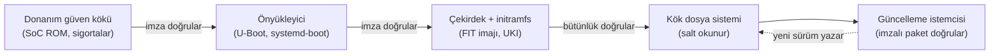
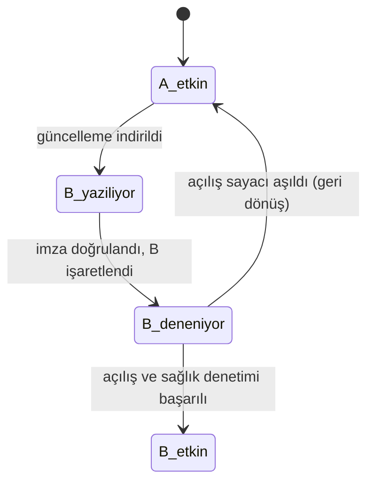

# 17 · Güvenlik ve sahada güncelleme

<div class="kunye" markdown>
<span>Süre: ~55 dk + uygulama</span><span>Düzey: İleri</span><span>Ön koşul: Bölüm 9–12, 16</span>
</div>

!!! hedef "Öğrenme hedefleri"
    Bu bölümün sonunda:

    - Bir ürün imajındaki güvenli varsayılanları denetleyebilir ve geliştirme özelliklerini ayırabilirsiniz.
    - Güvenli önyüklemedeki imza zincirini ve Yocto'daki U-Boot ve UEFI karşılıklarını açıklayabilirsiniz.
    - Salt okunur kök dosya sistemi ile ayrı veri bölümü tasarlayabilirsiniz.
    - A/B güncelleme mimarisini ve geri dönüş mekanizmasını açıklayabilirsiniz.
    - SWUpdate, RAUC ve Mender arasında ürün gereksinimlerine göre seçim yapabilirsiniz.
    - Paket tabanlı güncellemenin uygun olduğu ve olmadığı durumları ayırt edebilirsiniz.
    - 6.0'daki OpenSSL TLS değişikliğinin etkisini değerlendirebilirsiniz.

## 17.1 Katmanlı savunma

Sahadaki bir cihazın güvenliği tek bir ayara bağlı değildir. Her aşama bir sonrakinin güvenilirliğini
denetlediğinde bir **güven zinciri** (*chain of trust*) oluşur:



Zincirin herhangi bir halkası eksikse, sonraki halkalardaki önlemler atlatılabilir. Örneğin imzasız bir
çekirdek kabul eden önyükleyici, salt okunur kök dosya sisteminin sağladığı korumayı anlamsız kılar.
Bu bölüm zincirin Yocto ile oluşturulan halkalarını sırasıyla ele alır. Donanım güven kökü (anahtar
sigortaları, ROM doğrulaması) üreticiye özgüdür ve BSP katmanının kapsamındadır ([Bölüm 10](10-makine-bsp.md)).

## 17.2 Güvenli varsayılanlar

Yocto 6.0'da imajlar varsayılan olarak **root girişi kapalı** biçimde üretilir. Geliştirme sırasında
parolasız giriş gerektiğinde `core/yocto/root-login-with-empty-password` parçası etkinleştirilir; bu
parça `allow-empty-password`, `empty-root-password` ve `allow-root-login` imaj özelliklerini ekler.
Ürün imajı için temel ilke şudur: **geliştirme kolaylıkları ayrı parçalarda tutulur ve ürün
yapılandırmasında yer almaz.**

| Kontrol | Ürün imajındaki beklenen durum |
|---|---|
| `IMAGE_FEATURES` | `allow-empty-password`, `empty-root-password`, `allow-root-login`, `serial-autologin-root`, `tools-debug` gibi geliştirme özellikleri yok |
| Kullanıcılar | Her cihazda aynı olan sabit parola yok; mümkünse yalnızca anahtar tabanlı SSH erişimi |
| Ağ servisleri | Yalnızca ürün işlevi için gereken servisler dinliyor |
| Derleyici bayrakları | `security_flags.inc` etkin (yığın koruması, `_FORTIFY_SOURCE`, PIE, RELRO vb.) |
| Hata ayıklama | `gdbserver`, `strace` gibi araçlar ve hata ayıklama sembolleri imajda yok |

Ek kullanıcılar ve parolalar `extrausers` sınıfı ve `EXTRA_USERS_PARAMS` değişkeniyle tanımlanır.
Resmî belgeler, tüm cihazlarda aynı olan sabit bir parolanın güvenlik açısından uygun olmadığını ve bazı
yargı bölgelerinde yasal olarak kabul edilmeyebileceğini vurgular. Cihaza özgü kimlik bilgileri
derleme sırasında değil, üretim hattında veya ilk açılışta oluşturulmalıdır.

!!! info ":material-history: Önceki sürümlerde: `security_flags.inc`"
    5.x ve öncesinde güvenlik derleyici bayraklarının etkinleştirilmesi için dağıtım yapılandırmasına
    `require conf/distro/include/security_flags.inc` satırının eklenmesi gerekiyordu (Poky bunu kendisi
    yapıyordu). 6.0'da bu dosya OE-Core'un varsayılan dağıtım ayarlarına (`defaultsetup.conf`) dahil
    edilmiştir; `nodistro` ve Poky tabanlı tüm dağıtımlarda etkindir. Eski `debug-tweaks` imaj özelliği
    ise 5.2 sürümünde kaldırılmış ve yerini yukarıdaki üç ayrı özelliğe ve `post-install-logging`
    özelliğine bırakmıştır.

Ek sertleştirme araçları ayrı katmanlarda bulunur. `meta-security` katmanı güvenlik denetim araçları,
TPM desteği ve bütünlük ölçümü (IMA/EVM) gibi bileşenler için tarifler ve alt katmanlar içerir;
`meta-selinux` ise SELinux zorunlu erişim denetimini sağlar. Bu katmanların içeriği zaman içinde
değiştiğinden, kullanılacak bileşenler katmanın `wrynose` dalındaki belgelerden doğrulanmalıdır.

## 17.3 6.0'da OpenSSL ve TLS 1.0/1.1

!!! info ":material-history: Önceki sürümlerde: TLS 1.0 ve 1.1"
    5.x sürümlerinde OpenSSL, TLS 1.0 ve 1.1 protokolleri derlenmiş olarak gelirdi; kullanılıp
    kullanılmamaları yapılandırmaya bağlıydı. 6.0'da `openssl` tarifi bu protokolleri **varsayılan olarak
    derleme dışında bırakır** (`no-tls1`, `no-tls1_1`). Aynı sürümde OpenSSL'in `legacy` sağlayıcısı için
    de bir `PACKAGECONFIG` seçeneği eklenmiş ve varsayılan olarak kapatılmıştır; `python3-cryptography`
    tarifinin `legacy-openssl` özelliği de varsayılan olarak devre dışıdır.

Bu değişiklik, yalnızca eski protokolleri destekleyen saha cihazlarıyla (eski PLC'ler, endüstriyel ağ
geçitleri, eski web arayüzleri) iletişim kuran ürünleri etkileyebilir. Etkin seçenekler şöyle
doğrulanır:

```bash
bitbake-getvar -r openssl --value PACKAGECONFIG_CONFARGS
```

```text
 disable-devcryptoeng no-legacy no-tls1 no-tls1_1
```

Eski protokollerin zorunlu olduğu durumda tercih edilecek yol karşı tarafın güncellenmesidir. Bu mümkün
değilse, gerekçesi belgelenerek kurum katmanında bir tarif ekiyle protokoller yeniden etkinleştirilebilir:

```bitbake title="meta-ornek/recipes-connectivity/openssl/openssl_%.bbappend (yalnızca zorunlu durumda)"
# Gerekçe: saha cihazı X yalnızca TLS 1.1 destekliyor. Kaldırılma hedefi: ürün sürümü 2.0
PACKAGECONFIG:append = " tls1_1"
```

!!! dikkat "Kütüphane düzeyinde etkinleştirme tüm uygulamaları etkiler"
    `PACKAGECONFIG` değişikliği OpenSSL kütüphanesini kullanan tüm programların eski protokolleri
    kullanabilmesine olanak tanır. Etkinin sınırlanması için protokol sürümü uygulama yapılandırmasında
    açıkça kısıtlanmalıdır. 6.0'da OpenSSL, `${sysconfdir}/ssl/openssl.cnf.d/` dizinine kurulan yapılandırma
    parçalarını da okur; sistem genelindeki ayarlar bu dizin üzerinden yönetilebilir.

## 17.4 Güvenli önyükleme ve imza zinciri

**U-Boot doğrulanmış önyükleme (verified boot).** Çekirdek, aygıt ağacı ve initramfs bir FIT (*Flattened
Image Tree*) imajında birleştirilir ve özel anahtarla imzalanır. Açık anahtar U-Boot'un aygıt ağacına
gömülür; U-Boot imzası doğrulanamayan FIT imajını yüklemez. 6.0'da FIT imajı, `kernel-fit-image` sınıfını
kullanan ayrı bir tarifle (`linux-yocto-fitimage`) üretilir:

```bitbake title="Makine yapılandırması (örnek)"
KERNEL_CLASSES += "kernel-fit-extra-artifacts"
UBOOT_SIGN_ENABLE = "1"                     # FIT imzalama ve açık anahtarın U-Boot'a eklenmesi
UBOOT_SIGN_KEYDIR = "/guvenli/anahtarlar"   # dev.key ve dev.crt dosyalarının dizini
UBOOT_SIGN_KEYNAME = "dev"
FIT_HASH_ALG = "sha256"
```

**UEFI Secure Boot.** UEFI tabanlı x86-64 ve Arm64 sistemlerde firmware, önyükleyiciyi kayıtlı
sertifikalarla doğrular. OE-Core'daki `uki` sınıfı çekirdek, initramfs ve komut satırını tek bir
*Unified Kernel Image* (UKI) dosyasında birleştirir ve `UKI_SB_KEY`/`UKI_SB_CERT` tanımlandığında bu dosyayı
imzalar. Bu yöntem `systemd-boot` ve bir initramfs gerektirir; örnek bölümleme için OE-Core'daki
`efi-uki-bootdisk.wks.in` dosyasına bakılabilir.

!!! dikkat "Anahtarların derleme deposunda tutulması"
    `FIT_GENERATE_KEYS = "1"` derleme sırasında anahtar üretir ve yalnızca deneme amaçlıdır. Ürün
    anahtarları katman deposunda veya CI çalıştırıcısının diskinde açık biçimde tutulmamalıdır.
    Kurumsal uygulamada imzalama, erişimi sınırlı bir imzalama sunucusunda veya donanım güvenlik modülünde
    (HSM) yapılır; anahtar kaybı ya da sızması durumunda cihazlardaki açık anahtarın nasıl
    değiştirileceği (anahtar iptali) tasarım aşamasında planlanmalıdır.

Tedarik zincirinin derleme tarafında da imza kullanılabilir. Paylaşılan sstate nesneleri GPG ile
imzalanabilir ve tüketen derlemelerde doğrulanabilir (`SSTATE_SIG_KEY`, `SSTATE_VERIFY_SIG`,
`SSTATE_VALID_SIGS`). Bu, ağ üzerinden paylaşılan bir önbelleğe yetkisiz nesne eklenmesini önler
([Bölüm 15](15-sstate.md)).

## 17.5 Salt okunur kök dosya sistemi ve veri bölümü

Salt okunur kök dosya sistemi, sistem dosyalarının çalışma sırasında değiştirilmesini önler, ani güç
kesintilerinde dosya sistemi bozulması riskini azaltır ve güncellemelerde sistemin bilinen bir durumda
kalmasını sağlar. Özellik `read-only-rootfs` imaj özelliğiyle etkinleştirilir. Bu durumda tüm paket
kurulum sonrası betikleri (`pkg_postinst`) imaj oluşturulurken çalıştırılmalıdır; ilk açılışa bırakılan bir
betik varsa derleme durur. Bu davranış, hatanın sahada değil derleme sırasında ortaya çıkmasını sağlar.

Kalıcı yazılması gereken veriler için tipik bölüm düzeni şöyledir:

| Bölüm | İçerik | Bağlama |
|---|---|---|
| `boot` | Önyükleyici, çekirdek veya UKI | Salt okunur veya bağlanmaz |
| `rootfs-A`, `rootfs-B` | Sistem; biri etkin, diğeri güncelleme hedefi | Salt okunur |
| `data` | Yapılandırma, günlükler, uygulama verileri | Okuma-yazma, güncellemede korunur |

`/etc` altında cihaza özgü değişiklik gerektiğinde `overlayfs-etc` imaj özelliği `/etc` dizinini veri
bölümü üzerinde bir overlayfs ile bağlar (`OVERLAYFS_ETC_MOUNT_POINT`, `OVERLAYFS_ETC_DEVICE`,
`OVERLAYFS_ETC_FSTYPE`). 6.0'da OpenSSH için salt okunur sistemlerde ana makine anahtarlarının konumu
`OPENSSH_HOST_KEY_DIR_READONLY_CONFIG` ile ayrıca belirlenebilir.

Örnek katmandaki `ornek/urun` parçası ürün yapılandırmasının başlangıç noktasıdır:

```bitbake title="examples/meta-ornek/conf/fragments/urun.conf (özet)"
EXTRA_IMAGE_FEATURES += "read-only-rootfs"
IMAGE_CLASSES += "image-buildinfo"     # /etc/buildinfo: dağıtım sürümü ve katman revizyonları
COPY_LIC_MANIFEST = "1"
COPY_LIC_DIRS = "1"
```

## 17.6 Güncelleme mimarileri

Güncelleme mekanizması ilk ürün sürümünden itibaren tasarlanmalıdır. Bölüm düzeni, önyükleyici
yapılandırması ve imzalama anahtarları sahaya çıktıktan sonra değiştirilmesi en zor unsurlardır.

**A/B (simetrik) güncelleme.** İki eşdeğer sistem bölümü bulunur. Güncelleme, çalışmayan bölüme yazılır;
önyükleyiciye bir sonraki açılışta bu bölümü denemesi bildirilir. Yeni sistem başarıyla açılır ve kendini
doğrularsa kalıcı olarak etkinleşir; doğrulama gerçekleşmezse önyükleyici sayaç yoluyla eski bölüme döner:



**Asimetrik (kurtarma sistemi) güncelleme.** Tek bir ana sistem ve küçük bir kurtarma sistemi bulunur.
Güncelleme kurtarma sisteminden yapılır. Depolama alanı kısıtlı cihazlar için uygundur; ancak güncelleme
süresince cihaz hizmet veremez ve kesinti durumunda kurtarma sistemine dönülür.

**Paket tabanlı güncelleme.** Yalnızca değişen paketler bir paket deposundan kurulur (bkz. 17.8).

## 17.7 SWUpdate, RAUC ve Mender

Yocto ekosisteminde yaygın olarak kullanılan üç görüntü tabanlı güncelleme çözümü bulunur. Üçü de
OE-Core'un parçası değildir; her biri kendi katmanıyla gelir:

| | SWUpdate | RAUC | Mender |
|---|---|---|---|
| Katman | `meta-swupdate` | `meta-rauc` | `meta-mender` |
| Güncelleme paketi | `.swu` (cpio arşivi + `sw-description`) | `.raucb` paketi (squashfs + CMS imzası) | `.mender` yapıtı |
| Yapılandırma | `sw-description` içinde betimlenen işleyiciler | Hedefte `system.conf` ile tanımlanan yuvalar (slot) | Katman değişkenleriyle tanımlanan bölüm düzeni |
| Desteklenen düzenler | A/B ve kurtarma sistemiyle tek kopya | A/B ve asimetrik yuvalar | A/B kök dosya sistemi; ek güncelleme modülleri |
| İmza | Desteklenir; şifreleme seçeneği bulunur | Zorunludur (X.509) | Desteklenir |
| Sunucu tarafı | Yerleşik web arayüzü; Eclipse hawkBit entegrasyonu | Kendi sunucusu yok; hawkBit için ayrı istemci | Açık kaynak ve ticari sunucu seçenekleri |
| Lisans (istemci) | GPL-2.0 | LGPL-2.1 | Apache-2.0 |

Seçimde belirleyici olan sorular şunlardır: Ürünün kendi cihaz yönetim altyapısı var mıdır, yoksa hazır bir
sunucu tarafı mı gerekmektedir? Önyükleyici ve bölüm düzeni üzerinde ne ölçüde esneklik gerekir? Kurumun
lisans politikası istemci yazılımıyla uyumlu mudur? Destek ve bakım hangi kaynaktan sağlanacaktır?

!!! iyi "Katman uyumluluğunun doğrulanması"
    Üç katman da Yocto sürümlerine göre ayrı dallar yayımlar. Bir katmanın 6.0 ile kullanılmadan önce
    `wrynose` dalının bulunduğu ve `conf/layer.conf` dosyasındaki `LAYERSERIES_COMPAT` değerinin `wrynose`
    içerdiği doğrulanmalıdır. OpenEmbedded Layer Index ve katmanın kendi belgeleri güncel durumu
    gösterir. Bu kitap, söz konusu katmanların 6.0 uyumluluğu hakkında bir taahhütte bulunmaz.

## 17.8 Paket tabanlı güncelleme

`package-management` imaj özelliği paket yöneticisini (`PACKAGE_CLASSES` değerine göre `dnf`, `opkg`
veya `apt`) ve paket veritabanını imajda tutar. Derleme çıktıları bir paket deposu olarak yayımlanır:

```bash
bitbake package-index            # tmp/deploy/<rpm|ipk|deb>/ altında depo dizinlerini günceller
```

```bitbake
PACKAGE_FEED_URIS = "https://paket.ornek.example"
PACKAGE_FEED_BASE_PATHS = "rpm"
PRSERV_HOST = "localhost:0"      # paket sürümlerinin (PR) tutarlı artması için PR sunucusu
INHERIT += "sign_package_feed"   # depo imzası
PACKAGE_FEED_GPG_NAME = "ornek-paket-anahtari"
PACKAGE_FEED_GPG_PASSPHRASE_FILE = "/guvenli/parola-dosyasi"
```

| Uygun olduğu durumlar | Uygun olmadığı durumlar |
|---|---|
| Laboratuvar ve geliştirme cihazları | Sahada, gözetimsiz çalışan ürün cihazları |
| Sık ve küçük uygulama güncellemeleri | Çekirdek, C kütüphanesi veya init sistemi güncellemeleri |
| Bant genişliğinin çok sınırlı olduğu ortamlar (dikkatli sürüm yönetimiyle) | Atomik güncelleme ve geri dönüş gerektiren ürünler |

Paket güncellemesi atomik değildir: işlem yarıda kesilirse sistem tanımsız bir ara durumda kalabilir. Her
cihazın zamanla farklı paket birleşimlerine sahip olması da test edilen yapılandırma ile sahadaki
yapılandırmanın ayrışmasına yol açar. Bu nedenle ürün cihazlarında görüntü tabanlı güncelleme genellikle
tercih edilir. Ayrıca `package-management` özelliği salt okunur kök dosya sistemiyle birlikte anlamlı
değildir.

## 17.9 Uygulama

!!! lab "Uygulama 17.1 · Ürün yapılandırmasının uygulanması ve doğrulanması"
    Geliştirme parçaları devre dışı bırakılır, ürün parçası etkinleştirilir ve sonuç değişkenler üzerinden
    denetlenir:

    ```bash
    source ~/bitbake-builds/<kurulum-adı>/build/init-build-env
    bitbake-config-build disable-fragment ornek/gelistirici core/yocto/root-login-with-empty-password
    bitbake-config-build enable-fragment ornek/urun
    bitbake-getvar -r ornek-image --value IMAGE_FEATURES
    ```

    ```text
    read-only-rootfs
    ```

    Değişken başka parçalardan gelen özellikler de içeriyorsa çıktıda yer alır; `allow-*`,
    `empty-root-password` ve `tools-debug` bulunmamalıdır. OpenSSL seçenekleri doğrulanır:

    ```bash
    bitbake-getvar -r openssl --value PACKAGECONFIG_CONFARGS | tr ' ' '\n' | grep tls
    ```

    ```text
    no-tls1
    no-tls1_1
    ```

    Ürün imajında oturum açılamadığından, imajın içeriğini QEMU'da incelemek için parolasız giriş
    parçası **yalnızca bu doğrulama için** geçici olarak eklenir:

    ```bash
    bitbake-config-build enable-fragment core/yocto/root-login-with-empty-password
    bitbake ornek-image
    runqemu qemux86-64 nographic snapshot
    ```

    QEMU içinde, `root` olarak oturum açıldıktan sonra:

    ```text
    root@agecidi:~# touch /deneme
    touch: /deneme: Read-only file system
    root@agecidi:~# grep " / " /proc/mounts
    /dev/vda / ext4 ro,relatime 0 0
    root@agecidi:~# cat /etc/buildinfo
    -----------------------
    Build Configuration:  |
    -----------------------
    DISTRO = ornekos
    DISTRO_VERSION = 0.1
    -----------------------
    Layer Revisions:      |
    -----------------------
    meta              = wrynose:<commit>
    ...
    root@agecidi:~# ls /usr/share/common-licenses/ | head -3
    ```

    `/proc/mounts` çıktısındaki aygıt adı farklı olabilir; seçenekler alanının `ro` ile başlaması
    beklenir. Son komut, imaja kopyalanan lisans dizinlerini listeler. Doğrulamadan sonra QEMU kapatılır
    (`poweroff`) ve geçici parça kaldırılır:

    ```bash
    bitbake-config-build disable-fragment core/yocto/root-login-with-empty-password
    ```

## Özet

- Güvenlik bir güven zinciridir: donanım güven kökü, imzalı önyükleyici, imzalı çekirdek, bütünlüğü
  korunan kök dosya sistemi ve imzalı güncelleme paketleri.
- 6.0'da root girişi varsayılan olarak kapalıdır; parolasız giriş yalnızca geliştirme parçasıyla açılır.
  `security_flags.inc` varsayılan olarak etkindir.
- 6.0'da OpenSSL TLS 1.0/1.1 olmadan derlenir; zorunlu durumda `PACKAGECONFIG` ile gerekçeli olarak açılabilir.
- U-Boot için FIT imzalama (`UBOOT_SIGN_*`), UEFI için `uki` sınıfı ve `UKI_SB_*` değişkenleri kullanılır;
  ürün anahtarları derleme deposunda tutulmaz.
- `read-only-rootfs` ile salt okunur sistem, ayrı bir veri bölümü ve gerekiyorsa `overlayfs-etc` kullanılır.
- A/B güncelleme atomiklik ve geri dönüş sağlar. SWUpdate, RAUC ve Mender ayrı katmanlardan gelir;
  `wrynose` uyumlulukları ayrıca doğrulanmalıdır.
- Paket tabanlı güncelleme esneklik sağlar ancak atomik değildir; ürün cihazlarında sınırlı kullanılır.

## Değerlendirme soruları

<div class="quiz" data-id="b17-1">
<p class="quiz-soru">Geliştirme sırasında QEMU'da parolasız root girişi gerekmektedir. Yocto 6.0'da önerilen yöntem hangisidir?</p>
<ul>
<li><code>EXTRA_IMAGE_FEATURES += "debug-tweaks"</code></li>
<li data-dogru><code>bitbake-config-build enable-fragment core/yocto/root-login-with-empty-password</code></li>
<li>İmaj tarifinde root parolasının boş bir dizeyle değiştirilmesi</li>
<li><code>INHERIT += "extrausers"</code> satırının eklenmesi</li>
</ul>
<p class="quiz-aciklama">Parça, gerekli üç imaj özelliğini (<code>allow-empty-password</code>, <code>empty-root-password</code>,
<code>allow-root-login</code>) adı ve açıklaması olan tek bir birim olarak ekler; ürün yapılandırmasında kolayca devre dışı
bırakılır. <code>debug-tweaks</code> artık bulunmamaktadır.</p>
</div>

<div class="quiz" data-id="b17-2">
<p class="quiz-soru">A/B güncelleme mimarisinde yeni sistem açılışta takılırsa cihazın eski sürüme dönmesini sağlayan mekanizma nedir?</p>
<ul>
<li>Paket yöneticisinin geri alma komutu</li>
<li>Veri bölümünün biçimlendirilmesi</li>
<li data-dogru>Önyükleyicinin deneme sayacı: yeni bölüm başarılı açılışla onaylanmazsa önceki bölüm seçilir</li>
<li>Çekirdeğin kendi kendini yeniden derlemesi</li>
</ul>
<p class="quiz-aciklama">Yeni sistem önce "deneme" durumunda açılır. Sağlık denetimi başarılıysa kalıcı olarak etkinleştirilir.
Sayaç aşılırsa önyükleyici değiştirilmemiş eski bölümden açılır; bu nedenle güncelleme atomiktir.</p>
</div>

<div class="quiz" data-id="b17-3">
<p class="quiz-soru"><code>read-only-rootfs</code> özelliği etkinken bir paketin <code>pkg_postinst</code> betiği yalnızca hedef cihazda çalışabiliyorsa ne olur?</p>
<ul>
<li>Betik ilk açılışta otomatik olarak çalıştırılır</li>
<li>Betik sessizce atlanır</li>
<li data-dogru>Derleme, kök dosya sistemi oluşturulurken hata vererek durur</li>
<li>Kök dosya sistemi otomatik olarak okuma-yazma kipine geçer</li>
</ul>
<p class="quiz-aciklama">Salt okunur sistemde ilk açılışta betik çalıştırmak mümkün olmadığından Yocto bu durumu derleme sırasında yakalar.
Betik <code>$D</code> kullanılarak derleme makinesinde çalışabilir hale getirilmelidir.</p>
</div>

<div class="quiz" data-id="b17-4">
<p class="quiz-soru">6.0'a geçen bir ürün, yalnızca TLS 1.1 destekleyen eski bir saha cihazına bağlanamamaktadır. En uygun ilk adım hangisidir?</p>
<ul>
<li>OpenSSL tarifinin OE-Core içinde doğrudan değiştirilmesi</li>
<li data-dogru>Karşı cihazın güncellenmesinin değerlendirilmesi; mümkün değilse gerekçesi belgelenmiş bir tarif ekiyle <code>tls1_1</code> seçeneğinin açılması</li>
<li>OpenSSL yerine kurum içinde derlenmiş bir kütüphanenin elle kopyalanması</li>
<li>Bağlantının TLS olmadan yapılması</li>
</ul>
<p class="quiz-aciklama">Eski protokoller bilinen zayıflıklar nedeniyle kapatılmıştır. Başka katmanlar doğrudan değiştirilmez
(Bölüm 7); istisna, kurumun katmanında gerekçesi ve kaldırılma hedefiyle birlikte tanımlanır.</p>
</div>

<div class="quiz" data-id="b17-5">
<p class="quiz-soru">SWUpdate, RAUC ve Mender için aşağıdakilerden hangisi doğrudur?</p>
<ul>
<li>Üçü de OE-Core'un parçasıdır</li>
<li>Yalnızca biri A/B güncellemeyi destekler</li>
<li data-dogru>Her biri ayrı bir katmandan gelir; 6.0 ile kullanılmadan önce katmanın <code>wrynose</code> uyumluluğu doğrulanmalıdır</li>
<li>Üçü de yalnızca paket tabanlı güncelleme yapar</li>
</ul>
<p class="quiz-aciklama">Çözümler <code>meta-swupdate</code>, <code>meta-rauc</code> ve <code>meta-mender</code> katmanlarıyla gelir ve görüntü tabanlı
güncellemeyi destekler. Uyumluluk, katmanın dalı ve <code>LAYERSERIES_COMPAT</code> değeriyle denetlenir.</p>
</div>

!!! alistirma "Alıştırma: Ürün imajının güvenlik denetimi"
    `ornek-image` için, sahaya çıkmadan önce uygulanacak bir denetim betiği hazırlanmak istenmektedir.
    Betik, derleme dizininde çalıştırılacak ve aşağıdaki durumlardan biri bulunduğunda hata koduyla
    sonlanacaktır:

    1. `IMAGE_FEATURES` değişkeninde `allow-empty-password`, `empty-root-password`, `allow-root-login`
       veya `tools-debug` bulunması.
    2. `IMAGE_FEATURES` değişkeninde `read-only-rootfs` bulunmaması.
    3. Lisans manifestosunda `gdbserver` paketinin yer alması.

    ??? success "Örnek çözüm"
        ```bash title="urun-denetimi.sh"
        #!/bin/sh
        set -e
        OZELLIKLER=$(bitbake-getvar -q -r ornek-image --value IMAGE_FEATURES)
        MANIFESTO=tmp/deploy/licenses/qemux86_64/ornek-image-qemux86-64.rootfs/license.manifest
        HATA=0

        for o in allow-empty-password empty-root-password allow-root-login tools-debug; do
            if echo " $OZELLIKLER " | grep -q " $o "; then
                echo "HATA: ürün imajında '$o' özelliği bulunuyor"; HATA=1
            fi
        done

        echo " $OZELLIKLER " | grep -q " read-only-rootfs " || {
            echo "HATA: read-only-rootfs etkin değil"; HATA=1; }

        if grep -q "^PACKAGE NAME: gdbserver$" "$MANIFESTO"; then
            echo "HATA: gdbserver imajda"; HATA=1
        fi

        [ "$HATA" -eq 0 ] && echo "Denetim başarılı"
        exit "$HATA"
        ```
        Betik, imaj derlendikten sonra çalıştırılmalıdır; manifesto ancak `do_rootfs` sonrasında oluşur.
        Aynı denetim [Bölüm 18](18-ci.md)'deki CI iş akışına bir adım olarak eklenebilir. Daha kapsamlı
        denetimler için `oeqa` çalışma zamanı testleri (çalışan sistemde açık portların ve servislerin
        kontrolü) tercih edilmelidir.

**Sonraki bölüm:** [18 · Sürekli entegrasyon ve tekrarlanabilirlik →](18-ci.md)
