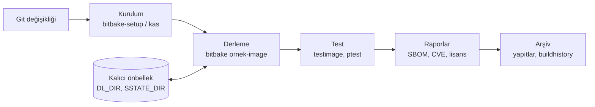

# 18 · Sürekli entegrasyon ve tekrarlanabilirlik

<div class="kunye" markdown>
<span>Süre: ~60 dk + uygulama</span><span>Düzey: İleri</span><span>Ön koşul: Bölüm 3, 7, 15, 16</span>
</div>

!!! hedef "Öğrenme hedefleri"
    Bu bölümün sonunda:

    - Ekibin derleme kurulumunu tek bir `bitbake-setup` yapılandırma şablonunda tanımlayabilirsiniz.
    - Aynı kurulumu kas ile YAML biçiminde ifade edebilir ve iki yaklaşımı karşılaştırabilirsiniz.
    - Konteyner tabanlı bir derleme ortamı hazırlayabilirsiniz.
    - Kurum içi bir CI çalıştırıcısında önbellek stratejisini tasarlayabilirsiniz.
    - `testimage` ile otomatik imaj testleri ve `ptest` ile paket testleri çalıştırabilirsiniz.
    - Tekrarlanabilir derlemenin koşullarını açıklayabilir ve `buildhistory` ile sürümler arası değişiklikleri izleyebilirsiniz.

## 18.1 Hedef: her değişiklikte aynı süreç

Önceki bölümlerde imaj, SBOM ve güvenlik denetimleri geliştiricinin makinesinde elle üretildi. Ürün
projelerinde aynı adımların **her değişiklikte, aynı biçimde ve kayıt altında** yürütülmesi gerekir.
Sürekli entegrasyon (CI) süreci şu sorulara yanıt verir: Değişiklik derlemeyi bozuyor mu? İmaj açılıyor ve
temel işlevlerini yerine getiriyor mu? İmajın içeriği bir önceki sürüme göre nasıl değişti? Yayımlanan
sürüm altı ay sonra yeniden üretilebilir mi?



Sürecin temeli, kurulumun kendisinin de sürüm denetiminde olmasıdır: hangi katmanların, hangi
revizyonlarla ve hangi yapılandırma parçalarıyla kullanıldığı bir dosyada tanımlanır.

## 18.2 `bitbake-setup` yapılandırma şablonu

[Bölüm 3](03-ilk-derleme.md)'te kullanılan `poky-wrynose` şablonu, BitBake deposundaki
`default-registry/configurations/` dizininde bulunan bir `.conf.json` dosyasıdır. Kurum aynı biçimde kendi
şablonunu yazabilir. Kitap deposundaki `examples/ci/ornek.conf.json` dosyası örnek ürün için üç
yapılandırma tanımlar:

```json title="examples/ci/ornek.conf.json (kısaltılmış)"
{
    "description": "ÖrnekOS endüstriyel sensör ağ geçidi (meta-ornek), Yocto Project 6.0 'wrynose'",
    "sources": {
        "bitbake":           { "git-remote": { "uri": "https://git.openembedded.org/bitbake",
                                               "branch": "2.18", "rev": "2.18" } },
        "openembedded-core": { "git-remote": { "...": "wrynose" } },
        "meta-yocto":        { "git-remote": { "...": "wrynose" } }
    },
    "bitbake-setup": {
        "configurations": [ {
            "bb-layers": ["openembedded-core/meta", "meta-yocto/meta-poky"],
            "bb-layers-file-relative": ["../meta-ornek"],
            "oe-fragments": ["distro/ornekos"],
            "oe-fragments-one-of": { "machine": { "description": "Hedef makine", "options": ["..."] } },
            "configurations": [
                { "name": "ornek",             "oe-fragments": ["ornek/urun", "ornek/sbom"] },
                { "name": "ornek-gelistirici", "oe-fragments": ["ornek/gelistirici", "..."] },
                { "name": "ornek-ci",          "oe-fragments": ["ornek/gelistirici", "ornek/ci", "..."] }
            ]
        } ]
    },
    "version": "1.0"
}
```

| Anahtar | Anlamı |
|---|---|
| `sources` | Çekilecek depolar; her biri `layers/` altında aynı adla bulunur. `rev` dal, etiket veya commit olabilir. |
| `bb-layers` | `layers/` dizinine göre katman yolları |
| `bb-layers-file-relative` | Şablon dosyasının bulunduğu dizine göre katman yolları; yalnızca şablon yerel bir dosya olarak verildiğinde kullanılabilir |
| `oe-fragments` | Her zaman etkinleştirilen parçalar |
| `oe-fragments-one-of` | Kullanıcıya veya komut satırına bırakılan, birbirini dışlayan seçimler |
| `configurations` | İç içe yapılandırmalar; alt yapılandırmanın listeleri üst yapılandırmanınkine eklenir |
| `setup-dir-name` | Önerilen kurulum dizini adı; `$machine` gibi seçimlerle doldurulur |

Kurulum, yapılandırma adı ve seçimler komut satırında verilerek etkileşimsiz oluşturulur:

```bash
bitbake-setup init --non-interactive \
    ~/yocto-gomulu-linux/examples/ci/ornek.conf.json ornek-ci machine/qemux86-64
```

`bitbake-setup` depoları çeker, `bblayers.conf` dosyasını oluşturur ve parçaları sırasıyla etkinleştirir.
Çekilen depoların **gerçek** revizyonları `layers/sources-fixed-revisions.json` dosyasına yazılır. Bu dosya
bir kaynak geçersiz kılma (*source override*) dosyasıdır; aynı revizyonlarla yeni bir kurulum oluşturmak
için `--source-overrides` seçeneğiyle verilebilir. Aynı yöntem, bir çekme isteğindeki (*pull request*)
dalın CI'da denenmesi için de kullanılır. Yerel bir depo üzerinde çalışırken `-L <kaynak> <yol>` seçeneği,
kaynağı çekmek yerine yerel dizine sembolik bağlantı oluşturur.

!!! iyi "Şablondaki revizyonlar ve sürüm kaydı"
    Resmî şablonlar `rev` değerinde dal adı (`wrynose`) kullanır; böylece `bitbake-setup update` ile
    kararlı daldaki düzeltmeler alınır. Ürün sürümlerinde ise kullanılan revizyonlar sabitlenmelidir.
    Yerleşik uygulama: geliştirme şablonunda dal adı tutulur, her ürün sürümünde
    `sources-fixed-revisions.json` dosyası sürüm yapıtlarıyla birlikte arşivlenir ve gerekirse bu dosyayla
    kurulum yeniden oluşturulur.

## 18.3 Alternatif: kas

kas, Siemens tarafından geliştirilen ve Yocto topluluğunda yaygın olarak kullanılan, YAML tabanlı bir
kurulum aracıdır. `bitbake-setup`'tan önce de mevcut olduğundan pek çok BSP ve ürün projesi kas dosyalarıyla
dağıtılır. Kitap deposundaki `examples/ci/kas-ornek.yml` aynı kurulumu tanımlar:

```yaml title="examples/ci/kas-ornek.yml (kısaltılmış)"
header:
  version: 19

machine: qemux86-64
distro: ornekos
target: ornek-image

repos:
  yocto-gomulu-linux:            # url verilmez: dosyanın bulunduğu depo
    layers:
      examples/meta-ornek:
  bitbake:
    url: https://git.openembedded.org/bitbake
    branch: "2.18"
    commit: 6e260eb6ab1631607ea414d9ff8ede1155faa5d9
    layers:
      .: disabled                # katman değil, yalnızca araç
  openembedded-core:
    url: https://git.openembedded.org/openembedded-core
    branch: wrynose
    commit: ae5a301091f5b0574ea7444aab40b309b6d9f3f2
    layers:
      meta:

local_conf_header:
  parcalar: |
    OE_FRAGMENTS += "ornek/urun ornek/sbom core/yocto/sbom-cve-check"
```

```bash
kas build examples/ci/kas-ornek.yml          # depoları çeker, yapılandırır ve target'ı derler
kas shell examples/ci/kas-ornek.yml          # aynı ortamda etkileşimli kabuk
```

kas, `commit` değeri olmayan depolar için `Using branch without commit ... is unsafe` uyarısı verir ve
sabitleme için kilit dosyası (*lock file*) kullanımını önerir. `header.version` değeri dosyanın kullandığı
biçim sürümüdür; kullanılan kas sürümünün desteklediği en yüksek biçim sürümü kas belgelerindeki biçim
değişiklik listesinde yer alır.

| | `bitbake-setup` | kas |
|---|---|---|
| Kaynak | BitBake'in parçası, 6.0 için resmî yöntem | Ayrı proje (MIT lisanslı) |
| Biçim | JSON şablonu, kayıt deposu (registry) | YAML, dosyalar arası `includes` |
| Parçalar | `oe-fragments`, `oe-fragments-one-of` doğrudan desteklenir | `local_conf_header` ile `OE_FRAGMENTS` yazılır |
| Revizyon kaydı | `sources-fixed-revisions.json` | `commit` alanları, kilit dosyası |
| Konteyner | Ayrı çözüm gerekir | `kas-container` betiği ve hazır konteyner imajı |

İki araç birbirini dışlamaz. Kurumun mevcut altyapısı kas kullanıyorsa geçiş zorunlu değildir; yeni
projelerde resmî yöntemin izlenmesi belgelerle uyumu kolaylaştırır.

## 18.4 Konteynerde derleme

Konteyner, derleme makinesinin dağıtımından bağımsız, sürümü sabitlenmiş bir ana makine ortamı sağlar.
Böylece CI çalıştırıcıları ile geliştirici makineleri aynı paket sürümleriyle derleme yapar.
`examples/ci/Dockerfile` bu amaçla hazırlanmış bir başlangıç noktasıdır:

```dockerfile title="examples/ci/Dockerfile (özet)"
FROM ubuntu:24.04
RUN apt-get update && apt-get install -y --no-install-recommends \
        build-essential chrpath cpio diffstat file gawk git iputils-ping iproute2 \
        lz4 python3 python3-venv socat zstd openssh-client locales ... \
    && locale-gen en_US.UTF-8
ENV LANG=en_US.UTF-8 LC_ALL=en_US.UTF-8
RUN useradd -m -u 1000 -s /bin/bash yocto
USER yocto
```

Konteyner tasarımında dikkat edilecek noktalar şunlardır:

- **Root olmayan kullanıcı.** BitBake'in yapılandırma denetimi (`sanity`) root kullanıcısıyla derlemeyi
  reddeder. Kullanıcı kimliği (UID), bağlanan dizinlerin sahibiyle aynı olmalıdır.
- **Kalıcı dizinler.** İndirmeler ve sstate konteynerin içinde değil, bağlanan (*bind-mount*) bir ana makine
  dizininde tutulur; aksi halde her çalıştırma sıfırdan derleme yapar.
- **Yerel ayar (locale).** `en_US.UTF-8` tanımlı olmalıdır; aksi halde BitBake sunucusu başlamaz.
- **QEMU testleri.** `testimage` için KVM hızlandırması isteniyorsa `/dev/kvm` konteynere aktarılmalıdır.

!!! info ":material-history: Önceki sürümlerde: CROPS konteynerleri"
    Eski kaynaklarda Yocto derlemeleri için CROPS projesinin `crops/poky` konteyner imajları önerilir. Bu
    imajlar Poky deposu tabanlı kurulum yöntemine göre hazırlanmıştır. Yocto belgeleri CROPS'u artık
    "önceden kullanılan" bir çözüm olarak anar ve 6.0 güncellemelerinde CROPS'a yapılan atıfların büyük
    bölümü kaldırılmıştır. Yeni projelerde kurum içi bir Dockerfile veya kas kullanılıyorsa
    `kas-container` tercih edilmelidir.

## 18.5 CI hizmetlerinde Yocto

Barındırılan (*hosted*) CI çalıştırıcıları, Yocto derlemeleri için genellikle yetersizdir. 6.0 belgeleri
en az 32 GB RAM ve 140 GB boş disk alanı önerir; ilk derleme saatler sürebilir ve iş zaman sınırlarını
aşabilir. Ayrıca her çalıştırma temiz bir makinede başladığından önbellek kullanılamaz. Bu nedenle ürün
projelerinde **kurum içi çalıştırıcılar** (*self-hosted runner*) kullanılır.

Önbellek stratejisinin temel kuralları şunlardır:

1. **`DL_DIR` ve `SSTATE_DIR` kalıcıdır.** `bitbake-setup`, üst dizinde (*top directory*) bir `site.conf`
   oluşturur ve indirmeleri, sstate'i ve hash eşdeğerliği veritabanını tüm kurulumlar arasında paylaşır
   (`common-sstate` ayarı, varsayılan `yes`). CI'da her çalıştırma için ayrı bir kurulum dizini açılır,
   ancak üst dizin çalıştırıcıda kalıcı tutulur.
2. **Birden fazla çalıştırıcı için paylaşılan sstate.** sstate bir HTTP sunucusundan yansı olarak sunulur
   ve bir hash eşdeğerliği sunucusu kullanılır ([Bölüm 15](15-sstate.md)). Bu durumda `common-sstate`
   ayarı `no` yapılarak sstate ayarları kurulum yapılandırmasına ayrıca eklenir.
3. **Kaynakların korunması.** `BB_GENERATE_MIRROR_TARBALLS = "1"` ile git kaynakları arşiv olarak
   saklanır; `own-mirrors` sınıfı ve `SOURCE_MIRROR_URL` ile kurum içi kaynak yansısı ilk başvuru noktası
   yapılır. Yukarı akış sunucuları erişilemez olduğunda da derleme yapılabilir.
4. **CI önbellek eylemleri uygun değildir.** Barındırılan CI hizmetlerinin genel amaçlı önbellek
   mekanizmaları onlarca gigabaytlık sstate için tasarlanmamıştır; çalıştırıcının yerel diski veya ağ
   üzerindeki bir sstate yansısı tercih edilir.

Kitap deposundaki `examples/ci/github-actions/ornek-image.yml` iş akışı bu kurallara göre hazırlanmıştır.
Temel adımları şunlardır:

```yaml title="examples/ci/github-actions/ornek-image.yml (kısaltılmış)"
env:
  YOCTO_TOP: /srv/yocto-ci                       # kalıcı üst dizin
  SETUP_NAME: ornek-ci-${{ github.run_id }}      # her çalıştırma için ayrı kurulum

jobs:
  derleme:
    runs-on: [self-hosted, linux, yocto]
    steps:
      - uses: actions/checkout@v4
      - name: Kurulumu oluştur
        run: |
          "$RUNNER_TEMP/bbsetup/bin/bitbake-setup" \
            --setting default top-dir-prefix "$(dirname "$YOCTO_TOP")" \
            --setting default top-dir-name "$(basename "$YOCTO_TOP")" \
            init --non-interactive --no-init-vscode --setup-dir-name "$SETUP_NAME" \
            "$GITHUB_WORKSPACE/examples/ci/ornek.conf.json" ornek-ci machine/qemux86-64
      - name: İmajı derle
        run: |
          . "$YOCTO_TOP/$SETUP_NAME/build/init-build-env"
          bitbake ornek-image
      - name: QEMU'da test et
        run: |
          . "$YOCTO_TOP/$SETUP_NAME/build/init-build-env"
          bitbake -c testimage ornek-image
      - uses: actions/upload-artifact@v4       # SBOM, CVE raporları, lisans manifestosu, test sonuçları
```

GitLab CI'da aynı süreç, kurum içi bir GitLab Runner üzerinde şöyle ifade edilebilir. GitLab yapıtları
yalnızca proje dizini içinden toplayabildiğinden çıktılar önce bu dizine kopyalanır:

```yaml title=".gitlab-ci.yml (örnek)"
ornek-image:
  tags: [yocto]
  timeout: 12h
  variables:
    KURULUM: /srv/yocto-ci/ornek-ci-$CI_PIPELINE_ID
  script:
    - python3 -m venv --clear .bbsetup && .bbsetup/bin/pip install bitbake-setup
    - >
      .bbsetup/bin/bitbake-setup --setting default top-dir-prefix /srv
      --setting default top-dir-name yocto-ci
      init --non-interactive --no-init-vscode --setup-dir-name "ornek-ci-$CI_PIPELINE_ID"
      "$CI_PROJECT_DIR/examples/ci/ornek.conf.json" ornek-ci machine/qemux86-64
    - . "$KURULUM/build/init-build-env"
    - bitbake ornek-image && bitbake -c testimage ornek-image
    - mkdir -p "$CI_PROJECT_DIR/ciktilar"
    - cp -L tmp/deploy/images/qemux86-64/ornek-image-qemux86-64.rootfs.*.json "$CI_PROJECT_DIR/ciktilar/"
  after_script:
    - rm -rf "/srv/yocto-ci/ornek-ci-$CI_PIPELINE_ID"
  artifacts:
    when: always
    paths: [ciktilar/]
```

!!! dikkat "Kurum içi çalıştırıcılar ve dış katkılar"
    Kurum içi çalıştırıcı, iş akışındaki komutları kurumun ağında ve kalıcı dizinlerle çalıştırır. Herkese
    açık bir depoda, dışarıdan gelen bir çekme isteği bu çalıştırıcıda keyfi kod çalıştırabilir ve paylaşılan
    sstate'i kirletebilir. GitHub da kurum içi çalıştırıcıların yalnızca özel depolarla kullanılmasını
    önerir. Dış katkılar için ayrı, yalıtılmış çalıştırıcılar ve salt okunur sstate erişimi kullanılmalıdır.

## 18.6 Otomatik imaj testleri: `testimage` ve `ptest`

`testimage` sınıfı imajı QEMU'da (veya `TEST_TARGET` ile gerçek donanımda) açar, SSH ile bağlanır ve
`lib/oeqa/runtime/cases/` dizinlerindeki Python `unittest` modüllerini çalıştırır. Kitabın `ornek/ci`
parçası şu ayarları yapar:

```bitbake title="examples/meta-ornek/conf/fragments/ci.conf (özet)"
IMAGE_CLASSES += "testimage"
TEST_RUNQEMUPARAMS += "slirp"        # tap arayüzü ve sudo gerektirmez
TEST_SUITES = "ping ssh date df"     # sıra önemlidir: ssh testi ping'e bağımlıdır
INHERIT += "buildhistory"
BUILDHISTORY_COMMIT = "1"
```

`testimage` için şu koşullar sağlanmalıdır:

- İmajda bir SSH sunucusu ve parolasız root girişi bulunmalıdır. Sınıf, `allow-empty-password`,
  `empty-root-password` ve `allow-root-login` özellikleri eksikse hata verir ve
  `core/yocto/root-login-with-empty-password` parçasını önerir. Bu nedenle test imajı ürün imajından ayrı
  bir yapılandırmadır (`ornek-ci`).
- Ana makinede `ip`, `ping`, `ssh` ve `scp` komutları bulunmalıdır; `testimage` bunları `HOSTTOOLS`
  listesine ekler.
- KVM kullanılacaksa `/dev/kvm` erişilebilir olmalıdır; KVM olmadan `QEMU_USE_KVM = ""` ile çalıştırılabilir,
  ancak testler önemli ölçüde yavaşlar.

Sonuçlar `tmp/log/oeqa/testresults.json` dosyasına yazılır; `resulttool` betiği bu dosyaları raporlamak,
birleştirmek ve JUnit biçimine dönüştürmek için kullanılır. Ürüne özgü testler katmanda
`lib/oeqa/runtime/cases/` dizinine eklenir. Katmanın `layer.conf` dosyası `BBPATH` değişkenini zaten
genişlettiğinden ek ayar gerekmez; modül adları OE-Core'daki adlarla çakışmamalıdır.

**ptest**, paketlerin yukarı akış test takımlarını hedef sistemde çalıştırır. Test takımı ayrı bir
`<paket>-ptest` paketine konur ve `ptest-runner` ile çalıştırılır. İmaja bu paketleri eklemek için
`ptest-pkgs` imaj özelliği, `testimage` içinde çalıştırmak için `ptest` test modülü kullanılır. OE-Core,
bu amaçla hazırlanmış `core-image-ptest`, `core-image-ptest-fast` ve `core-image-ptest-all` imajlarını
içerir.

!!! info ":material-history: Önceki sürümlerde: `ptest` dağıtım özelliği"
    5.x'te `ptest` dağıtım özelliği Poky'de etkin, `nodistro`'da ise ayrıca eklenmesi gereken bir
    özellikti. 6.0'da `ptest`, `DISTRO_FEATURES` değişkeninin varsayılanları arasındadır. Test paketleri
    yine de ancak `ptest-pkgs` imaj özelliği istendiğinde imaja girer; ürün imajlarının boyutu bundan
    etkilenmez.

## 18.7 Tekrarlanabilir derlemeler

Yocto Project, tekrarlanabilirliği şöyle tanımlar: aynı girdi yapılandırması, derlemenin ne zaman, hangi
dizinde ve hangi ana makine dağıtımında yapıldığından bağımsız olarak **ikili düzeyde aynı çıktıyı**
üretmelidir. Bu özellik 3.1 sürümünden beri varsayılan olarak etkindir. Ürün açısından önemi şudur: bir
güvenlik düzeltmesi için yeniden derleme yapıldığında yalnızca değişen bileşenler ikili düzeyde değişir;
doğrulama kapsamı net biçimde sınırlanır. Hash eşdeğerliği de aynı çıktıyı tanıyarak daha etkin çalışır.

Tekrarlanabilirliğin en önemli aracı `SOURCE_DATE_EPOCH` değişkenidir. Derleme araçlarının çoğu, ikili
dosyalara yazılan tarih için o anki saat yerine bu değeri kullanır. OE-Core değeri her tarif için kaynaktan
türetir:

1. Kaynakla gelen `__source_date_epoch.txt` dosyası varsa bu değer,
2. git kaynaklarında son commit'in zamanı,
3. `NEWS`, `ChangeLog` gibi bilinen dosyaların değişiklik zamanı,
4. kaynak ağacındaki en yeni dosyanın değişiklik zamanı,
5. hiçbiri yoksa sabit bir yedek değer (`SOURCE_DATE_EPOCH_FALLBACK`).

Kök dosya sistemindeki dosya zamanları ise `REPRODUCIBLE_TIMESTAMP_ROOTFS` ile sabitlenir.

Tekrarlanabilirliği bozan yaygın nedenler şunlardır: `SRCREV = "${AUTOREV}"` kullanımı, uygulama
kodunda `__DATE__`/`__TIME__` makroları, ana makineden sızan araç veya kütüphaneler (eksik `DEPENDS`
ve otomatik algılanan `PACKAGECONFIG` seçenekleri) ve derleme yolunun çıktılara yazılması. SBOM tarafında
`SPDX_INCLUDE_BITBAKE_PARENT_BUILD = "1"` ayarı, her çalıştırmada değişen bir derleme kimliği eklediğinden
SPDX çıktısını tekrarlanamaz hale getirir; belgelerde bu durum açıkça belirtilir.

OE-Core, tekrarlanabilirlik için bir `oe-selftest` testi içerir. Test, hedefleri bir kez sstate ile, bir
kez sstate kullanmadan derler ve paketleri karşılaştırır:

```bitbake
# build/conf/local.conf: yalnızca belirtilen tarifler test edilir
OEQA_REPRODUCIBLE_TEST_TARGET = "sensor-oku"
```

```bash
oe-selftest -r reproducible.ReproducibleTests.test_reproducible_builds
```

!!! dikkat "Ek katmanlar tekrarlanabilirliği etkileyebilir"
    Belgelere göre tam tekrarlanabilirlik yalnızca BitBake ve OE-Core için güvence altındadır. Eklenen her
    katman, tarif eki veya sınıf bu güvenceyi bozabilir. Ürün katmanları için tekrarlanabilirlik testi,
    ilk ürün sürümünden önce CI'a eklenmelidir; sorunun ilk güvenlik güncellemesinde fark edilmesi geç
    kalınmış olur.

## 18.8 `buildhistory` ile değişikliklerin izlenmesi

`buildhistory` sınıfı her derlemede paketlerin, imajların ve SDK'ların içeriğini (paket listeleri, dosya
listeleri, boyutlar, bağımlılıklar, sürümler) düz metin dosyaları olarak `BUILDHISTORY_DIR` altına yazar
ve `BUILDHISTORY_COMMIT = "1"` olduğunda bir git deposuna işler. İki derleme arasındaki anlamlı farklar
`buildhistory-diff` betiğiyle listelenir:

```bash
buildhistory-diff                         # son iki derleme
buildhistory-diff <eski-commit> HEAD      # belirli iki kayıt
```

Çıktı, değişen alanları dosya yollarıyla birlikte gösterir. Örneğin `sensor-oku` paketinin boyutu
belirgin biçimde arttığında şuna benzer bir satır üretilir (değerler örnektir):

```text
packages/x86-64-v3-poky-linux/sensor-oku/sensor-oku: PKGSIZE changed from 14608 to 18704 (+28%)
```

Boyut alanlarındaki %10'un altındaki değişiklikler varsayılan olarak raporlanmaz; tüm değişiklikler için
`-a` seçeneği kullanılır. Paket listesi, bağımlılık (`RDEPENDS`) ve dosya listesi değişiklikleri de aynı
biçimde raporlanır.

Varsayılan `BUILDHISTORY_DIR` değeri derleme dizinidir (`${TOPDIR}/buildhistory`). CI'da her çalıştırma
yeni bir kurulum dizini açtığından geçmişin korunması için dizin kalıcı bir konuma alınmalı (örneğin üst
dizindeki `site.conf` içinde `BUILDHISTORY_DIR` tanımlanarak) veya `BUILDHISTORY_PUSH_REPO` ile merkezi
bir git deposuna gönderilmelidir. Aynı geçmiş deposunu kullanan işler eşzamanlı çalıştırılmamalıdır.

!!! iyi "Sürüm notlarının buildhistory'den üretilmesi"
    `buildhistory-diff` çıktısı, bir ürün sürümünde hangi paketlerin eklendiğini, kaldırıldığını veya
    sürüm değiştirdiğini nesnel biçimde gösterir. Sürüm notlarının ve değişiklik onaylarının bu çıktıya
    dayandırılması, CRA kapsamındaki teknik dokümantasyon için de izlenebilir bir kayıt oluşturur
    ([Bölüm 16](16-lisans-sbom.md)).

## 18.9 Uygulama

!!! lab "Uygulama 18.1 · CI yapılandırmasının yerel olarak çalıştırılması"
    Kitap deposundaki şablonla CI yapılandırması ayrı bir kurulum olarak oluşturulur. Bölüm 3'teki
    `bitbake-setup` ortamının etkin olduğu varsayılır:

    ```bash
    bitbake-setup init --non-interactive \
        ~/yocto-gomulu-linux/examples/ci/ornek.conf.json ornek-ci machine/qemux86-64
    ```

    Komutun sonunda yapılandırmanın açıklaması ve ortam betiğinin yolu yazdırılır:

    ```text
    This bitbake configuration provides:
        CI yapılandırması (testimage, buildhistory, SBOM ve CVE taraması)
    ...
    To run builds, source the environment using
        . /home/<kullanıcı>/bitbake-builds/ornek-ci-qemux86-64/build/init-build-env
    ```

    Etkin parçalar denetlenir:

    ```bash
    . ~/bitbake-builds/ornek-ci-qemux86-64/build/init-build-env
    bitbake-config-build list-fragments
    ```

    ```text
    Enabled built-in fragments:
    distro/ornekos	Sets DISTRO = "ornekos"
    machine/qemux86-64	Sets MACHINE = "qemux86-64"
    ...
    Enabled fragments:
    core/yocto/root-login-with-empty-password	Log in as root without password on serial console and over ssh (use with caution).
    core/yocto/sbom-cve-check	This fragment enables sbom-cve-check with recommended default options
    ...
    Enabled fragments:
    ornek/ci	Sürekli entegrasyon: otomatik imaj testi ve derleme geçmişi
    ornek/gelistirici	Geliştirici imajı ayarları
    ornek/sbom	SBOM ayrıntıları ve tedarikçi bilgisi
    ```

    İmaj derlenir ve test edilir. Kurulum, Bölüm 3'teki kurulumla aynı üst dizinde olduğundan önceki
    derlemelerin sstate'i kullanılır:

    ```bash
    bitbake ornek-image
    bitbake -c testimage ornek-image
    ```

    Test sonuçları görev günlüğünün sonunda özetlenir (sıra ve süreler farklı olabilir):

    ```text
    RESULTS:
    RESULTS - date.DateTest.test_date: PASSED (…s)
    RESULTS - df.DfTest.test_df: PASSED (…s)
    RESULTS - ping.PingTest.test_ping: PASSED (…s)
    RESULTS - ssh.SSHTest.test_ssh: PASSED (…s)
    SUMMARY:
    ornek-image () - Ran 4 tests in …s
    ornek-image - OK - All required tests passed (successes=4, skipped=0, failures=0, errors=0)
    ```

    Son olarak `buildhistory` deposunun oluştuğu doğrulanır:

    ```bash
    git -C buildhistory log --oneline | head -3
    ```

## Özet

- Kurulum, sürüm denetimindeki bir `bitbake-setup` şablonuyla (`.conf.json`) tanımlanır; gerçek
  revizyonlar `sources-fixed-revisions.json` dosyasına yazılır.
- kas, aynı amaca YAML ile hizmet eden yaygın bir alternatiftir; `commit` alanları veya kilit dosyasıyla
  revizyonlar sabitlenir.
- Konteyner, ana makine ortamını sabitler; root olmayan kullanıcı, kalıcı dizinler ve yerel ayar gereklidir.
- Yocto CI'ında kurum içi çalıştırıcılar ve kalıcı `DL_DIR`/`SSTATE_DIR` kullanılır; çoklu çalıştırıcıda
  paylaşılan sstate yansısı ve hash eşdeğerliği sunucusu tercih edilir.
- `testimage`, imajı QEMU'da açıp `oeqa` testlerini çalıştırır; parolasız root ve SSH sunucusu gerektirir.
  `ptest` paketlerin kendi test takımlarını çalıştırır.
- Tekrarlanabilirlik `SOURCE_DATE_EPOCH`, sabit `SRCREV` ve açık bağımlılıklarla sağlanır ve
  `oe-selftest` ile doğrulanır.
- `buildhistory` ve `buildhistory-diff`, sürümler arası değişikliklerin nesnel kaydını oluşturur.

## Değerlendirme soruları

<div class="quiz" data-id="b18-1">
<p class="quiz-soru">Bir <code>bitbake-setup</code> şablonunda kitabın katmanı <code>"bb-layers-file-relative": ["../meta-ornek"]</code> ile tanımlanmıştır. Bu tanım hangi durumda çalışır?</p>
<ul>
<li>Şablon bir kayıt deposundan (registry) seçildiğinde</li>
<li>Şablon HTTP adresinden verildiğinde</li>
<li data-dogru>Şablon yerel diskteki yoluyla <code>bitbake-setup init</code> komutuna verildiğinde</li>
<li>Her durumda</li>
</ul>
<p class="quiz-aciklama">Yol, şablon dosyasının bulunduğu dizine göre çözülür. Şablon bir kayıt deposundan veya HTTP üzerinden
alındığında böyle bir dizin bulunmadığından <code>bitbake-setup</code> hata verir.</p>
</div>

<div class="quiz" data-id="b18-2">
<p class="quiz-soru">Kurum içi bir CI çalıştırıcısında her çalıştırma ayrı bir kurulum dizini açmaktadır. Derlemelerin hızlı kalması için ne kalıcı tutulmalıdır?</p>
<ul>
<li>Her kurulumun <code>tmp/</code> dizini</li>
<li data-dogru>Üst dizindeki indirmeler, sstate ve hash eşdeğerliği veritabanı</li>
<li>Yalnızca <code>bblayers.conf</code></li>
<li>Hiçbir şey; temiz derleme her zaman tercih edilir</li>
</ul>
<p class="quiz-aciklama"><code>bitbake-setup</code> üst dizindeki <code>site.conf</code> ile <code>DL_DIR</code>, <code>SSTATE_DIR</code> ve
<code>BB_HASHSERVE_DB_DIR</code> değerlerini kurulumlar arasında paylaştırır. <code>tmp/</code> yeniden üretilebilir ve kurulumla
birlikte silinebilir.</p>
</div>

<div class="quiz" data-id="b18-3">
<p class="quiz-soru"><code>bitbake -c testimage ornek-image</code> komutu, IMAGE_FEATURES ile ilgili bir hata vererek durmaktadır. En olası neden nedir?</p>
<ul>
<li>İmajda Python bulunmaması</li>
<li data-dogru>İmajda parolasız root girişi için gereken özelliklerin bulunmaması</li>
<li><code>TEST_SUITES</code> değişkeninin boş olması</li>
<li>Derleme makinesinde Docker bulunmaması</li>
</ul>
<p class="quiz-aciklama">QEMU hedefinde <code>testimage</code>, <code>allow-empty-password</code>, <code>empty-root-password</code> ve
<code>allow-root-login</code> özelliklerini zorunlu tutar ve eksikse <code>core/yocto/root-login-with-empty-password</code>
parçasını önerir. Bu nedenle test imajı ürün imajından ayrı bir yapılandırma olarak tanımlanır.</p>
</div>

<div class="quiz" data-id="b18-4">
<p class="quiz-soru">Aşağıdakilerden hangisi bir ürün katmanının derlemelerinin tekrarlanabilirliğini bozar?</p>
<ul>
<li>Sabit bir <code>SRCREV</code> değerinin kullanılması</li>
<li data-dogru>Bir tarifte <code>SRCREV = "${AUTOREV}"</code> kullanılması</li>
<li><code>SOURCE_DATE_EPOCH</code> değerinin git commit zamanından türetilmesi</li>
<li>Derlemenin farklı bir dizinde yapılması</li>
</ul>
<p class="quiz-aciklama"><code>AUTOREV</code>, her derlemede dalın o anki ucunu kullandığından girdi değişir. Derleme dizini ise
<code>DEBUG_PREFIX_MAP</code> gibi ayarlarla çıktılardan arındırılır ve tekrarlanabilirliği bozmamalıdır.</p>
</div>

<div class="quiz" data-id="b18-5">
<p class="quiz-soru">Ürün sürümleri arasında hangi paketlerin boyutunun veya sürümünün değiştiğini gösteren araç hangisidir?</p>
<ul>
<li><code>bitbake-layers show-appends</code></li>
<li><code>oe-pkgdata-util list-pkg-files</code></li>
<li data-dogru><code>buildhistory-diff</code></li>
<li><code>bitbake-setup status</code></li>
</ul>
<p class="quiz-aciklama"><code>buildhistory</code> sınıfı her derlemenin içeriğini git deposuna kaydeder; <code>buildhistory-diff</code> iki kayıt
arasındaki anlamlı farkları listeler. <code>bitbake-setup status</code> ise katman revizyonlarının şablondan farkını gösterir.</p>
</div>

!!! alistirma "Alıştırma: Ürüne özgü bir çalışma zamanı testi"
    `sensor-oku` programının imajda bulunduğunu ve beklenen biçimde çıktı ürettiğini doğrulayan bir
    `oeqa` testi yazın:

    1. Test, `meta-ornek` katmanında doğru dizinde yer almalıdır.
    2. Test SSH testine bağımlı olmalı ve `sensor-oku` paketi imajda yoksa atlanmalıdır.
    3. `sensor-oku 2` komutunun başarıyla çalıştığını ve çıktıda iki okuma satırı bulunduğunu denetlemelidir.
    4. Test `TEST_SUITES` listesine eklenerek çalıştırılmalıdır.

    ??? success "Örnek çözüm"
        ```python title="meta-ornek/lib/oeqa/runtime/cases/sensor_oku.py"
        # SPDX-License-Identifier: MIT
        from oeqa.runtime.case import OERuntimeTestCase
        from oeqa.core.decorator.depends import OETestDepends
        from oeqa.runtime.decorator.package import OEHasPackage

        class SensorOkuTest(OERuntimeTestCase):

            @OETestDepends(['ssh.SSHTest.test_ssh'])
            @OEHasPackage(['sensor-oku'])
            def test_sensor_oku(self):
                status, output = self.target.run('sensor-oku 2')
                self.assertEqual(status, 0, msg='sensor-oku başarısız: %s' % output)
                okumalar = [s for s in output.splitlines() if 'okuma' in s]
                self.assertEqual(len(okumalar), 2, msg='Beklenmeyen çıktı: %s' % output)
        ```

        ```bitbake
        # build/conf/local.conf veya ornek/ci parçası
        TEST_SUITES:append = " sensor_oku"
        ```

        ```bash
        bitbake -c testimage ornek-image
        ```

        Beklenen sonuç satırı: `RESULTS - sensor_oku.SensorOkuTest.test_sensor_oku: PASSED`. Modül adı
        (`sensor_oku`), `TEST_SUITES` içinde kullanılan addır ve OE-Core'daki test modüllerinin adlarıyla
        çakışmamalıdır.

## Kitabın sonu ve sonraki adımlar

Bu bölümle birlikte kitabın ana anlatımı tamamlanmıştır. İlk derlemeden başlayarak tarif, katman, imaj,
dağıtım ve çekirdek düzeyinde bir ürün oluşturulmuş; lisans uyumu, güvenlik, güncelleme ve sürekli
entegrasyon süreçleriyle ürünleştirme adımları ele alınmıştır. Çalışmalara devam etmek için şu kaynaklar
önerilir:

- [Komut özeti](../ekler/kopya-kagidi.md): Kitapta kullanılan komutların toplu listesi.
- [Terimler sözlüğü](../ekler/sozluk.md): Türkçe ve İngilizce terim karşılıkları.
- [Sürüm takvimi](../ekler/surumler.md): LTS sürümlerin destek süreleri ve geçiş planlaması.
- [Kaynakça ve ileri okuma](../ekler/kaynakca.md): Resmî belgeler, eğitim materyalleri ve araçlar.
- [Katkı rehberi](../ekler/katki.md): Yeni bölümlerin yazılmasına ve mevcut bölümlerin iyileştirilmesine
  katkı süreci.

Yocto Project her altı ayda bir yeni sürüm, iki yılda bir yeni LTS sürüm yayımlar. Kitaptaki örneklerin
yeni sürümlere uyarlanmasında ilk başvuru kaynağı, ilgili sürümün geçiş kılavuzudur (*Migration Guide*).
