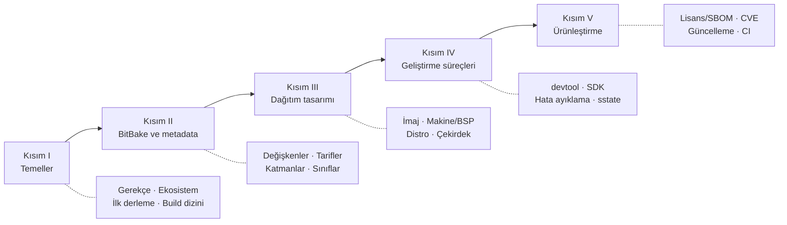

# Yocto Project ile Gömülü Linux

**Yocto Project ve OpenEmbedded üzerine açık kaynak, Türkçe başvuru ve öğretim kitabı.**

Bu kitap, gömülü cihazlar için özel Linux dağıtımı üretmenin standart araçlarından biri olan
[Yocto Project](https://www.yoctoproject.org/)'i temel kavramlarından ürünleştirme aşamasına kadar
sistematik biçimde ele alır. Her bölüm önce kavramı ve gerekçesini açıklar, ardından uygulama
çalışmaları ve değerlendirme sorularıyla pekiştirir.

## Hedef kitle

- Gömülü Linux ile çalışmaya başlayan yazılım ve donanım mühendisleri
- Yocto tabanlı bir ürünün geliştirme veya bakım ekibine katılan profesyoneller
- Yocto Project 5.0 ve öncesinden 6.0 *Wrynose* sürümüne geçiş yapan ekipler
- Gömülü sistemler dersi veren veya alan öğretim üyeleri ve öğrenciler

Okurun temel düzeyde Linux komut satırı, C derleme süreci ve git bilgisine sahip olduğu varsayılır.

## Gömülü Linux Kitaplığı

Bu kitap, **Gömülü Linux Kitaplığı**'nın ana kitabıdır. Yocto ile verimli çalışmak için gereken temel
beceriler ve ileri konular aynı yapıdaki ayrı kitaplarda ele alınır:

| Kitap | Konu |
|---|---|
| <a href="../bash-komut-satiri/index.html">Linux Komut Satırı ve Bash</a> | Kabuk, metin işleme, sağlam betikler, BitBake kabuk görevleri |
| <a href="../git-surum-kontrolu/index.html">Git ile Sürüm Kontrolü</a> | Nesne modeli, dallar, geçmiş düzenleme, yama akışı, alt modüller |
| <a href="../python-gomulu/index.html">Gömülü Geliştirici için Python</a> | Otomasyon, test, ikili protokoller, BitBake'te Python |
| <a href="../c-derleme/index.html">C, Make ve CMake ile Derleme</a> | Derleme aşamaları, ELF, Make, CMake, çapraz derleme, gdb |
| <a href="../cekirdek-onyukleme/index.html">Linux Çekirdeği ve Önyükleme</a> | U-Boot, Kconfig, aygıt ağacı, udev, systemd, çekirdek hata ayıklama |
| <a href="../aygit-surucusu/index.html">Linux Aygıt Sürücüsü Geliştirme</a> | Modüller, sürücü modeli, platform/I2C/SPI sürücüleri, kesmeler, hwmon/IIO |

## Kitabın yapısı

| Kısım | Kapsam |
|---|---|
| **I · Temeller** | Gömülü Linux sisteminin bileşenleri, Yocto'nun konumu ve gerekçesi, ekosistemdeki projeler, ilk derleme ve derleme çıktılarının yapısı |
| **II · BitBake ve metadata** | BitBake dili, tarifler ve görevler, katman mimarisi, sınıflar |
| **III · Dağıtım tasarımı** | İmaj, makine (BSP), dağıtım politikası ve çekirdek yapılandırması |
| **IV · Geliştirme süreçleri** | devtool, SDK, hata ayıklama, derleme performansı |
| **V · Ürünleştirme** | Lisans uyumu, SBOM ve CVE takibi, güvenlik, sahada güncelleme, sürekli entegrasyon |

## Örnek proje

Kitap boyunca tek bir örnek ürün üzerinden ilerlenir: ekransız bir **endüstriyel sensör ağ geçidi**.
Bu ürün için **ÖrnekOS** adlı bir dağıtım tanımlanır. İlgili tüm kodlar depodaki
`examples/meta-ornek` katmanında yer alır ve QEMU emülatöründe, donanım gerektirmeden çalıştırılabilir.

## Sürüm kapsamı

!!! info "Bu kitap Yocto Project 6.0 *Wrynose* (LTS) esas alınarak yazılmıştır"
    Wrynose, Nisan 2026'da yayımlanan ve **en az Nisan 2030'a kadar** desteklenecek uzun süreli
    destek sürümüdür. Önceki LTS sürümüne (5.0 *Scarthgap*) göre kurulum ve yapılandırma yöntemi köklü
    biçimde değişmiştir. Bu değişiklikler 5.2 ve 5.3 ara sürümlerinde gelmiştir:

    - Tek parça **Poky deposu artık güncellenmemektedir**. Kurulum `bitbake-setup` aracıyla yapılır.
    - Ayarlar **yapılandırma parçaları** (*configuration fragments*) ile yönetilir.

    Önceki yöntemle farklılık bulunan yerler ":material-history: Önceki sürümlerde" başlıklı notlarla
    belirtilmiştir. Bkz. [Sürüm takvimi](ekler/surumler.md).

## Okuma önerileri

- **Yocto'ya yeni başlayanlar:** [Kitabın kullanımı](nasil-okunur.md) → [Bölüm 1](bolumler/01-neden-yocto.md)'den itibaren sırayla
- **5.x'ten 6.0'a geçenler:** [Bölüm 3](bolumler/03-ilk-derleme.md), [Bölüm 6](bolumler/06-tarifler.md) ve [Sürüm takvimi](ekler/surumler.md)
- **Hızlı başvuru:** [Komut özeti](ekler/kopya-kagidi.md) ve [Terimler sözlüğü](ekler/sozluk.md)

## Lisans ve katkı

Bu kitap açık kaynaklı bir topluluk çalışmasıdır. Metin
[CC BY-SA 4.0](https://creativecommons.org/licenses/by-sa/4.0/deed.tr), örnek kodlar MIT lisansıyla
yayımlanır. Düzeltme ve katkı önerileri her sayfanın üstündeki :material-file-edit-outline: düğmesiyle
iletilebilir. Ayrıntılar için: [Katkı rehberi](ekler/katki.md).

<small>Yocto Project, Linux Foundation'ın tescilli markasıdır. Bu kitap bağımsız bir topluluk çalışmasıdır;
Yocto Project tarafından yayımlanmamış veya onaylanmamıştır.</small>
